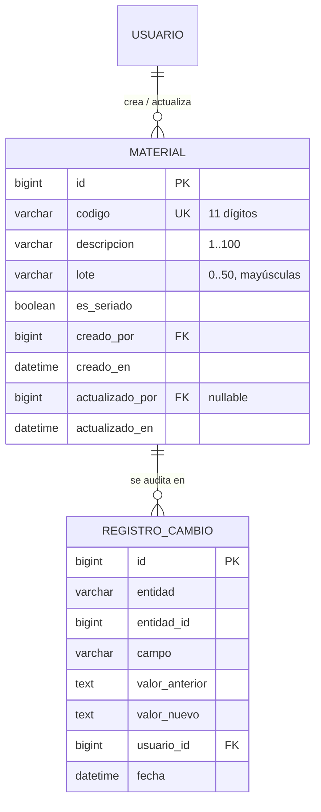

# Modelo de datos: 002 Módulo de materiales

**Fase**: 1 | **Fecha**: 2026-11-12 | **Spec**: `05-especificaciones/002-materiales/spec.md`

Este documento describe la entidad, sus campos, restricciones, reglas de normalización y los
eventos de auditoría. El detalle de servicios y firmas vive en `plan.md`; los contratos HTTP en
`contracts/`.

## Diagrama de relaciones



`USUARIO` es `acceso.Usuario` y `REGISTRO_CAMBIO` es `auditoria.RegistroCambio`, ambos
propiedad de la spec 001. `Material` **no** tiene `tenant_id`: es la única entidad compartida
del sistema.

## Clasificación de la tabla

| Tabla | Tipo | Aislamiento |
|---|---|---|
| `materiales.Material` | Catálogo compartido (excepción documentada) | Global: todos los tenants ven los mismos materiales; no se filtra por tenant |

## Entidad

### Material (`materiales.Material`)

Material que Lari introduce en el almacén central y que los tenants usan en recojos,
asignaciones, traspasos y conciliaciones.

| Campo | Tipo | Nulo | Regla |
|---|---|---|---|
| `id` | `BigAutoField` | No | Clave primaria |
| `codigo` | `CharField(11)` | No | Exactamente 11 dígitos (`^[0-9]{11}$`); único global; inmutable tras el alta |
| `descripcion` | `CharField(100)` | No | 1–100 caracteres después de normalizar; no vacía; sin espacios al inicio/final ni repetidos |
| `lote` | `CharField(50)` | No | Opcional (cadena vacía permitida); hasta 50 caracteres; se normaliza en mayúsculas y sin espacios repetidos |
| `es_seriado` | `BooleanField` | No | `True` = Seriado, `False` = No seriado; obligatorio; inmutable si el material tiene stock o movimientos |
| `creado_por` | FK `Usuario` | No | `PROTECT`, `related_name="+"`; cuenta que registró el material |
| `creado_en` | `DateTimeField` | No | `auto_now_add` |
| `actualizado_por` | FK `Usuario` | Sí | `PROTECT`, `related_name="+"`; última cuenta que editó |
| `actualizado_en` | `DateTimeField` | No | `auto_now` |

**Propiedad derivada**

| Propiedad | Tipo | Valor |
|---|---|---|
| `tipo` | `str` | `"SERIADO"` si `es_seriado` es `True`; `"NO_SERIADO"` si es `False` |

**Restricciones**

- `unique(codigo)` — unicidad global, fuente de verdad ante altas concurrentes.
- `CheckConstraint(material_codigo_11_digitos)`: `codigo ~ '^[0-9]{11}$'`.
- `CheckConstraint(material_descripcion_obligatoria)`: `descripcion <> ''`.

**Índices**

- Índice único implícito de `codigo` (por `unique=True`).
- Índices de clave foránea de `creado_por` y `actualizado_por` (los crea Django).
- No se agrega índice de texto completo en esta versión; la búsqueda usa `icontains` sobre
  `codigo` y `descripcion` con el volumen estimado (1 000–10 000 filas).

**Relaciones**

- N:1 con `Usuario` por `creado_por` y `actualizado_por` (`PROTECT`).
- 1:N con `RegistroCambio` por convención de `entidad`/`entidad_id` (sin FK física, igual que
  el resto de la auditoría).
- Referenciada por las specs 004, 005, 006, 008, 009, 010, 011 y 013 mediante `PROTECT`; esta
  spec no agrega esas FK.

**Reglas de negocio**

- Cada material tiene un solo lote; el lote es informativo y no separa stock.
- El código no se edita después del alta.
- Solo el creador o el Administrador de plataforma editan descripción y lote.
- El tipo solo cambia si el material no tiene stock ni movimientos en ningún tenant.
- No se elimina ningún material; se conserva aunque su creador se desactive.
- El catálogo es global y la búsqueda no se filtra por tenant.

## Reglas de normalización

| Campo | Transformación | Ejemplo |
|---|---|---|
| `codigo` | `strip()` de espacios externos; no se quitan separadores internos | `" 10402520279 "` → `"10402520279"`; `"1040 2520279"` → se rechaza |
| `descripcion` | `strip()` + colapso de espacios internos a uno | `"  ROSETA   ÓPTICA "` → `"ROSETA ÓPTICA"` |
| `lote` | `strip()` + colapso de espacios internos + `upper()` | `" fiberhome "` → `"FIBERHOME"` |

La normalización ocurre antes de validar longitud y formato, y antes de escribir en la base.

## Validaciones y su ubicación

| Regla | Modelo/BD | Servicio | Formulario | Mensaje |
|---|---|---|---|---|
| Exactamente 11 dígitos | `CheckConstraint` regex | Sí | Sí | El código debe tener 11 dígitos |
| Código único global | `unique` | Sí | Sí | El material ya existe |
| Descripción obligatoria | `CheckConstraint` | Sí | Sí | La descripción es obligatoria |
| Descripción ≤ 100 | Longitud del campo | Sí | Sí | La descripción no puede superar los 100 caracteres |
| Lote ≤ 50 y opcional | Longitud del campo | Sí | Sí | El lote no puede superar los 50 caracteres |
| Tipo obligatorio | `BooleanField` | Sí | Sí | El tipo es obligatorio |
| Código inmutable | — | Sí | Campo ausente | El código no se puede cambiar |
| Permiso de edición | — | Sí | Sí (UX) | No tienes permiso para editar este material |
| Tipo inmutable con movimientos | — | `puede_cambiar_tipo` | Sí (deshabilitado) | El tipo no se puede cambiar: el material tiene movimientos |

## Reglas de auditoría

Se reutiliza `auditoria.RegistroCambio` (spec 001). Cada evento se escribe en la misma
transacción que el cambio.

| Evento | `entidad` | `campo` | `valor_anterior` | `valor_nuevo` |
|---|---|---|---|---|
| Alta | `Material` | `alta` | vacío | `codigo=10402520279; descripcion=ROSETA; lote=FIBERHOME; tipo=SERIADO` |
| Edición de descripción | `Material` | `descripcion` | descripción anterior | descripción nueva |
| Edición de lote | `Material` | `lote` | lote anterior | lote nuevo |
| Cambio de tipo | `Material` | `tipo` | `SERIADO` / `NO_SERIADO` | `NO_SERIADO` / `SERIADO` |

- Un registro por campo modificado.
- Los valores se guardan como texto legible; fechas en ISO 8601 cuando correspondan.
- Nunca se auditan contraseñas, `token_hash`, tokens de invitación, secretos TOTP ni claves.
- Si la operación falla (permiso, duplicado, tipo inmutable), no se escribe auditoría.
- La consulta de estos registros pertenece a la auditoría administrativa; esta spec no expone
  una ruta de consulta.

## Ciclo de vida

```text
(no existe) ── crear_material ──▶ activo (sin estado explícito)
activo ── actualizar_material (descripción/lote/tipo) ──▶ activo
activo ── (no existe borrado) ──▶ activo
```

- No hay estado `activo/inactivo`: la spec no define desactivación de materiales.
- No hay transición a eliminado.
- El material permanece visible y utilizable aunque su creador se desactive.

## Trazabilidad con la spec

| Criterio / regla | Elemento del modelo |
|---|---|
| Alta con creador y fecha | `creado_por`, `creado_en`, auditoría `alta` |
| Código duplicado sin revelar tenant | `unique(codigo)`; `Material` sin `tenant_id` |
| Código de 10/12 dígitos o con letras rechazado | `CheckConstraint(material_codigo_11_digitos)` |
| Material visible para otro tenant con su lote | Catálogo global; `lote` en el contrato de búsqueda |
| Material sin lote | `lote` vacío permitido |
| Edición de descripción auditada | `RegistroCambio` campo `descripcion` |
| Solo creador o admin editan | `creado_por` + rol `ADMIN_PLATAFORMA` |
| Código no editable | Campo ausente del formulario; servicio rechaza `codigo` |
| Tipo inmutable con movimientos | `puede_cambiar_tipo` |
| Descripción solo espacios rechazada | Normalización + `material_descripcion_obligatoria` |
| Doble clic sin duplicado | `unique(codigo)` + traducción de `IntegrityError` |
| Búsqueda por descripción | `buscar_materiales` (`descripcion__icontains`) |
