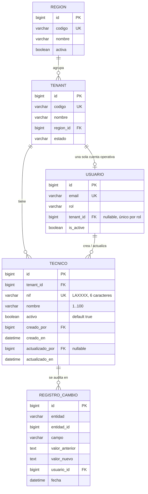

# Modelo de datos: 003 Técnicos del tenant

**Fase**: 1 | **Fecha**: 2026-11-12 | **Spec**: `05-especificaciones/003-tecnicos/spec.md`

Este documento describe la entidad, sus campos, restricciones, reglas de normalización,
transiciones de estado y los eventos de auditoría. El detalle de servicios y firmas vive en
`plan.md`; los contratos HTTP en `contracts/`.

## Diagrama de relaciones



`REGION`, `TENANT` y `USUARIO` son propiedad de la spec 001 (`tenants.Region`,
`tenants.Tenant`, `acceso.Usuario`). `REGISTRO_CAMBIO` es `auditoria.RegistroCambio`, también de
la spec 001.

## Clasificación de la tabla

| Tabla | Tipo | Aislamiento |
|---|---|---|
| `tecnicos.Tecnico` | Operativa | Filtrada siempre por el tenant de la sesión (`tenant_id`); RLS como respaldo |
| `auditoria.RegistroCambio` | Global de auditoría | Consulta según la entidad auditada y el alcance de la cuenta; esta spec solo escribe |

`Tecnico` **sí** lleva `tenant_id`; a diferencia del catálogo de materiales, no es una entidad
compartida. La región no se guarda: se obtiene de `tenant.region`.

## Entidad

### Tecnico (`tecnicos.Tecnico`)

Persona que recibe materiales del tenant y se identifica por su NIF en asignaciones, traspasos,
conciliaciones y registros. Es un actor pasivo: no tiene cuenta ni inicia sesión.

| Campo | Tipo | Nulo | Regla |
|---|---|---|---|
| `id` | `BigAutoField` | No | Clave primaria |
| `tenant` | FK `Tenant` | No | `PROTECT`, `related_name="tecnicos"`; inmutable tras el alta; se obtiene de la sesión |
| `nif` | `CharField(6)` | No | Exactamente `LA` + 4 dígitos (`^LA[0-9]{4}$`); único global; inmutable tras el alta; se guarda en mayúsculas |
| `nombre` | `CharField(100)` | No | 1–100 caracteres después de normalizar; no vacío; sin espacios al inicio/final ni repetidos |
| `activo` | `BooleanField` | No | Por defecto `True`; `True` = Activo, `False` = Desactivado |
| `creado_por` | FK `Usuario` | No | `PROTECT`, `related_name="+"`; cuenta que registró el técnico |
| `creado_en` | `DateTimeField` | No | `auto_now_add` |
| `actualizado_por` | FK `Usuario` | Sí | `PROTECT`, `related_name="+"`; última cuenta que editó o cambió el estado |
| `actualizado_en` | `DateTimeField` | No | `auto_now` |

**Restricciones**

- `unique(nif)` — unicidad global, fuente de verdad ante altas concurrentes.
- `CheckConstraint(tecnico_nif_formato)`: `nif ~ '^LA[0-9]{4}$'`.
- `CheckConstraint(tecnico_nombre_obligatorio)`: `nombre <> ''`.
- `varchar(100)` en `nombre` — límite máximo impuesto por PostgreSQL.
- `varchar(6)` en `nif` — longitud máxima coherente con el único formato válido.

**Índices**

- Índice único implícito de `nif` (por `unique=True`).
- `Index(tenant, activo)` — listado filtrado por estado y selectores de operación.
- `Index(tenant, nombre)` — búsqueda y orden por nombre dentro del tenant.
- Índices de clave foránea de `tenant`, `creado_por` y `actualizado_por` (los crea Django).
- No se agrega índice de texto completo en esta versión; la búsqueda usa `icontains` sobre `nif`
  y `nombre` con el volumen estimado (≈5 000 filas).

**Relaciones**

- N:1 con `Tenant` (`PROTECT`); un técnico pertenece a exactamente un tenant.
- N:1 con `Usuario` por `creado_por` y `actualizado_por` (`PROTECT`).
- 1:N con `RegistroCambio` por convención de `entidad`/`entidad_id` (sin FK física, igual que el
  resto de la auditoría).
- Referenciada por las specs 005, 006, 009, 010, 011 y 013 mediante FK `PROTECT`; esta spec no
  agrega esas FK.
- La región es la de `tenant.region`; no hay relación directa `Tecnico → Region`.

**Reglas de negocio**

- Cada técnico pertenece a un solo tenant; la relación no cambia después del alta.
- La cuenta del tenant solo ve y opera técnicos de su tenant.
- El NIF es único en todo el sistema y no se reutiliza.
- El NIF no se edita después del alta.
- El nombre es obligatorio, no único, y se normaliza antes de guardar.
- Un técnico no se elimina; se desactiva y se reactiva.
- La desactivación no borra stock, series, asignaciones, traspasos, órdenes ni conciliaciones.
- Los selectores de operaciones nuevas solo muestran técnicos activos.
- El técnico no tiene usuario, contraseña ni sesión.

## Reglas de normalización

| Campo | Transformación | Ejemplo |
|---|---|---|
| `nif` | `strip()` de espacios externos + `upper()`; no se quitan separadores internos | `" la1234 "` → `"LA1234"`; `"LA 1234"` y `"LA-1234"` se rechazan |
| `nombre` | `strip()` + colapso de espacios internos a uno | `"  Juan   Pérez "` → `"Juan Pérez"` |

La normalización ocurre antes de validar longitud y formato, y antes de escribir en la base.

## Validaciones y su ubicación

| Regla | Modelo/BD | Servicio | Formulario | Mensaje |
|---|---|---|---|---|
| NIF `LAXXXX` | `CheckConstraint` regex | Sí | Sí | El NIF debe tener el formato LAXXXX |
| NIF único global | `unique` | Sí | Sí | El NIF ya está registrado |
| NIF de un desactivado del mismo tenant | — | Sí | Sí | El NIF ya está registrado; reactiva el técnico existente |
| NIF de un desactivado de otro tenant | — | Sí | Sí | El NIF ya está registrado |
| NIF inmutable | — | Sí | Campo ausente | El NIF no se puede cambiar |
| Nombre obligatorio | `CheckConstraint` | Sí | Sí | El nombre es obligatorio |
| Nombre ≤ 100 | `varchar(100)` | Sí | Sí | El nombre no puede superar los 100 caracteres |
| Tenant inmutable | — | Sí | Campo ausente | El tenant del técnico no se puede cambiar |
| Solo cuenta del tenant | — | Sí | Sí (UX) | No tienes permiso para gestionar técnicos |
| Técnico de otro tenant | — | Sí | — | El técnico no existe |
| Técnico activo para operar | — | `validar_tecnico_para_operacion` | — | El técnico está desactivado |
| Tenant suspendido | — | Sí | — | El tenant está suspendido |

## Estados y transiciones

```text
(no existe) ── crear_tecnico ──▶ ACTIVO
ACTIVO ── desactivar_tecnico ──▶ DESACTIVADO
DESACTIVADO ── reactivar_tecnico ──▶ ACTIVO
ACTIVO ── desactivar_tecnico (ya desactivado) ──▶ sin cambio
DESACTIVADO ── reactivar_tecnico (ya activo) ──▶ sin cambio
ACTIVO / DESACTIVADO ── eliminar ──▶ NO PERMITIDO
```

| Estado | Significado | Operaciones nuevas | Historial |
|---|---|---|---|
| `ACTIVO` (`activo=True`) | Disponible para asignaciones, traspasos y órdenes | Sí | Visible |
| `DESACTIVADO` (`activo=False`) | Conservado pero fuera de operaciones nuevas | No | Visible |

- La desactivación es idempotente: repetirla no cambia el estado ni duplica la auditoría.
- La reactivación es idempotente: repetirla no cambia el estado ni duplica la auditoría.
- No existe transición a eliminado.
- Un técnico desactivado puede seguir editándose en su nombre; eso no lo reactiva.

## Reglas de auditoría

Se reutiliza `auditoria.RegistroCambio` (spec 001). Cada evento se escribe en la misma
transacción que el cambio.

| Evento | `entidad` | `campo` | `valor_anterior` | `valor_nuevo` |
|---|---|---|---|---|
| Alta | `Tecnico` | `alta` | vacío | `nif=LA1234; nombre=Juan Pérez; estado=ACTIVO` |
| Edición de nombre | `Tecnico` | `nombre` | nombre anterior | nombre nuevo |
| Desactivación | `Tecnico` | `activo` | `ACTIVO` | `DESACTIVADO` |
| Reactivación | `Tecnico` | `activo` | `DESACTIVADO` | `ACTIVO` |

- Un registro por campo modificado.
- El alta registra los datos en una sola fila de evento compuesto, sin ocultar campos.
- Una edición sin cambios no genera auditoría.
- Una transición idempotente no genera auditoría.
- Un intento rechazado (permiso, duplicado, NIF/tenant inmutable, tenant suspendido) **no** genera
  auditoría: no hubo cambio.
- `nif` y `tenant` no se auditan como cambios porque son inmutables; el alta sí registra el NIF.
- Los valores se guardan como texto legible; fechas en ISO 8601 cuando correspondan.
- Nunca se auditan contraseñas, `token_hash`, tokens de invitación, secretos TOTP ni claves.
- La auditoría no lleva un `tenant_id` separado: el alcance se deriva de la entidad `Tecnico` y de
  la cuenta autora.
- La consulta de estos registros pertenece a la auditoría administrativa; esta spec no expone una
  ruta de consulta.

## Trazabilidad con la spec

| Criterio / regla | Elemento del modelo |
|---|---|
| Alta con NIF y nombre válidos, activo y auditado | `nif`, `nombre`, `activo=True`, auditoría `alta` |
| NIF duplicado en el mismo tenant | `unique(nif)` + mensaje uniforme |
| NIF duplicado en otro tenant sin revelar tenant | `unique(nif)` global + mensaje uniforme |
| NIF en minúsculas o con espacios externos se normaliza | `normalizar_nif` (`strip` + `upper`) |
| NIF con formato inválido se rechaza | `CheckConstraint(tecnico_nif_formato)` |
| Nombre vacío o solo espacios se rechaza | Normalización + `tecnico_nombre_obligatorio` |
| Nombre de más de 100 caracteres se rechaza | `varchar(100)` + validación de servicio |
| Edición de nombre auditada | `RegistroCambio` campo `nombre` |
| NIF no editable | Campo ausente del formulario; servicio rechaza `nif` |
| Tenant no editable | Campo ausente; servicio rechaza `tenant`/`tenant_id` |
| Desactivación fuera de selectores | `activo=False` + `tecnicos_para_operacion` |
| Historial visible de desactivados | Sin borrado; `tecnicos_para_reporte` |
| Reactivación auditada | `RegistroCambio` campo `activo` |
| NIF de desactivado no reutilizable | `unique(nif)` + mensaje de reactivación |
| Búsqueda solo del tenant | `buscar_tecnicos` filtra por `tenant` |
| Técnico de otro tenant rechazado | `obtener_tecnico` filtra por `tenant`; `404` |
| Admin y almacén no gestionan | Validación de rol `USUARIO_TENANT` |
| Técnico desactivado en formulario viejo | `validar_tecnico_para_operacion` |
| Desactivación conserva stock | Sin FK de stock en esta spec; `PROTECT` en consumidores |
| Altas simultáneas con el mismo NIF | `unique(nif)` + `IntegrityError` |
| No se puede eliminar | Sin ruta de borrado; `DELETE` responde `405` |
| Nombre duplicado permitido | `nombre` sin `unique` |
| Desactivar dos veces no duplica auditoría | Transición idempotente |
| Búsqueda vacía devuelve listado paginado | `buscar_tecnicos(q="")` |
| Tenant suspendido no gestiona | `validar_cuenta_tenant` + middleware |
| Formulario viejo con desactivado | `validar_tecnico_para_operacion` |
| Dos sesiones crean el mismo NIF | `unique(nif)` |
