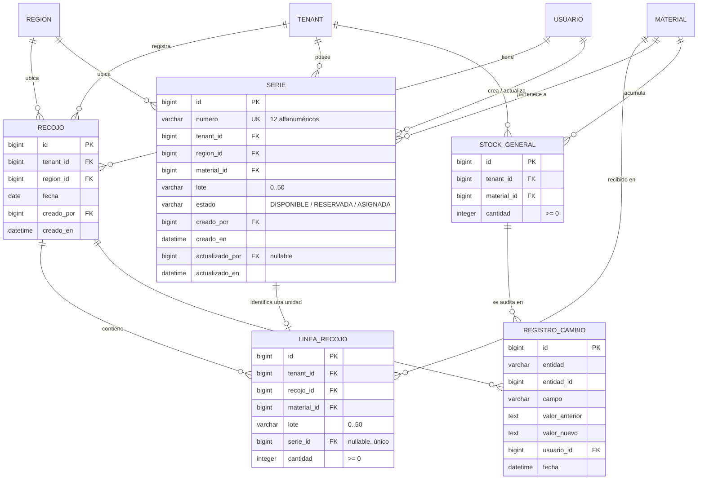

# Modelo de datos: 004 Recojo de materiales

**Fase**: 1 | **Fecha**: 2026-11-12 | **Spec**: `05-especificaciones/004-recojo-de-materiales/spec.md`

Este documento describe las entidades nuevas, sus campos, restricciones, reglas de normalización,
transiciones de estado y eventos de auditoría. El detalle de servicios y firmas vive en `plan.md`;
los contratos HTTP en `contracts/`.

## Diagrama de relaciones



`TENANT`, `REGION`, `USUARIO`, `MATERIAL`, `STOCK_GENERAL` y `REGISTRO_CAMBIO` son entidades de
001, 002 y 008; esta spec no las redefine. `STOCK_GENERAL` se muestra porque el recojo la modifica a
través del servicio de 008.

## Clasificación de las tablas

| Tabla | Tipo | Aislamiento |
|---|---|---|
| `recojos.Recojo` | Operativa de tenant | `tenant_id` obligatorio; toda consulta filtra por el tenant de la sesión |
| `recojos.LineaRecojo` | Operativa de tenant (hija) | `tenant_id` denormalizado para RLS; debe coincidir con el del recojo |
| `series.Serie` | Operativa de tenant | `tenant_id` obligatorio; la unicidad de `numero` es global |
| `stock.StockGeneral` | Operativa de tenant (spec 008) | `tenant_id` obligatorio; única por tenant y material |

Todas las tablas operativas llevan `tenant_id`, como exige la constitución. `LineaRecojo` lo lleva
aunque pueda derivarse del recojo, para permitir RLS directa y consultas de respaldo.

## Entidades

### Recojo (`recojos.Recojo`)

Documento que registra los materiales retirados del almacén central de la región del tenant.

| Campo | Tipo | Nulo | Regla |
|---|---|---|---|
| `id` | `BigAutoField` | No | Clave primaria |
| `tenant` | FK `tenants.Tenant` | No | `PROTECT`, `related_name="recojos"`; se toma de la sesión y es inmutable |
| `region` | FK `tenants.Region` | No | `PROTECT`, `related_name="recojos"`; se fija desde `tenant.region` y es inmutable |
| `fecha` | `DateField` | No | Fecha del recojo; por defecto hoy en el formulario; no se imponen límites de pasado/futuro |
| `creado_por` | FK `Usuario` | No | `PROTECT`, `related_name="recojos_creados"`; cuenta que registró el recojo |
| `creado_en` | `DateTimeField` | No | `auto_now_add`; fecha y hora de registro, distinta de `fecha` |

**Restricciones**

- No hay restricción de unicidad: un tenant puede registrar varios recojos en la misma fecha.
- `fecha` no nula la impone el tipo de campo.
- No existe `CheckConstraint` de fecha: la validación de formato la hace el formulario.

**Índices**

- `Index(tenant, fecha)` para el listado por tenant y fecha.
- `Index(region, fecha)` para consultas de región y reportes posteriores.
- Índices de clave foránea de `tenant`, `region` y `creado_por` (los crea Django).

**Relaciones**

- N:1 con `Tenant`, `Region` y `Usuario` (`PROTECT`).
- 1:N con `LineaRecojo` (`related_name="lineas"`).
- 1:N con `RegistroCambio` por convención `entidad="Recojo"`/`entidad_id` (sin FK física).
- No referencia técnicos.

**Reglas de negocio**

- El tenant y la región salen de la sesión; nunca de un parámetro del cliente.
- La región debe ser la del tenant y debe tener un almacén configurado.
- El recojo es inmutable: no se edita ni se borra; una corrección se hará con un movimiento nuevo
  de una spec posterior.
- La fecha del recojo puede ser pasada; `creado_en` conserva el momento de carga.

### LineaRecojo (`recojos.LineaRecojo`)

Unidad del recojo: una serie individual o una cantidad de material no seriado.

| Campo | Tipo | Nulo | Regla |
|---|---|---|---|
| `id` | `BigAutoField` | No | Clave primaria |
| `tenant` | FK `tenants.Tenant` | No | `PROTECT`, `related_name="lineas_recojo"`; se fija desde el recojo y debe coincidir |
| `recojo` | FK `Recojo` | No | `PROTECT`, `related_name="lineas"`; el recojo no se borra |
| `material` | FK `materiales.Material` | No | `PROTECT`, `related_name="lineas_recojo"`; debe existir en el catálogo |
| `lote` | `CharField(50)` | No | Opcional (cadena vacía permitida); copia del lote del material al momento del recojo |
| `serie` | `OneToOneField(series.Serie)` | Sí | `PROTECT`, `related_name="linea_recojo"`; nulo para no seriados; único, una serie no puede estar en dos líneas |
| `cantidad` | `IntegerField` | No | `>= 0`; `1` cuando hay serie; `> 0` cuando no hay serie |

**Restricciones**

- `linea_recojo_serie_o_cantidad`: `serie IS NOT NULL OR cantidad > 0`.
- `linea_recojo_serie_cantidad_uno`: `serie IS NULL OR cantidad = 1`.
- `linea_recojo_cantidad_no_negativa`: `cantidad >= 0`.
- `OneToOneField(serie)` crea un índice único: una `Serie` pertenece a una sola línea de recojo.
- La coherencia `material.es_seriado` con la presencia de `serie` no se puede expresar como
  `CheckConstraint` de Django porque cruza tablas; la valida el servicio.

**Índices**

- `Index(recojo, material)` para el detalle y los totales.
- `Index(tenant, material)` para la verificación de movimientos y RLS.
- Índice único implícito de `serie`.

**Relaciones**

- N:1 con `Recojo`, `Tenant`, `Material` y `Serie`.
- No tiene estado propio: el estado operativo de la unidad está en `Serie`.

**Reglas de negocio**

- Una línea seriada representa exactamente una unidad física y siempre tiene `cantidad=1`.
- Una línea no seriada representa la cantidad digitada y no tiene serie.
- `lote` es una instantánea informativa; no separa el stock ni cambia la clave de stock.
- `tenant` debe ser igual a `recojo.tenant`.
- No se edita ni se borra; es parte del documento histórico.

### Serie (`series.Serie`)

Identificador único de una unidad física de material seriado. Es la fuente de verdad transversal de
identidad y estado.

| Campo | Tipo | Nulo | Regla |
|---|---|---|---|
| `id` | `BigAutoField` | No | Clave primaria |
| `numero` | `CharField(12)` | No | 12 caracteres alfanuméricos `A-Z0-9`; único global; inmutable |
| `tenant` | FK `tenants.Tenant` | No | `PROTECT`, `related_name="series"`; propietario de la serie; inmutable |
| `region` | FK `tenants.Region` | No | `PROTECT`, `related_name="series"`; se fija desde `tenant.region`; inmutable |
| `material` | FK `materiales.Material` | No | `PROTECT`, `related_name="series"`; material al que pertenece la unidad; inmutable |
| `lote` | `CharField(50)` | No | Opcional; copia del lote del material al crear la serie; informativo |
| `estado` | `CharField(10)` | No | `DISPONIBLE`, `RESERVADA`, `ASIGNADA`, `INSTALADA` o `INACTIVA`; por defecto `DISPONIBLE` |
| `tecnico` | FK `tecnicos.Tecnico` | Sí | `PROTECT`, `related_name="series"`; custodio actual; nulo si no está asignada |
| `asignada_en` | `DateTimeField` | Sí | Inicio de la custodia actual; lo fijan 005/008/009 y lo limpia 011 |
| `creado_por` | FK `Usuario` | No | `PROTECT`, `related_name="+"`; cuenta que registró la serie |
| `creado_en` | `DateTimeField` | No | `auto_now_add` |
| `actualizado_por` | FK `Usuario` | Sí | `PROTECT`, `related_name="+"`; última cuenta que cambió el estado |
| `actualizado_en` | `DateTimeField` | No | `auto_now` |

**Restricciones**

- `unique(numero)` — unicidad global, fuente de verdad ante altas concurrentes.
- `CheckConstraint(serie_formato)`: `numero ~ '^[A-Z0-9]{12}$'`.
- `CheckConstraint(serie_estado_valido)`: `estado IN ('DISPONIBLE', 'RESERVADA', 'ASIGNADA',
  'INSTALADA', 'INACTIVA')`.
- `CheckConstraint(serie_tecnico_coherente_estado)`: `ASIGNADA` exige `tecnico` y `asignada_en` no
  nulos; `DISPONIBLE`, `RESERVADA`, `INSTALADA` e `INACTIVA` exigen ambos nulos.
- La pertenencia de `tecnico` al mismo `tenant` de la serie se valida en los servicios de
  005/008/009; no se puede expresar con un `CheckConstraint` entre tablas.
- El patrón de aplicación proviene de `settings.SERIE_PATRON`; la restricción de base usa el valor
  vigente (12 caracteres) como respaldo. Si el negocio cambia la longitud o el formato, se corrige
  primero la spec y se genera una migración que actualice la restricción junto con la configuración.

**Índices**

- Índice único implícito de `numero` (por `unique=True`).
- `Index(tenant, estado)` para el inventario disponible y los selectores de 006.
- `Index(tenant, material)` para reportes y verificación de movimientos.
- `Index(tecnico, estado)` y `Index(tecnico, material)` para los selectores de 006/009 y los días en
  mano.
- Índices de clave foránea de `region`, `material`, `tecnico`, `creado_por` y `actualizado_por`.

**Relaciones**

- N:1 con `Tenant`, `Region`, `Material`, `Tecnico` y `Usuario`.
- 1:1 con `LineaRecojo` por `LineaRecojo.serie` (una serie puede no tener línea de recojo si
  ingresa por stock inicial).
- 1:N con `RegistroCambio` por convención `entidad="Serie"` si una spec posterior audita sus
  transiciones.

**Estados y transiciones**

| Estado | Significado | Transiciones en esta spec |
|---|---|---|
| `DISPONIBLE` | Está en el stock general del tenant y puede asignarse | Ninguna; es el estado inicial |
| `RESERVADA` | Está reservada en una asignación pendiente | No la implementa 004; pertenece a 006/007 |
| `ASIGNADA` | Está en posesión de un técnico | No la implementa 004; pertenece a 008/009/011 |
| `INSTALADA` | Liquidada/instalada; ya no está en custodia | La implementa 010 al aprobar la conciliación |
| `INACTIVA` | Recuperada o dada de baja; no vuelve al stock | La implementa 011 al registrar la baja |

```text
(no existe) ── recojo (004) ──▶ DISPONIBLE
(no existe) ── stock inicial (005) ──▶ ASIGNADA
DISPONIBLE ── reserva (006) ──▶ RESERVADA
RESERVADA ── confirmación (008) ──▶ ASIGNADA
RESERVADA ── rechazo (007) ──▶ DISPONIBLE
ASIGNADA ── conciliación (010) ──▶ INSTALADA
ASIGNADA ── devolución (011) ──▶ DISPONIBLE
ASIGNADA/DISPONIBLE ── baja (011) ──▶ INACTIVA
```

- 004 crea `DISPONIBLE` con el valor por defecto de `crear_serie`.
- 005 crea `ASIGNADA` pasando `estado=EstadoSerie.ASIGNADA`, porque el stock inicial ya está en
  posesión del técnico y no pasa por el stock general.
- 006–011 agregan las demás transiciones; 004 y 005 no las implementan.
- 005 crea `ASIGNADA` con `tecnico` y `asignada_en`; 008 los fija al confirmar una asignación; 009
  cambia `tecnico` y reinicia `asignada_en` al traspasar; 010 marca `INSTALADA` y limpia ambos al
  liquidar; 011 los limpia al devolver a `DISPONIBLE` y al dar de baja a `INACTIVA`.
- `INSTALADA` e `INACTIVA` son terminales: no vuelven a `DISPONIBLE` ni se reasignan.
- Una serie no cambia de tenant, región ni material.
- Una serie dada de baja no vuelve al stock disponible; la regla pertenece a 011.

**Reglas de negocio**

- Una serie existe una sola vez en todo el sistema y en un solo lugar a la vez.
- El número se normaliza antes de validar y de escribir.
- La región se fija desde `tenant.region`; no se acepta del cliente.
- La serie es trazable por su fila, su autor, su fecha y su vínculo con la línea y el recojo.
- La custodia actual vive en `tecnico`/`asignada_en`; la auditoría conserva cada cambio.
- No se elimina; se conserva durante toda su vida.

### StockGeneral (`stock.StockGeneral`, spec 008)

Entidad externa que 004 modifica solo a través de `incrementar_stock_general`. Se documenta para
dejar explícita la dependencia.

| Campo | Tipo | Nulo | Regla |
|---|---|---|---|
| `id` | `BigAutoField` | No | Clave primaria |
| `tenant` | FK `tenants.Tenant` | No | `PROTECT`; propietario del stock |
| `material` | FK `materiales.Material` | No | `PROTECT`; material acumulado |
| `cantidad` | `IntegerField` | No | `>= 0`; suma de series disponibles y cantidades no seriadas |

- `UniqueConstraint(tenant, material)`.
- `CheckConstraint(cantidad >= 0)`.
- El lote no forma parte de la clave: el stock se acumula por tenant y material.
- 004 no crea ni migra esta tabla; la parte fundacional de 008 debe existir antes.

## Reglas de normalización

| Campo | Transformación | Ejemplo |
|---|---|---|
| `Serie.numero` | Elimina todos los espacios en blanco (`\s+`) y convierte a mayúsculas | `" abc 123456789 "` → `"ABC123456789"` |
| `LineaRecojo.lote` | `strip()` + colapso de espacios internos + `upper()`; se copia del material | `" fiberhome "` → `"FIBERHOME"` |
| `Recojo.fecha` | Se valida como fecha ISO `YYYY-MM-DD`; por defecto hoy | `"2026-11-12"` |
| `LineaRecojo.cantidad` | Entero; se valida `> 0` en no seriados y `= 1` en seriados | `25` |

La normalización de series ocurre antes de validar formato, duplicados y existencia, y antes de
escribir en la base. Un número con guiones o caracteres especiales no se corrige: se rechaza.

## Validaciones y su ubicación

| Regla | Modelo/BD | Servicio | Formulario | Mensaje |
|---|---|---|---|---|
| Al menos una línea | — | Sí | Sí | El recojo debe tener al menos una línea |
| Fecha obligatoria y válida | `DateField` | Sí | Sí | La fecha es obligatoria / La fecha no es válida |
| Material existe | FK `PROTECT` | Sí | Sí | El material no existe en el catálogo |
| Serie con formato `^[A-Z0-9]{12}$` | `CheckConstraint` | Sí | Sí | La serie debe tener 12 caracteres alfanuméricos |
| Serie única global | `unique(numero)` | Sí | — | La serie ya está registrada en el sistema |
| Serie no duplicada en el recojo | — | Sí | Sí | La serie está duplicada en el recojo |
| Serie obligatoria en seriado | — | Sí | Sí | Debe indicar al menos una serie |
| Cantidad 1 en seriado | `CheckConstraint` | Sí | — | Para un material seriado la cantidad debe ser 1 |
| Cantidad > 0 en no seriado | `CheckConstraint` | Sí | Sí | La cantidad debe ser mayor a 0 |
| No seriado sin series | — | Sí | Sí | Un material no seriado no admite series |
| Recojo de otro tenant | — | Sí | — | El recojo no existe |
| Solo cuenta del tenant | — | Sí | Sí (UX) | No tienes permiso para registrar recojos |
| Tenant activo | — | Sí | — | El tenant está suspendido |
| Región con almacén | — | Sí | — | La región del tenant no tiene almacén configurado |
| Coherencia `linea.tenant == recojo.tenant` | — | Sí | — | Error interno de integridad del recojo |
| Coherencia `serie.material == linea.material` | — | Sí | — | La serie no corresponde al material |
| Coherencia `serie.tenant/region == recojo.tenant/region` | — | Sí | — | La serie no corresponde al tenant o a la región |

## Reglas de auditoría

Se reutiliza `auditoria.RegistroCambio` (001). Cada evento se escribe en la misma transacción que el
cambio.

| Evento | `entidad` | `campo` | `valor_anterior` | `valor_nuevo` |
|---|---|---|---|---|
| Alta de recojo | `Recojo` | `alta` | vacío | `fecha=2026-11-12; region=Ayacucho; lineas=4; series=3; cantidad=25` |
| Incremento de stock | `StockGeneral` | `cantidad` | cantidad anterior | cantidad nueva (lo escribe 008) |

- Un registro por alta de recojo y uno por cada material incrementado; no uno por serie.
- Los valores se guardan como texto legible; fechas en ISO 8601.
- La serie queda trazada por `Serie.creado_por`, `Serie.creado_en` y su `LineaRecojo → Recojo`.
- Nunca se auditan contraseñas, `token_hash`, tokens de invitación, secretos TOTP ni claves.
- Si la operación falla (validación, serie existente, error de stock), no se escribe auditoría de
  recojo ni de stock.
- La auditoría no guarda `tenant_id` separado: el alcance se deriva de la entidad y de la cuenta
  autora.

## Ciclo de vida

```text
(no existe) ── crear_recojo ──▶ registrado (inmutable)
registrado ── consulta ──▶ registrado
registrado ── (no existe edición) ──▶ registrado
registrado ── (no existe borrado) ──▶ registrado
```

- El recojo nace completo y no cambia.
- Las líneas y series se crean en la misma transacción.
- Una corrección posterior se hará con una devolución, ajuste o movimiento de una spec posterior,
  nunca editando el recojo.

## Trazabilidad con la spec

| Criterio / regla | Elemento del modelo |
|---|---|
| CA-01: solo el almacén de la región del tenant | `Recojo.tenant` + `Recojo.region` fijados desde la sesión; sin `region_id` del cliente |
| CA-02: series válidas suman al stock | `Serie` `DISPONIBLE` + `incrementar_stock_general` |
| CA-03: normalización a mayúsculas | `normalizar_numero` + `CheckConstraint(serie_formato)` |
| CA-04: formato de 12 caracteres | `CheckConstraint(serie_formato)` + servicio |
| CA-05: duplicado en el mismo recojo | Validación en memoria + `OneToOneField(serie)` |
| CA-06: serie existente en el sistema | `unique(numero)` + consulta global uniforme |
| CA-07: todo o nada | `transaction.atomic` + `RecojoInvalido` |
| CA-08: vista previa en tiempo real | `previsualizar_series` + fragmento HTMX |
| CA-09: no seriado suma cantidad | `LineaRecojo` con `serie=NULL`, `cantidad>0` + stock |
| Región inmutable de la serie | `Serie.region` fijada desde `tenant.region` |
| Stock solo sube con recojos | `incrementar_stock_general` desde 004; sin decrementos en esta spec |
| Lote informativo | `LineaRecojo.lote` y `Serie.lote`; el stock no se separa por lote |
| Tipo de material inmutable con movimientos | Verificación registrada en 002 sobre `LineaRecojo`/`Serie`/`StockGeneral` |
| Sin edición ni borrado | Ausencia de rutas; `PROTECT` en líneas y series |
