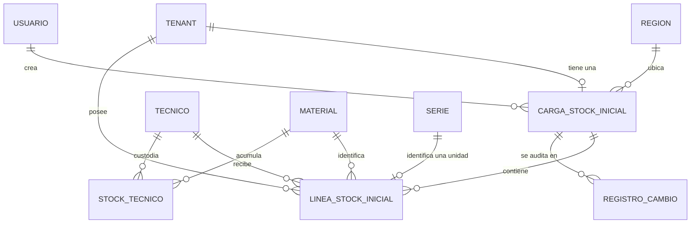

# Modelo de datos: 005 Stock Inicial de Técnicos

**Fase**: 1 | **Fecha**: 2026-11-12 | **Spec**:
`05-especificaciones/005-stock-inicial-de-tecnicos/spec.md`

Este documento describe las entidades nuevas, sus campos, restricciones, reglas de agregación,
transiciones de estado, eventos de auditoría y trazabilidad con los criterios de aceptación. El
detalle de servicios y firmas vive en `plan.md`; los contratos HTTP y de Excel en `contracts/`.

## Diagrama de relaciones



## 1. Cambios en `tenants.Tenant` (spec 001)

| Campo | Tipo | Nulo | Regla | Descripción |
|---|---|---|---|---|
| `stock_inicial_cargado` | `BooleanField` | No | `default=False` | Indica si el tenant ya cargó su stock inicial. Pasa a `True` en la carga y vuelve a `False` en el reinicio. |
| `fecha_stock_inicial` | `DateTimeField` | Sí | `null=True, blank=True` | Instante de la carga. Se limpia en el reinicio. |

Reglas:

- Ambos campos se actualizan en la misma transacción que la carga o el reinicio.
- Se actualizan `actualizado_por` y `actualizado_en` del tenant.
- Se auditan como cambios de `Tenant`.
- No se aceptan desde formularios, URLs ni archivos.
- El valor de `stock_inicial_cargado` no reemplaza la restricción única de `CargaStockInicial`; ambos
  se refuerzan.

## 2. `stock_inicial.CargaStockInicial`

| Campo | Tipo | Nulo | Regla | Descripción |
|---|---|---|---|---|
| `id` | `BigAutoField` | No | PK | Identificador de la carga. |
| `tenant` | FK `tenants.Tenant` | No | `on_delete=PROTECT`, `related_name="cargas_stock_inicial"`, `unique` | Tenant de la sesión. Una sola carga por tenant. |
| `region` | FK `tenants.Region` | No | `on_delete=PROTECT`, `related_name="cargas_stock_inicial"` | Instantánea de `tenant.region` al cargar. |
| `fecha` | `DateTimeField` | No | `auto_now_add=True` | Fecha y hora de la carga. |
| `metodo` | `CharField(10)` | No | `choices=EXCEL/FORMULARIO` | Forma de carga. |
| `archivo_nombre` | `CharField(255)` | No | `blank=True, default=""` | Nombre base del archivo Excel; vacío para formulario. |
| `archivo_hash` | `CharField(64)` | No | `blank=True, default=""` | SHA-256 hexadecimal de los bytes del archivo; vacío para formulario. |
| `creado_por` | FK `AUTH_USER_MODEL` | No | `on_delete=PROTECT`, `related_name="cargas_stock_inicial_creadas"` | Cuenta que cargó. |

### Restricciones e índices

- `UniqueConstraint(fields=["tenant"], name="carga_stock_inicial_tenant_unico")`.
- `Index(fields=["tenant", "fecha"], name="carga_stock_tenant_fecha")`.
- `Meta.ordering = ["-fecha", "-id"]`.
- No hay `CheckConstraint` adicional: la existencia de la fila implica carga completa.

### Reglas

- `region` se fija desde `tenant.region`; nunca se acepta del cliente.
- `archivo_nombre` se guarda con `Path(nombre).name` y se trunca a 255 si es necesario.
- `archivo_hash` se calcula sobre los bytes originales antes de abrir el Excel.
- La carga por formulario deja `archivo_nombre` y `archivo_hash` vacíos.
- `creado_por` es `PROTECT`: la desactivación de la cuenta no borra la carga.
- No se actualiza ni se borra por operación normal; solo el reinicio la elimina, con auditoría.

## 3. `stock_inicial.LineaStockInicial`

| Campo | Tipo | Nulo | Regla | Descripción |
|---|---|---|---|---|
| `id` | `BigAutoField` | No | PK | Identificador de la línea. |
| `tenant` | FK `tenants.Tenant` | No | `on_delete=PROTECT`, `related_name="lineas_stock_inicial"` | FK denormalizada para RLS; se fija desde la carga. |
| `carga` | FK `CargaStockInicial` | No | `on_delete=CASCADE`, `related_name="lineas"` | Carga a la que pertenece. |
| `tecnico` | FK `tecnicos.Tecnico` | No | `on_delete=PROTECT`, `related_name="lineas_stock_inicial"` | Técnico que recibe el stock. |
| `material` | FK `materiales.Material` | No | `on_delete=PROTECT`, `related_name="lineas_stock_inicial"` | Material del catálogo global. |
| `lote` | `CharField(50)` | No | `blank=True, default=""` | Copia de `material.lote`; nunca del Excel. |
| `serie` | `OneToOneField(series.Serie)` | Sí | `null=True, blank=True`, `on_delete=PROTECT`, `related_name="linea_stock_inicial"` | Serie individual para materiales seriados; nula para no seriados. |
| `cantidad` | `IntegerField` | No | `default=0` | Cantidad para no seriados; `1` para seriados. |

### Restricciones

- `CheckConstraint(Q(serie__isnull=False) | Q(cantidad__gt=0), name="linea_stock_inicial_serie_o_cantidad")`:
  toda línea tiene serie o cantidad positiva.
- `CheckConstraint(Q(serie__isnull=True) | Q(cantidad=1), name="linea_stock_inicial_serie_cantidad_uno")`:
  una línea seriada tiene cantidad 1.
- `CheckConstraint(Q(cantidad__gte=0), name="linea_stock_inicial_cantidad_no_negativa")`:
  la cantidad nunca es negativa.
- `UniqueConstraint(fields=["carga", "tecnico", "material"], condition=Q(serie__isnull=True), name="linea_stock_inicial_no_seriada_unica")`:
  una sola línea no seriada por técnico y material dentro de la carga. Las líneas seriadas quedan
  fuera porque su unicidad es la serie.
- La unicidad global de la serie no se duplica aquí: la impone `series.Serie.numero` con
  `unique=True` y su `CheckConstraint` de formato.
- La `OneToOneField` de `serie` impide que una serie pertenezca a dos líneas de stock inicial; junto
  con la `OneToOneField` de `LineaRecojo`, una serie pertenece a una sola línea de cualquier flujo.

### Índices

- `Index(fields=["tenant", "tecnico"], name="linea_stock_tenant_tecnico")`.
- `Index(fields=["carga", "tecnico"], name="linea_stock_carga_tecnico")`.
- `Index(fields=["tenant", "material"], name="linea_stock_tenant_material")`.
- El índice de `serie` lo crea la `OneToOneField`.

### Reglas

- `tenant` se fija desde `carga.tenant`; el servicio nunca lo acepta del cliente.
- `lote` se copia de `material.lote`; si el catálogo lo tiene vacío, queda vacío.
- Para materiales seriados, `serie` no es nula y `cantidad=1`. La `Libre utilización` del Excel se
  ignora.
- Para materiales no seriados, `serie` es nula y `cantidad>0`. Varias filas del Excel del mismo
  técnico y material se suman en una sola línea.
- No se cambia `tecnico`, `material`, `lote` ni `serie` de una línea existente. Para corregirlos se
  elimina la línea y se agrega una nueva, dentro del mismo lote de edición si se desea.
- La línea no tiene `creado_por`: el autor está en `carga.creado_por`, en la auditoría y en la serie.

## 4. Entidades externas

### `series.Serie` (spec 004)

| Aspecto | Uso en 005 |
|---|---|
| `numero` | 12 caracteres alfanuméricos; único global; se normaliza con `normalizar_numero` y se valida con `validar_numero`. |
| `tenant`, `region` | Se fijan desde la sesión y `tenant.region`; nunca del cliente. |
| `material` | Material del catálogo de la línea. |
| `lote` | Copia de `material.lote`. |
| `estado` | 005 crea `ASIGNADA`; 004 crea `DISPONIBLE`; 006–011 agregan transiciones. |
| `creado_por`, `creado_en` | Trazabilidad del alta. |
| Unicidad | `unique(numero)` en PostgreSQL; la base decide en concurrencia. |

005 no crea otra tabla de series ni otra columna única.

### `stock.StockTecnico` (spec 008)

| Aspecto | Uso en 005 |
|---|---|
| `tenant` | Copiado de `tecnico.tenant` por 008; obligatorio para RLS y aislamiento. |
| `tecnico`, `material` | Clave lógica única. |
| `cantidad` | Se incrementa o decrementa solo con los servicios de 008. |
| Auditoría | `StockTecnico/cantidad` con valor anterior y nuevo, escrita por 008. |
| `StockGeneral` | **No se lee ni se modifica.** |

### Otras entidades

- `tecnicos.Tecnico`: `tenant`, `nif` único global, `nombre`, `activo`. El Excel acepta técnicos
  existentes activos o desactivados; el formulario ofrece solo activos.
- `materiales.Material`: `codigo` único global, `descripcion`, `lote`, `es_seriado`.
- `auditoria.RegistroCambio`: entidad, entidad_id, campo, valor anterior, valor nuevo, usuario y
  fecha. Solo inserción.
- `tenants.Region`: instantánea en la carga; no se acepta del cliente.

## 5. Reglas de agregación y normalización

### 5.1 Excel y formulario

1. Se normaliza el NIF: `strip()` y mayúsculas; se valida `^LA[0-9]{4}$`.
2. Se normaliza el código de material: `strip()`.
3. Se normaliza la serie: se eliminan espacios y se pasa a mayúsculas; se valida el patrón
   configurable (`^[A-Z0-9]{12}$` por defecto).
4. Para cada fila:
   - Si el material es seriado y hay serie: una `LineaValidada` con `cantidad=1`.
   - Si el material es seriado y no hay serie: error.
   - Si el material no es seriado y hay serie: error.
   - Si el material no es seriado y no hay serie: se suma `Libre utilización` al grupo
     `(tecnico, material)`.
5. Los grupos no seriados se convierten en una línea por `(tecnico, material)` con la suma.
6. Los lotes y descripciones del Excel se ignoran para el guardado; se usan los del catálogo.
7. Las filas vacías se ignoran.
8. Las filas con error no se guardan; si hay al menos un error, no se guarda nada.

### 5.2 Duplicados y existencia de series

- Dentro de la carga, la misma serie normalizada dos veces: la segunda y posteriores se marcan con
  "La serie está duplicada en la carga".
- Contra el sistema, se consulta `series_existentes` una sola vez con todos los números
  normalizados; si alguno existe, se marca "La serie ya está registrada en el sistema".
- El mensaje no revela tenant, región, recojo ni técnico.
- La validación previa no es autoridad: la carga revalida y la base impone `unique(numero)`.

### 5.3 Cantidades

- No seriados: entero mayor a 0. Se rechazan decimales, texto, cero y negativos.
- Seriados: cantidad fija 1; la cantidad del Excel se ignora.
- La base impone `cantidad >= 0` y `cantidad=1` para seriados.

## 6. Estados y transiciones

### 6.1 Tenant

```text
stock_inicial_cargado=False, fecha_stock_inicial=NULL
        │
        │  carga exitosa (transacción)
        ▼
stock_inicial_cargado=True, fecha_stock_inicial=ahora
        │
        │  reinicio por comando (transacción, solo implementación)
        ▼
stock_inicial_cargado=False, fecha_stock_inicial=NULL
```

- No hay otro camino para volver a `False`.
- La carga fallida no cambia el estado.
- El reinicio exige que las series sigan `ASIGNADA` y que el stock alcance.

### 6.2 Serie

```text
(no existe) ── alta de stock inicial ──▶ ASIGNADA
ASIGNADA ── eliminación de línea de stock inicial (corrección) ──▶ (no existe)
ASIGNADA ── devolución/desasignación (011) ──▶ DISPONIBLE
ASIGNADA ── traspaso (009) ──▶ ASIGNADA (cambia el técnico)
```

- 005 solo crea `ASIGNADA` y elimina una serie `ASIGNADA` en la corrección de la carga inicial.
- 005 no cambia una serie a `DISPONIBLE`, `RESERVADA` ni la da de baja.
- Si la serie ya salió del técnico, 005 no la elimina.

### 6.3 Línea y carga

- La línea no tiene estado. Existe mientras pertenece a la carga.
- La carga no tiene estado. Existe mientras el tenant tiene stock inicial cargado.
- La edición crea, elimina o modifica líneas; no cambia el estado del tenant.
- El reinicio elimina líneas y carga, y devuelve el tenant a “no cargado”.

## 7. Auditoría

| Evento | Entidad | Campo | Valor anterior | Valor nuevo |
|---|---|---|---|---|
| Alta de carga | `CargaStockInicial` | `alta` | — | método, archivo, hash, región, técnicos, líneas, series, cantidad |
| Alta de línea | `LineaStockInicial` | `alta` | — | técnico, material, lote, serie o cantidad |
| Alta de serie | `Serie` | `alta` | — | número, tenant, región, material, `ASIGNADA` |
| Marca de tenant | `Tenant` | `stock_inicial_cargado` | `False` | `True` |
| Fecha de tenant | `Tenant` | `fecha_stock_inicial` | — | fecha ISO |
| Baja de línea | `LineaStockInicial` | `baja` | técnico, material, lote, serie o cantidad | — |
| Baja de serie | `Serie` | `baja` | número, estado, técnico | — |
| Cambio de cantidad | `LineaStockInicial` | `cantidad` | anterior | nueva |
| Baja de carga | `CargaStockInicial` | `baja` | método, archivo, hash, totales | — |
| Reinicio de tenant | `Tenant` | `stock_inicial_cargado` | `True` | `False` |
| Limpieza de fecha | `Tenant` | `fecha_stock_inicial` | fecha anterior | — |
| Stock técnico | `StockTecnico` | `cantidad` | anterior | nueva (008) |

Reglas:

- Todos los registros se escriben en la misma transacción que el cambio.
- Si la operación falla, no se escribe auditoría.
- La auditoría de stock la escribe 008; 005 no la duplica.
- La auditoría no contiene contraseñas, tokens, secretos TOTP ni `token_hash`.
- No se escribe `tenant_id` como campo separado; se deduce del usuario y de la entidad.
- La auditoría sobrevive a la desactivación de la cuenta, la suspensión del tenant y el borrado
  físico de una serie o línea.

## 8. RLS y aislamiento

- `stock_inicial_cargastockinicial` y `stock_inicial_lineastockinicial` llevan `tenant_id` y
  políticas RLS por tenant, si la infraestructura de 001 está disponible.
- `LineaStockInicial.tenant` se fija desde `carga.tenant`.
- Todas las consultas filtran por el tenant de la sesión.
- `series_serie` y `stock_stocktecnico` tienen políticas propias de 004 y 008; 005 no las duplica.
- Si RLS no está listo, se registra la deuda y se mantiene el filtrado de aplicación.

## 9. Trazabilidad con criterios de aceptación

| CA | Entidades y reglas |
|---|---|
| CA-01 Carga por Excel exitosa | `CargaStockInicial` + `LineaStockInicial` + `Serie` + `StockTecnico`; `Tenant.stock_inicial_cargado=True`; auditoría de carga. |
| CA-02 Carga por formulario exitosa | Igual que CA-01 con `metodo=FORMULARIO`, `archivo_nombre=""`, `archivo_hash=""`. |
| CA-03 Técnico no existe | Validación por NIF y tenant; no se crea nada; error "El técnico no existe en este tenant". |
| CA-04 Material no existe | Validación contra `Material.codigo`; no se crea nada; error "El material no existe en el catálogo". |
| CA-05 Serie duplicada en Excel | Detección en memoria por número normalizado; error "La serie está duplicada en la carga"; no se crea nada. |
| CA-06 Serie ya existe | `series_existentes`; error uniforme "La serie ya está registrada en el sistema"; no se revela el tenant. |
| CA-07 Carga única | `Tenant.stock_inicial_cargado` + `UniqueConstraint(tenant)`; error "El stock inicial ya fue cargado para este tenant". |
| CA-08 Asignación directa | `StockTecnico` incrementado; `StockGeneral` sin cambios; series `ASIGNADA`. |
| CA-09 Auditoría de carga | `RegistroCambio` con usuario, fecha, nombre de archivo y hash; resumen y detalle. |
| CA-10 Transaccionalidad | Toda la carga en `transaction.atomic`; un error revierte líneas, series, stock, tenant y auditoría. |
| CA-11 Agregar serie | Operación `AGREGAR` seriada; crea `Serie` `ASIGNADA`, línea, stock y auditoría; lote del catálogo. |
| CA-12 Eliminar serie | Operación `ELIMINAR`; valida estado `ASIGNADA` y stock; elimina línea y serie; audita baja. |
| CA-13 Modificar cantidad | Operación `MODIFICAR` sobre línea no seriada; ajusta stock por diferencia; audita cantidad anterior y nueva. |

## 10. Invariantes del modelo

1. Un tenant tiene como máximo una `CargaStockInicial`.
2. Una carga tiene al menos una línea.
3. Toda línea pertenece a la carga y al tenant de la carga.
4. Toda línea tiene serie (cantidad 1) o cantidad positiva (sin serie).
5. Una serie pertenece a una sola línea de stock inicial y a una sola línea de cualquier flujo.
6. Una línea no seriada es única por `(carga, tecnico, material)`.
7. El lote de la línea es el del catálogo, no el del Excel.
8. El stock inicial no modifica `StockGeneral`.
9. Toda serie creada por 005 nace `ASIGNADA`.
10. Toda modificación de stock pasa por 008 y deja auditoría.
11. La carga, la edición y el reinicio son todo o nada.
12. La auditoría es de solo inserción y no se borra con las entidades.
