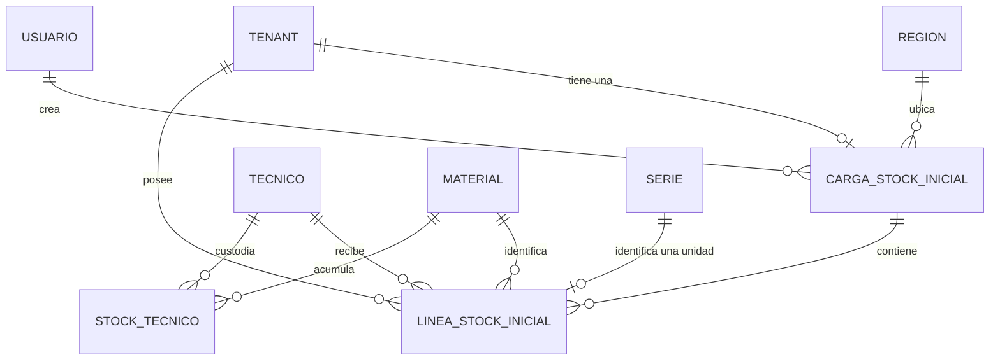

# Plan técnico: 005 Stock Inicial de Técnicos

**Branch**: `005-stock-inicial-de-tecnicos` | **Date**: 2026-11-12 | **Spec**:
`05-especificaciones/005-stock-inicial-de-tecnicos/spec.md`

**Input**: Spec en `05-especificaciones/005-stock-inicial-de-tecnicos/spec.md`

## Summary

Implementar la carga única del stock inicial de los técnicos de cada tenant, por Excel o por
formulario, sin pasar por el stock general. El stock inicial representa los materiales que cada
técnico ya tenía antes de empezar a usar el sistema. La carga valida técnicos, materiales, series y
cantidades; crea las series en estado `ASIGNADA` en el registro transversal `series.Serie`; suma las
cantidades al `stock.StockTecnico` mediante los servicios de la spec 008; marca el tenant como
`stock_inicial_cargado`; y registra auditoría completa en la misma transacción. Después de la carga,
la cuenta del tenant puede corregir el stock inicial mediante operaciones de edición (agregar,
eliminar o modificar) aplicadas de forma transaccional y auditada. El reinicio solo existe como
comando de gestión, deshabilitado por defecto y reservado a la implementación.

El diseño reutiliza la cuenta única, el middleware de contexto, la auditoría y el modelo `Tenant` de
la spec 001; el catálogo global de materiales de la spec 002; los técnicos de la spec 003; la app
transversal `series` de la spec 004; y el núcleo de stock de la spec 008. No crea otra tabla de
series, no escribe `StockGeneral` y no modifica recojos, asignaciones, traspasos, conciliaciones ni
logística inversa.

## Technical Context

| Aspecto | Decisión |
|---|---|
| Lenguaje | Python 3.12+ |
| Framework | Django LTS 5.x |
| Base de datos | PostgreSQL 16+; sin SQLite, tampoco en pruebas |
| Interfaz | Django + HTMX + plantillas; sin SPA ni API REST |
| Excel | `openpyxl`; solo `.xlsx` |
| Pruebas | `pytest` + `pytest-django` sobre PostgreSQL |
| Cola | No se usa Celery: la carga es una operación síncrona y transaccional; el progreso se muestra con el indicador de HTMX |
| Apps | Nueva app `stock_inicial`; cambios en `tenants`; consumidor de `acceso`, `auditoria`, `materiales`, `tecnicos`, `series` y `stock` |
| Rutas | `stock_inicial/urls.py` incluido desde `config/urls.py` con el prefijo `/stock-inicial/` |
| Plantillas | `templates/stock_inicial/` |
| Pruebas | `tests/{unit,integration,contract}/` |
| Dependencias nuevas | Ninguna |

### Prerrequisitos bloqueantes

- **001**: `AUTH_USER_MODEL = "acceso.Usuario"`, `tenants.Region`, `tenants.Tenant`,
  `ContextoUsuarioMiddleware` con `request.usuario`, roles `ADMIN_PLATAFORMA`,
  `USUARIO_TENANT`, `RESPONSABLE_ALMACEN`, `auditoria.RegistroCambio` y
  `auditoria.services.registrar_cambio`.
- **002**: `materiales.Material` con `codigo` único global, `descripcion`, `lote` y `es_seriado`.
- **003**: `tecnicos.Tecnico` con `tenant`, `nif` único global, `nombre`, `activo`, y los servicios
  `normalizar_nif`, `validar_nif`, `obtener_tecnico_por_nif` y `tecnicos_para_operacion`.
- **004**: app `series` con `series.Serie`, `EstadoSerie`, `series.services.normalizar_numero`,
  `validar_numero`, `series_existentes` y `crear_serie`. 005 no crea otra tabla ni otra columna de
  series.
- **008 (parte fundacional)**: `stock.StockTecnico` y
  `stock.services.incrementar_stock_tecnico` / `decrementar_stock_tecnico`. La confirmación de
  asignaciones de 008 no es prerrequisito. `stock.StockGeneral` puede existir, pero 005 nunca lo
  modifica.

Si falta cualquiera de estos prerrequisitos, la implementación se detiene y se reporta; no se
sustituye con una tabla o un servicio local.

## Constitution Check

| Principio | Resultado | Justificación |
|---|---|---|
| I. Aislamiento multitenant (NO NEGOCIABLE) | PASA | Tenant y región salen de la sesión (`request.usuario`), nunca de campos ocultos, URLs ni archivos. `LineaStockInicial.tenant` es una FK denormalizada para RLS y respaldo. Una carga o línea de otro tenant responde `404`. |
| II. Jerarquía Región → Tenant → Técnico | PASA | La región se copia de `tenant.region` como instantánea; el técnico se valida dentro del tenant. El Administrador de plataforma no opera inventario; solo el comando de reinicio puede ejecutarlo un administrador durante la implementación. |
| III. Invariantes de stock | PASA | Se respeta la excepción constitucional del stock inicial: se carga una sola vez y se asigna directamente a `StockTecnico` sin tocar `StockGeneral`. El lote es informativo y proviene del catálogo. Seriados generan una fila por serie con cantidad 1; no seriados, una fila por técnico y material con la cantidad sumada. |
| IV. Identidad y unicidad de series | PASA | Se usa `series.Serie`; la unicidad global la impone `unique(numero)` en PostgreSQL. El formato se valida con `settings.SERIE_PATRON` y la longitud es configurable. El mensaje de serie existente es uniforme y no revela el tenant. |
| V. Integridad transaccional | PASA | Carga, edición y reinicio se ejecutan en una sola `transaction.atomic`; un error en cualquier fila revierte todo. |
| VI. Auditoría inmutable y trazabilidad | PASA | Se escribe un `RegistroCambio` por alta de carga, línea y serie, por cambio de cantidad, por baja y por cambio de los campos del tenant, en la misma transacción. Nunca se auditan contraseñas, tokens ni secretos. |
| VII. Autoridad del reporte de Lari | PASA | 005 no integra el reporte de Lari ni altera stock desde una vista previa; el Excel es un formato de entrada y la carga es una acción humana explícita. |
| VIII. Spec-driven, pruebas y simplicidad | PASA | Cada CA-01…CA-13 tiene al menos una prueba. No se agregan dependencias; la lógica vive en `stock_inicial/services.py` y es testeable sin interfaz. Se usa `openpyxl`, ya aprobado por la constitución. |

**Post-design re-check**: PASA. El diseño final no introduce tablas de stock ni de series, no usa
`tenant_id` del cliente, no modifica `StockGeneral`, no expone el reinicio por HTTP y mantiene la
auditoría dentro de la misma transacción.

## Project Structure

```text
stock_inicial/
├── __init__.py
├── apps.py
├── forms.py
├── models.py
├── services.py
├── urls.py
├── views.py
├── management/
│   └── commands/
│       └── reiniciar_stock_inicial.py
└── migrations/
    ├── 0001_initial.py
    └── 0002_rls.py

templates/stock_inicial/
├── estado.html
├── carga_excel.html
├── carga_formulario.html
├── detalle.html
├── editar.html
├── _resultado_validacion.html
├── _linea_form.html
└── _resumen_carga.html

tests/
├── unit/
│   ├── test_stock_inicial_validaciones.py
│   ├── test_stock_inicial_excel.py
│   └── test_stock_inicial_servicios.py
├── integration/
│   ├── test_stock_inicial_carga.py
│   ├── test_stock_inicial_stock.py
│   ├── test_stock_inicial_edicion.py
│   ├── test_stock_inicial_auditoria.py
│   ├── test_stock_inicial_concurrencia.py
│   ├── test_stock_inicial_reinicio.py
│   └── test_stock_inicial_aislamiento.py
└── contract/
    ├── test_stock_inicial_estado_http.py
    ├── test_stock_inicial_carga_http.py
    ├── test_stock_inicial_validacion_http.py
    ├── test_stock_inicial_edicion_http.py
    └── test_stock_inicial_permisos_http.py
```

También se modifican:

- `config/settings/base.py`: registrar `stock_inicial` en `INSTALLED_APPS` y agregar
  `PERMITIR_REINICIO_STOCK_INICIAL` (por defecto `False`, leído de variable de entorno).
- `config/urls.py`: incluir `stock_inicial.urls` bajo `/stock-inicial/`.
- `tenants/models.py`: campos `stock_inicial_cargado` y `fecha_stock_inicial`.
- `tenants/migrations/0002_stock_inicial_fields.py`: migración de esos campos.
- `series/services.py`: parámetros opcionales `estado`, `tecnico` y `asignada_en` en `crear_serie`
  (corrección coordinada con 004/009; `ASIGNADA` exige técnico y fecha).
- `templates/base.html`: enlace a Stock inicial visible solo para `USUARIO_TENANT` con tenant
  activo.

## Modelo de datos

### Cambios en `tenants.Tenant` (001)

```python
class Tenant(models.Model):
    # ... campos existentes ...
    stock_inicial_cargado = models.BooleanField(default=False)
    fecha_stock_inicial = models.DateTimeField(null=True, blank=True)
```

- `stock_inicial_cargado` marca la carga única. Nace en `False` y solo cambia a `True` dentro de la
  transacción de carga; el reinicio lo devuelve a `False`.
- `fecha_stock_inicial` guarda el instante de la carga y se limpia en el reinicio.
- Ambos campos se actualizan junto con `actualizado_por` y `actualizado_en` del tenant y se auditan.

### `stock_inicial.CargaStockInicial`

```python
class CargaStockInicial(models.Model):
    tenant = models.ForeignKey(
        "tenants.Tenant",
        on_delete=models.PROTECT,
        related_name="cargas_stock_inicial",
    )
    region = models.ForeignKey(
        "tenants.Region",
        on_delete=models.PROTECT,
        related_name="cargas_stock_inicial",
    )
    fecha = models.DateTimeField(auto_now_add=True)
    metodo = models.CharField(
        max_length=10,
        choices=[("EXCEL", "Excel"), ("FORMULARIO", "Formulario")],
    )
    archivo_nombre = models.CharField(max_length=255, blank=True, default="")
    archivo_hash = models.CharField(max_length=64, blank=True, default="")
    creado_por = models.ForeignKey(
        settings.AUTH_USER_MODEL,
        on_delete=models.PROTECT,
        related_name="cargas_stock_inicial_creadas",
    )

    class Meta:
        ordering = ["-fecha", "-id"]
        constraints = [
            models.UniqueConstraint(
                fields=["tenant"],
                name="carga_stock_inicial_tenant_unico",
            ),
        ]
        indexes = [
            models.Index(fields=["tenant", "fecha"], name="carga_stock_tenant_fecha"),
        ]
```

- Una sola carga por tenant, impuesta por `UniqueConstraint(tenant)`. Es la fuente de verdad
  estructural de la carga única, además del flag.
- `region` es una instantánea de `tenant.region`; el servicio la fija y nunca la acepta del cliente.
- `archivo_nombre` guarda el nombre base del archivo; `archivo_hash` guarda el SHA-256 hexadecimal
  de los bytes originales. Para la carga por formulario ambos quedan vacíos.
- `creado_por` es `PROTECT`: la carga histórica no se pierde si la cuenta se desactiva.
- No hay estado de carga: la existencia de la fila implica carga completada. El reinicio la elimina
  y conserva la auditoría.

### `stock_inicial.LineaStockInicial`

```python
class LineaStockInicial(models.Model):
    tenant = models.ForeignKey(
        "tenants.Tenant",
        on_delete=models.PROTECT,
        related_name="lineas_stock_inicial",
    )
    carga = models.ForeignKey(
        CargaStockInicial,
        on_delete=models.CASCADE,
        related_name="lineas",
    )
    tecnico = models.ForeignKey(
        "tecnicos.Tecnico",
        on_delete=models.PROTECT,
        related_name="lineas_stock_inicial",
    )
    material = models.ForeignKey(
        "materiales.Material",
        on_delete=models.PROTECT,
        related_name="lineas_stock_inicial",
    )
    lote = models.CharField(max_length=50, blank=True, default="")
    serie = models.OneToOneField(
        "series.Serie",
        null=True,
        blank=True,
        on_delete=models.PROTECT,
        related_name="linea_stock_inicial",
    )
    cantidad = models.IntegerField(default=0)

    class Meta:
        constraints = [
            models.CheckConstraint(
                condition=Q(serie__isnull=False) | Q(cantidad__gt=0),
                name="linea_stock_inicial_serie_o_cantidad",
            ),
            models.CheckConstraint(
                condition=Q(serie__isnull=True) | Q(cantidad=1),
                name="linea_stock_inicial_serie_cantidad_uno",
            ),
            models.CheckConstraint(
                condition=Q(cantidad__gte=0),
                name="linea_stock_inicial_cantidad_no_negativa",
            ),
            models.UniqueConstraint(
                fields=["carga", "tecnico", "material"],
                condition=Q(serie__isnull=True),
                name="linea_stock_inicial_no_seriada_unica",
            ),
        ]
        indexes = [
            models.Index(fields=["tenant", "tecnico"], name="linea_stock_tenant_tecnico"),
            models.Index(fields=["carga", "tecnico"], name="linea_stock_carga_tecnico"),
            models.Index(fields=["tenant", "material"], name="linea_stock_tenant_material"),
        ]
```

- `tenant` es una FK denormalizada para RLS y consultas de respaldo; el servicio la fija desde la
  carga y nunca la acepta del cliente.
- `serie` es uno a uno con `series.Serie`: una serie pertenece a una sola línea de stock inicial y,
  por la `OneToOneField` de `LineaRecojo`, a una sola línea de cualquier flujo. Es nula para
  materiales no seriados.
- `lote` se copia de `material.lote`; el lote del Excel es informativo y no prevalece.
- Para seriados, `cantidad=1`; para no seriados, `serie=NULL` y `cantidad>0`.
- La restricción `linea_stock_inicial_no_seriada_unica` garantiza una sola fila no seriada por
  técnico y material dentro de la carga; el servicio agrega las cantidades de varias filas del Excel.
- El formato de la serie no se duplica en esta tabla: lo impone `series.Serie` con su
  `CheckConstraint` y su validación de servicio.

### Entidades externas consumidas

| Entidad | Dueña | Uso en 005 |
|---|---|---|
| `series.Serie` | 004 | Registro central de identidad, estado y custodia. 005 crea series `ASIGNADA` con `crear_serie(..., estado=EstadoSerie.ASIGNADA, tecnico=tecnico, asignada_en=ahora)` y las consulta con `series_existentes`. |
| `stock.StockTecnico` | 008 | Stock del técnico por material. 005 solo lo modifica con `incrementar_stock_tecnico` y `decrementar_stock_tecnico`. |
| `stock.StockGeneral` | 008 | **No se lee ni se modifica.** El stock inicial no pasa por el stock general. |
| `tecnicos.Tecnico` | 003 | Validación de existencia en el tenant y selector del formulario. |
| `materiales.Material` | 002 | Catálogo global; origen de `descripcion`, `lote` y `es_seriado`. |
| `auditoria.RegistroCambio` | 001 | Auditoría inmutable compartida. |

### Diagrama de relaciones



## Migraciones

- `tenants/migrations/0002_stock_inicial_fields.py`: agrega `stock_inicial_cargado` y
  `fecha_stock_inicial` a `Tenant`. No modifica datos existentes.
- `stock_inicial/migrations/0001_initial.py`: `CargaStockInicial` y `LineaStockInicial` con la
  restricción única de tenant, las restricciones de línea y los índices.
- `stock_inicial/migrations/0002_rls.py`: políticas RLS por `tenant_id` para
  `stock_inicial_cargastockinicial` y `stock_inicial_lineastockinicial`, si la infraestructura RLS
  de 001 está disponible. Si no lo está, se registra la deuda en `research.md` y no se inventa una
  infraestructura paralela.
- No se crean cargas, líneas, series, técnicos ni materiales por migración.
- No se modifican tablas de stock, series, asignaciones, traspasos ni conciliaciones.
- `series` no requiere migración por el parámetro `estado` de `crear_serie`: es un cambio de
  servicio, no de esquema.

## Servicios (lógica de negocio)

Viven en `stock_inicial/services.py`, salvo la lectura de Excel, que puede vivir en
`stock_inicial/services.py` o en un módulo auxiliar `stock_inicial/excel.py` importado por el
servicio. Las vistas, formularios y el comando no contienen lógica de negocio.

### Excepciones

- `ValidacionStockInicial`: contiene `errores` (lista de `ErrorValidacion`) y se usa para devolver
  `400` con detalle.
- `StockInicialYaCargado`: el tenant ya tiene carga; `409`.
- `StockInicialNoCargado`: se intenta editar sin carga; `409`.
- `StockInicialNoExiste`: carga o línea inexistente o de otro tenant; `404`.
- `PermisoDenegado`: rol, cuenta o alcance incorrecto; `403`.
- `TenantSuspendido`: tenant `SUSPENDIDO`; `403`.
- `TecnicoNoExiste`: el NIF no existe en el tenant; error de validación.
- `MaterialNoExiste`: el código no existe en el catálogo; error de validación.
- `SerieInvalida`: formato incorrecto; se reutiliza la excepción de `series.services` y se traduce
  al mensaje de 005.
- `SerieDuplicada`: la serie se repite dentro de la carga o edición; error de validación.
- `SerieYaExiste`: la serie ya está registrada en el sistema; error de validación o `409` si la
  detecta la base durante el guardado.
- `FormatoExcelInvalido`: archivo no `.xlsx`, ilegible, sin columnas o sin filas; `400`.
- `CantidadInvalida`: cantidad no numérica, negativa o cero; error de validación.
- `LineaNoEditable`: la línea no pertenece a la carga, la serie ya no está asignada o el stock es
  insuficiente; `400`/`409` según el caso.
- `EdicionInvalida`: el lote de operaciones contiene errores; `400` y rollback completo.
- `ReinicioDeshabilitado`: el comando se ejecutó con la configuración apagada; error del comando.

### Alcance y permisos

- `validar_cuenta_tenant(actor)`:
  - Exige `actor.rol == Rol.USUARIO_TENANT`.
  - Exige `actor.is_active`.
  - Exige `actor.tenant` y `actor.tenant.estado == "ACTIVO"`; si no, `TenantSuspendido` con
    "El tenant está suspendido".
  - Cualquier otro rol lanza `PermisoDenegado` con "No tienes permiso para cargar stock inicial".
  - Devuelve el tenant de la sesión. No acepta `tenant_id` externo.
- `validar_cuenta_admin(actor)`:
  - Solo para el comando de reinicio.
  - Exige `actor.rol == Rol.ADMIN_PLATAFORMA` y `actor.is_active`; si no,
    "No tienes permiso para reiniciar el stock inicial".
  - No se usa en ninguna vista HTTP.
- `validar_puede_cargar_stock_inicial(tenant)`:
  - Exige `tenant.stock_inicial_cargado is False` y que no exista `CargaStockInicial` del tenant.
  - Si ya está cargado, `StockInicialYaCargado` con
    "El stock inicial ya fue cargado para este tenant".
- `validar_puede_editar_stock_inicial(tenant)`:
  - Exige `tenant.stock_inicial_cargado is True` y que exista la carga.
  - Si no, `StockInicialNoCargado` con "El stock inicial aún no ha sido cargado".
- `obtener_carga(tenant, carga_id)`:
  - Busca con `CargaStockInicial.objects.filter(tenant=tenant, id=carga_id)`.
  - Si no existe o es de otro tenant, `StockInicialNoExiste` con "El stock inicial no existe".
- `obtener_linea(carga, linea_id)`:
  - Busca con `LineaStockInicial.objects.filter(carga=carga, id=linea_id)`.
  - Si no existe, `StockInicialNoExiste` con "La línea no pertenece al stock inicial".

### Lectura y validación de Excel

- `leer_excel_stock_inicial(archivo)`:
  - Exige extensión `.xlsx` (comparación sin distinguir mayúsculas); si no, `FormatoExcelInvalido`
    con "El archivo debe ser un Excel .xlsx".
  - Lee los bytes una sola vez, calcula `sha256` y abre con
    `openpyxl.load_workbook(BytesIO(contenido), read_only=True, data_only=True)`.
  - Usa la primera hoja. La primera fila es la cabecera; se normaliza con `strip()` y
    `casefold()` para comparar, pero se conservan los nombres canónicos del contrato.
  - Columnas obligatorias: `Material`, `Lote`, `Libre utilización`, `Número de serie`,
    `Nº ident.fis.1`, `Texto breve material`.
  - Si falta una columna, `FormatoExcelInvalido` con
    "El archivo no tiene la columna obligatoria: {columna}".
  - Si no hay filas de datos, `FormatoExcelInvalido` con "El archivo no contiene filas de datos".
  - Devuelve `(filas, archivo_nombre, archivo_hash)`, donde `filas` es una lista de `FilaExcel`
    con `numero_fila`, `material`, `lote`, `libre_utilizacion`, `numero_serie`, `nif` y
    `texto_breve`.
  - No escribe en la base ni crea series.
- `FilaExcel` y `ErrorValidacion` son `dataclass` inmutables. `ErrorValidacion` contiene
  `fila: int | None`, `campo: str`, `mensaje: str` y `valor: str` (valor seguro para mostrar; nunca
  incluye datos de otro tenant).
- `ResultadoValidacionStockInicial` contiene `valido: bool`, `errores: list[ErrorValidacion]`,
  `lineas: list[LineaValidada]`, `resumen: ResumenValidacion`, `archivo_nombre` y `archivo_hash`.

### Validación común de filas (Excel y formulario)

- `normalizar_filas_stock_inicial(filas)`:
  - Normaliza el NIF con `tecnicos.services.normalizar_nif` y lo valida con `validar_nif`.
  - Normaliza el código de material con `strip()`.
  - Normaliza la serie con `series.services.normalizar_numero` si existe.
  - Convierte `libre_utilizacion` a entero; acepta cadenas numéricas y enteros; rechaza decimales,
    negativos y cero.
- `validar_filas_stock_inicial(tenant, filas)`:
  - Carga en bloque los técnicos por NIF (`Tecnico.objects.filter(tenant=tenant, nif__in=...)`),
    los materiales por código (`Material.objects.filter(codigo__in=...)`) y las series existentes
    (`series.services.series_existentes`). No hace una consulta por fila.
  - Para cada fila:
    - Técnico: si el NIF no cumple `^LA[0-9]{4}$`, "El NIF debe tener el formato LAXXXX"; si no
      existe en el tenant, "El técnico no existe en este tenant".
    - Material: si no existe en el catálogo, "El material no existe en el catálogo".
    - Tipo: si el material es seriado y la fila no tiene serie,
      "El material es seriado y requiere número de serie"; si no es seriado y la fila tiene serie,
      "El material no es seriado y no admite número de serie".
    - Serie: si no cumple el patrón, "La serie debe tener 12 caracteres alfanuméricos"; si se repite
      dentro de la carga, "La serie está duplicada en la carga" (se marca la segunda y posteriores);
      si ya existe en el sistema, "La serie ya está registrada en el sistema". El mensaje es
      idéntico para series propias y ajenas.
    - Cantidad no seriada: si no es numérica, "La cantidad de la fila {n} no es un número válido"
      (en el formulario, "La cantidad no es un número válido"); si es menor o igual a cero,
      "La cantidad debe ser mayor a 0".
    - Para seriados, `Libre utilización` se ignora y la cantidad es 1.
  - Agrupa las filas no seriadas por `(tecnico_id, material_id)` y suma sus cantidades. Genera una
    sola `LineaValidada` por grupo.
  - Genera una `LineaValidada` por cada serie válida, con `cantidad=1`.
  - `LineaValidada` contiene `tecnico`, `material`, `lote` (de `material.lote`), `serie` (objeto o
    `None`), `cantidad` y `filas_origen`.
  - Devuelve `ResultadoValidacionStockInicial`; `valido` es `True` solo si no hay errores.
  - No escribe en la base.
- `validar_excel_stock_inicial(tenant, archivo)`:
  - Combina `leer_excel_stock_inicial` y `validar_filas_stock_inicial`.
- `validar_formulario_stock_inicial(tenant, datos)`:
  - Convierte las secciones del formulario en `FilaExcel` lógicas (con `numero_fila=None`), con
    `tecnico_id` resuelto a NIF y `material_id` resuelto a código, y aplica la misma validación.
  - Para el formulario, el técnico se busca por `id` y tenant; el material por `id` global; no se
    acepta `tenant_id` ni `region_id`.
  - Las series se reciben como texto separado por saltos de línea, comas o espacios; se normalizan.

### Carga

- `cargar_stock_inicial(tenant, resultado, metodo, actor, archivo_nombre="", archivo_hash="")`:
  - `validar_cuenta_tenant(actor)`, `validar_puede_cargar_stock_inicial(tenant)`.
  - Exige `resultado.valido` y al menos una línea; si no, `ValidacionStockInicial` con los errores.
  - En `transaction.atomic`:
    - Bloquea el tenant con `Tenant.objects.select_for_update().get(pk=tenant.pk)` y revalida
      `stock_inicial_cargado` y la inexistencia de carga. Usa el objeto bloqueado para el resto de
      la transacción.
    - Crea `CargaStockInicial` con `tenant_bloqueado`, región de la sesión, método, nombre, hash y
      actor.
    - Agrupa las líneas por `(tecnico_id, material_id)` para el stock.
    - Por cada línea:
      - Si es seriada, crea primero la `Serie` con
        `series.services.crear_serie(tenant, region, material, numero, material.lote, actor, estado=EstadoSerie.ASIGNADA, tecnico=tecnico, asignada_en=ahora)`;
        la custodia queda en `Serie.tecnico` y `Serie.asignada_en`.
      - Crea la `LineaStockInicial` con `tenant`, `carga`, `tecnico`, `material`, `lote` del
        catálogo, `serie` y `cantidad`.
      - Audita `LineaStockInicial/alta` y, si aplica, `Serie/alta`.
    - Por cada `(tecnico, material)`, llama una sola vez a
      `stock.services.incrementar_stock_tecnico(tecnico, material, cantidad, actor)` con la suma de
      cantidades. No actualiza `StockTecnico` directamente.
    - Marca `tenant_bloqueado.stock_inicial_cargado = True`,
      `tenant_bloqueado.fecha_stock_inicial = timezone.now()`,
      `tenant_bloqueado.actualizado_por = actor` y guarda.
    - Audita `CargaStockInicial/alta` con el resumen y el hash, `Tenant/stock_inicial_cargado` y
      `Tenant/fecha_stock_inicial`.
  - Captura `IntegrityError` de `CargaStockInicial.tenant` y la traduce a
    `StockInicialYaCargado`; captura `IntegrityError` de `Serie.numero` y la traduce a
    `SerieYaExiste`.
  - Devuelve la carga creada.
- `cargar_desde_excel(tenant, archivo, actor)`:
  - `validar_cuenta_tenant`, `validar_puede_cargar_stock_inicial`.
  - Lee y valida; si hay errores, `ValidacionStockInicial`.
  - Llama a `cargar_stock_inicial` con método `EXCEL` y los datos del archivo.
- `cargar_desde_formulario(tenant, datos, actor)`:
  - Mismas validaciones; método `FORMULARIO`, nombre y hash vacíos.
- La validación previa se ejecuta antes de la transacción para fallar rápido, pero la transacción
  vuelve a validar el estado del tenant y las restricciones de base. La vista previa no es
  autoridad.

### Edición

La edición se expone como un lote de operaciones que se aplica en una sola transacción. Cada
operación individual también puede invocarse como un lote de un solo elemento.

- `aplicar_edicion_stock_inicial(carga, operaciones, actor)`:
  - `validar_cuenta_tenant(actor)`, `validar_puede_editar_stock_inicial(carga.tenant)`.
  - Exige al menos una operación; si no, `EdicionInvalida` con "No se enviaron cambios".
  - En `transaction.atomic`:
    - Bloquea `Tenant` y `CargaStockInicial` con `select_for_update`; vuelve a validar.
    - **Fase de validación (sin escribir):**
      - `AGREGAR`: exige técnico del tenant, material del catálogo, series o cantidad según tipo.
        Valida formato, duplicados dentro del lote, contra las líneas existentes y contra
        `series_existentes`. Para no seriados, si ya existe una línea del mismo técnico y material,
        la operación se interpreta como incremento de cantidad.
      - `ELIMINAR`: exige `linea_id` de la carga; la línea no puede repetirse en el lote. Si es
        seriada, la `Serie` debe existir y estar `ASIGNADA`; si no, "La serie ya no pertenece al
        stock inicial del técnico". Valida que el stock del técnico alcance para restar.
      - `MODIFICAR`: exige `linea_id` de la carga, línea no seriada y `cantidad > 0`. Valida stock
        suficiente si la cantidad baja.
    - **Fase de aplicación:** aplica las operaciones en orden, agrupando los deltas de stock por
      `(tecnico, material)` y llamando una sola vez a `incrementar_stock_tecnico` o
      `decrementar_stock_tecnico` por grupo.
    - Para `AGREGAR` seriado: crea `Serie` `ASIGNADA`, crea `LineaStockInicial`, audita
      `Serie/alta` y `LineaStockInicial/alta`.
    - Para `AGREGAR` no seriado: crea o incrementa la línea, audita `LineaStockInicial/alta` o
      `LineaStockInicial/cantidad`.
    - Para `ELIMINAR`: audita `LineaStockInicial/baja` con los valores anteriores; si es seriada,
      elimina primero la línea y después la `Serie` (por la FK `PROTECT`) y audita `Serie/baja`.
    - Para `MODIFICAR`: audita `LineaStockInicial/cantidad` con valor anterior y nuevo.
    - Captura `IntegrityError` de `Serie.numero` y lo traduce a `SerieYaExiste`.
  - Devuelve la carga actualizada.
- `agregar_linea_stock_inicial(carga, datos, actor)`:
  - Envuelve `aplicar_edicion_stock_inicial` con una operación `AGREGAR`.
- `eliminar_linea_stock_inicial(carga, linea, actor)`:
  - Envuelve con una operación `ELIMINAR`.
- `modificar_cantidad_stock_inicial(carga, linea, nueva_cantidad, actor)`:
  - Envuelve con una operación `MODIFICAR`.
- La edición no permite cambiar técnico, material, lote ni serie de una línea existente. Para
  corregir esos datos se elimina la línea y se agrega una nueva, dentro del mismo lote si se desea.
- La edición no permite tocar una serie que ya salió del stock del técnico (por ejemplo, devuelta o
  traspasada); en ese caso responde con error y no modifica nada.
- Las operaciones se representan con `OperacionEdicion` (`tipo`, `linea_id`, `tecnico`,
  `material`, `series`, `cantidad`) para que el servicio sea testeable sin formularios.

### Consultas y resumen

- `obtener_detalle_carga(tenant, carga_id)`:
  - `obtener_carga` y precarga `lineas__tecnico`, `lineas__material` y `lineas__serie`.
- `listar_lineas_agrupadas(carga)`:
  - Devuelve una estructura ordenada por `tecnico.nif` con las líneas de cada técnico.
- `totales_carga(carga)`:
  - `total_tecnicos`: técnicos distintos.
  - `total_lineas`: líneas.
  - `total_series`: líneas con serie.
  - `total_cantidad`: suma de `cantidad` de líneas no seriadas.
- `estado_stock_inicial(tenant)`:
  - Devuelve `cargado`, `fecha` y la carga (si existe).

### Reinicio (solo comando de gestión)

- `reiniciar_stock_inicial(tenant, actor)`:
  - Exige `settings.PERMITIR_REINICIO_STOCK_INICIAL is True`; si no, `ReinicioDeshabilitado` con
    "El reinicio del stock inicial está deshabilitado".
  - `validar_cuenta_admin(actor)`.
  - En `transaction.atomic`:
    - Bloquea el tenant y la carga con `select_for_update`.
    - Exige `tenant.stock_inicial_cargado` y la carga; si no, "No hay stock inicial cargado para
      reiniciar".
    - Valida que todas las series sigan `ASIGNADA` y que el stock del técnico alcance para restar
      lo cargado. Si alguna serie ya salió o el stock es insuficiente, aborta con
      "El stock inicial ya fue modificado; no se puede reiniciar".
    - Agrupa las cantidades por `(tecnico, material)`, resta con `decrementar_stock_tecnico` y
      audita el stock desde 008.
    - Audita `LineaStockInicial/baja` y `Serie/baja` por cada elemento.
    - Elimina primero todas las líneas y después las series; elimina la carga.
    - Marca `tenant.stock_inicial_cargado = False`, `fecha_stock_inicial = None`,
      `actualizado_por = actor` y guarda.
    - Audita `CargaStockInicial/baja` con el resumen, `Tenant/stock_inicial_cargado` y
      `Tenant/fecha_stock_inicial`.
  - No se expone por HTTP ni por el Admin de Django. Solo se invoca con el comando
    `reiniciar_stock_inicial`.
- `reiniciar_stock_inicial` es una operación de implementación. Si el tenant ya operó (recibió
  traspasos, devoluciones o asignaciones), el guard de stock/serie impide el reinicio y obliga a
  corregir por edición o por los flujos normales.

## Permisos

- **Cargar, ver y editar**: únicamente `USUARIO_TENANT` activo con tenant `ACTIVO`. La cuenta se
  obtiene de la sesión; no hay subcuentas.
- **Administrador de plataforma**: no carga, no ve y no edita stock inicial. Recibe `403` con
  "No tienes permiso para cargar stock inicial" o "No tienes permiso para editar el stock inicial".
  La única excepción es el comando de reinicio, que exige un actor `ADMIN_PLATAFORMA` y la
  configuración explícita.
- **Responsable de almacén**: `403` en todas las rutas.
- **Tenant suspendido**: `403` con "El tenant está suspendido".
- **Cuenta inactiva**: no puede iniciar sesión; si la sesión existiera, el servicio la rechaza.
- **Datos de otro tenant**: `404` con "El stock inicial no existe" o "La línea no pertenece al stock
  inicial", sin revelar el propietario.
- **Anónimo**: redirección al login.
- Los permisos se validan en la vista y de nuevo en el servicio. Ocultar un botón no es
  autorización. No se siembran grupos ni permisos de Django en migraciones; la autorización es por
  rol explícito y alcance de tenant, igual que en 001.
- No se acepta `tenant_id`, `region_id`, `almacen_id` ni `creado_por` desde formularios, URLs,
  archivos o peticiones HTMX.

## Interfaz y endpoints

| Ruta | Método | Función | Éxito | Errores principales |
|---|---|---|---|---|
| `/stock-inicial/` | GET | Estado del stock inicial; opciones Excel/formulario o resumen | `200` | `403`, `405` |
| `/stock-inicial/validar-excel/` | POST | Validación previa del Excel; no escribe | `200` con fragmento | `400`, `403`, `405` |
| `/stock-inicial/cargar-excel/` | POST | Carga por Excel | `302` al detalle | `400`, `403`, `409`, `405` |
| `/stock-inicial/formulario/` | GET | Formulario con secciones por técnico | `200` | `403`, `405` |
| `/stock-inicial/formulario/` | POST | Carga por formulario | `302` al detalle | `400`, `403`, `409`, `405` |
| `/stock-inicial/<int:carga_id>/` | GET | Detalle de la carga | `200` | `403`, `404`, `405` |
| `/stock-inicial/<int:carga_id>/editar/` | GET | Página de edición | `200` | `403`, `404`, `409`, `405` |
| `/stock-inicial/<int:carga_id>/editar/` | POST | Aplica un lote de cambios | `302` al detalle | `400`, `403`, `404`, `409`, `405` |

- No existe ruta de borrado de la carga ni del stock inicial. `DELETE`, `PUT` y `PATCH` responden
  `405` en todas las rutas.
- El comando `reiniciar_stock_inicial` no tiene ruta HTTP.
- `validar-excel` devuelve un fragmento HTML/HTMX, nunca JSON. El navegador no guarda el resultado:
  `cargar-excel` recibe de nuevo el archivo y revalida todo.
- El formulario tiene **secciones por técnico**. Cada sección permite elegir un técnico y agregar
  varias líneas (material, series o cantidad). El conjunto se guarda como una sola carga, para
  respetar la carga única por tenant. No hay borradores ni cargas parciales por técnico.
- `cargar-excel` y `cargar-formulario` redirigen al detalle tras el éxito. Si hay errores, vuelven a
  renderizar el formulario con `400` y los valores ingresados, sin escribir.
- La pantalla de estado muestra:
  - Si no está cargado: dos opciones, Excel y formulario, y el aviso de carga única.
  - Si está cargado: fecha, método, totales, enlace al detalle y enlace a edición.
- El detalle muestra fecha, método, nombre y hash del archivo, región, totales y líneas agrupadas
  por técnico (material, descripción, lote, serie o cantidad).
- La edición muestra las líneas agrupadas por técnico, permite marcar líneas para eliminar, cambiar
  cantidades no seriadas y agregar líneas nuevas. Un solo botón "Guardar cambios" envía el lote; el
  servicio lo aplica todo o nada.
- HTMX se usa para la validación previa del Excel y para el selector de material del formulario
  (búsqueda sobre `/materiales/buscar/`, ya existente en 002). No se usa para las operaciones de
  edición: el lote se envía por POST normal para preservar la atomicidad y el `redirect` posterior.
- El progreso de la carga se muestra con `hx-indicator` / `hx-disabled-elt` mientras el POST está en
  curso. No hay barra de progreso real por filas porque la transacción no publica estados
  intermedios.

## Integraciones

- **001 Tenants y acceso**: `Tenant`, `Region`, `Usuario`, `ContextoUsuarioMiddleware`,
  `request.usuario`, `RegistroCambio` y `registrar_cambio`. Los campos nuevos del tenant se auditan
  como cambios de tenant.
- **002 Materiales**: catálogo global. Se usa `Material.codigo`, `descripcion`, `lote` y
  `es_seriado`; `descripcion` y `lote` del Excel no prevalecen. El selector del formulario reutiliza
  `buscar_materiales` y `/materiales/buscar/`.
- **003 Técnicos**: `Tecnico` del tenant; `normalizar_nif`, `validar_nif`,
  `obtener_tecnico_por_nif` y `tecnicos_para_operacion`. El Excel acepta técnicos existentes del
  tenant, activos o desactivados, para no perder stock histórico; el selector del formulario ofrece
  solo activos. La validación de existencia se hace en bloque por NIF.
- **004 Series**: `series.Serie` y `series.services`. 005 crea series `ASIGNADA` y nunca otra tabla
  de series. La `OneToOneField` de `LineaStockInicial.serie` comparte la unicidad de la serie con
  `LineaRecojo.serie`.
- **008 Stock**: `StockTecnico` y `incrementar_stock_tecnico` / `decrementar_stock_tecnico`. 005
  nunca escribe `StockGeneral` ni calcula disponibilidad. La auditoría de cantidad la escribe 008.
- **006, 007, 009, 010, 011 y 013**: consumen las series `ASIGNADA` y el `StockTecnico` creados
  aquí. 005 no depende de sus tablas ni de sus flujos.
- **Lari**: no hay integración directa. El Excel de stock inicial es un formato de entrada; el
  reporte de Lari se procesa en 010.

## Validaciones (dónde vive cada una)

| Regla | Dónde se valida | Mensaje | Respuesta |
|---|---|---|---|
| Carga única | Servicio y restricción `UniqueConstraint(tenant)` | "El stock inicial ya fue cargado para este tenant" | `409` |
| Editar sin carga | Servicio | "El stock inicial aún no ha sido cargado" | `409` |
| Rol y tenant de la sesión | Vista y servicio | "No tienes permiso para cargar stock inicial" / "No tienes permiso para editar el stock inicial" | `403` |
| Tenant suspendido | Servicio | "El tenant está suspendido" | `403` |
| Carga de otro tenant | Servicio | "El stock inicial no existe" | `404` |
| Línea de otra carga | Servicio | "La línea no pertenece al stock inicial" | `404` |
| Técnico existe en el tenant | Servicio | "El técnico no existe en este tenant" | `400` |
| NIF con formato LAXXXX | Servicio | "El NIF debe tener el formato LAXXXX" | `400` |
| Material existe en el catálogo | Servicio | "El material no existe en el catálogo" | `400` |
| Seriado requiere serie | Servicio | "El material es seriado y requiere número de serie" | `400` |
| No seriado no admite serie | Servicio | "El material no es seriado y no admite número de serie" | `400` |
| Formato de serie | Servicio (`series.services.validar_numero`) | "La serie debe tener 12 caracteres alfanuméricos" | `400` |
| Serie duplicada en la carga | Servicio | "La serie está duplicada en la carga" | `400` |
| Serie ya registrada | Servicio (`series_existentes`) y `unique` de base | "La serie ya está registrada en el sistema" | `400` / `409` si gana la base |
| Cantidad no numérica | Servicio | "La cantidad de la fila {n} no es un número válido" | `400` |
| Cantidad `> 0` | Servicio y `CheckConstraint` | "La cantidad debe ser mayor a 0" | `400` |
| Serie con cantidad distinta de 1 | `CheckConstraint` | Violación de restricción | `400` |
| Línea sin serie ni cantidad | `CheckConstraint` | Violación de restricción | `400` |
| Línea no seriada duplicada | `UniqueConstraint` | Violación de restricción | `400` |
| Archivo no `.xlsx` | Servicio | "El archivo debe ser un Excel .xlsx" | `400` |
| Archivo corrupto o ilegible | Servicio | "El archivo no se pudo leer como Excel" | `400` |
| Columna obligatoria faltante | Servicio | "El archivo no tiene la columna obligatoria: {columna}" | `400` |
| Archivo sin filas | Servicio | "El archivo no contiene filas de datos" | `400` |
| Serie ya no asignada al técnico | Servicio | "La serie ya no pertenece al stock inicial del técnico" | `400` |
| Stock insuficiente al eliminar | Servicio de 008 | "El técnico no tiene suficiente stock" | `400` |
| Reinicio deshabilitado | Servicio y comando | "El reinicio del stock inicial está deshabilitado" | Comando |
| Reinicio sin carga | Servicio | "No hay stock inicial cargado para reiniciar" | Comando |
| Reinicio con stock modificado | Servicio | "El stock inicial ya fue modificado; no se puede reiniciar" | Comando |

## Transacciones y concurrencia

- La carga, la edición por lote y el reinicio se ejecutan en una sola `transaction.atomic`. Si una
  fila, una serie, una cantidad o una auditoría falla, se revierte todo.
- La validación previa no es autoridad. La carga vuelve a validar dentro de la transacción y la base
  impone `CargaStockInicial.tenant` único y `Serie.numero` único.
- **Carga concurrente del mismo tenant**: ambas sesiones pueden validar en paralelo. Al guardar, la
  primera bloquea el `Tenant` con `select_for_update`, crea la carga y marca el flag; la segunda
  espera, relee el flag y falla con "El stock inicial ya fue cargado para este tenant". Si la
  carrera supera el flag, la restricción única de `CargaStockInicial.tenant` produce el mismo
  mensaje.
- **Serie concurrente**: si dos cargas o ediciones intentan la misma serie nueva, la restricción
  `unique(numero)` de `series.Serie` decide; la perdedora recibe "La serie ya está registrada en el
  sistema" (`409` si ocurre durante el guardado).
- **Edición concurrente**: se bloquean `Tenant`, `CargaStockInicial` y las líneas afectadas con
  `select_for_update`, en ese orden y con los ids de línea ordenados, para evitar interbloqueos.
- **Stock**: 005 no actualiza `StockTecnico` directamente. Exige que
  `incrementar_stock_tecnico` / `decrementar_stock_tecnico` de 008 usen `select_for_update` o
  `F()` y auditen valor anterior y nuevo. 005 agrupa los deltas por `(tecnico, material)` para
  minimizar bloqueos.
- No se usan bloqueos de aplicación, cachés de validación ni estados de “carga en progreso”. La base
  y la transacción son la autoridad.
- La vista previa del Excel no bloquea ni escribe; puede ejecutarse en paralelo con todo.

## Auditoría

Se reutiliza `auditoria.RegistroCambio` (001). Eventos propios de esta spec:

| Evento | `entidad` | `campo` | `valor_anterior` | `valor_nuevo` |
|---|---|---|---|---|
| Alta de carga | `CargaStockInicial` | `alta` | — | método, nombre de archivo, hash, región, técnicos, líneas, series, cantidad |
| Alta de línea | `LineaStockInicial` | `alta` | — | técnico, material, lote, serie o cantidad |
| Alta de serie | `Serie` | `alta` | — | número, tenant, región, material, `ASIGNADA` |
| Marca de carga en el tenant | `Tenant` | `stock_inicial_cargado` | `False` | `True` |
| Fecha de carga en el tenant | `Tenant` | `fecha_stock_inicial` | — | fecha ISO |
| Baja de línea por edición | `LineaStockInicial` | `baja` | técnico, material, lote, serie o cantidad | — |
| Baja de serie por edición | `Serie` | `baja` | número, estado, técnico | — |
| Cambio de cantidad | `LineaStockInicial` | `cantidad` | cantidad anterior | cantidad nueva |
| Alta de línea por edición | `LineaStockInicial` | `alta` | — | técnico, material, lote, serie o cantidad |
| Baja de carga por reinicio | `CargaStockInicial` | `baja` | método, archivo, hash, totales | — |
| Reinicio del tenant | `Tenant` | `stock_inicial_cargado` | `True` | `False` |
| Limpieza de fecha por reinicio | `Tenant` | `fecha_stock_inicial` | fecha anterior | — |
| Cambio de stock técnico | `StockTecnico` | `cantidad` | cantidad anterior | cantidad nueva (lo escribe 008) |

- Todos los registros se escriben en la misma transacción que el cambio. Si la operación falla, no
  se escribe auditoría.
- La auditoría de stock es responsabilidad de 008; 005 no la duplica.
- La serie tiene además `creado_por` y `creado_en` en `series.Serie`, lo que permite rastrear su
  alta aunque se consulte el registro central.
- No se auditan contraseñas, tokens, secretos TOTP, `token_hash` ni datos sensibles.
- No se escribe `tenant_id` como campo separado en la auditoría; el tenant se deduce del usuario y
  de la entidad. Los valores de auditoría no revelan datos de otros tenants.

## RLS y aislamiento

- `stock_inicial_cargastockinicial` y `stock_inicial_lineastockinicial` llevan `tenant_id` y
  políticas RLS por tenant, si la infraestructura de 001 está disponible.
- `LineaStockInicial.tenant` se fija desde `carga.tenant`; el servicio nunca lo acepta del cliente.
- Las consultas de detalle, edición y totales filtran siempre por `tenant=request.usuario.tenant`.
- `series_serie` y `stock_stocktecnico` tienen sus propias políticas, propiedad de 004 y 008. 005 no
  las duplica.
- Si RLS no está listo, el filtrado de aplicación sigue siendo obligatorio y la deuda se registra en
  `research.md`; no se implementa una RLS paralela.

## Pruebas

**Puerta**: cada CA-01…CA-13 tiene al menos una prueba. Las pruebas se escriben primero y deben
fallar antes de implementar. Todas corren sobre PostgreSQL, nunca SQLite.

### Unitarias

- `tests/unit/test_stock_inicial_validaciones.py`:
  - normalización de NIF, material y serie;
  - agrupación de no seriados por técnico y material;
  - duplicados de serie dentro de la carga;
  - serie existente con mensaje uniforme;
  - cantidad cero, negativa y no numérica;
  - material seriado sin serie y no seriado con serie;
  - `LineaValidada` con lote del catálogo y no del Excel.
- `tests/unit/test_stock_inicial_excel.py`:
  - lectura de un `.xlsx` generado con `openpyxl`;
  - extensión `.xls` rechazada con "El archivo debe ser un Excel .xlsx";
  - columna faltante, archivo vacío, hoja sin filas y archivo corrupto;
  - hash SHA-256 estable y nombre base;
  - `read_only` y `data_only` no modifican la base.
- `tests/unit/test_stock_inicial_servicios.py`:
  - `validar_cuenta_tenant` con los tres roles, cuenta inactiva y tenant suspendido;
  - `validar_puede_cargar_stock_inicial` y `validar_puede_editar_stock_inicial`;
  - construcción de `OperacionEdicion` y validación de lotes vacíos;
  - `totales_carga` y agrupación por técnico.

### Integración

- `tests/integration/test_stock_inicial_carga.py`:
  - **CA-01** `test_carga_excel_exitosa_marca_tenant_y_crea_carga`;
  - **CA-02** `test_carga_formulario_exitosa`;
  - **CA-03** `test_tecnico_no_existe_rechaza_carga`;
  - **CA-04** `test_material_no_existe_rechaza_carga`;
  - **CA-05** `test_serie_duplicada_en_carga_rechaza`;
  - **CA-06** `test_serie_ya_existe_rechaza_sin_revelar_tenant`;
  - **CA-07** `test_segunda_carga_rechazada_por_flag_y_por_restriccion`;
  - **CA-10** `test_error_en_una_fila_no_carga_nada`;
  - `test_carga_excel_agrupa_no_seriados_por_tecnico_y_material`;
  - `test_carga_ignora_lote_y_descripcion_del_excel`;
  - `test_carga_formulario_con_varios_tecnicos_es_una_sola_carga`.
- `tests/integration/test_stock_inicial_stock.py`:
  - **CA-08** `test_asignacion_directa_stock_tecnico_sin_stock_general`;
  - `test_stock_general_no_cambia_en_carga_ni_edicion`;
  - `test_stock_tecnico_se_incrementa_una_vez_por_material`;
  - `test_series_creadas_estado_asignada`.
- `tests/integration/test_stock_inicial_edicion.py`:
  - **CA-11** `test_editar_agrega_serie_y_audita`;
  - **CA-12** `test_editar_elimina_serie_y_audita`;
  - **CA-13** `test_editar_modifica_cantidad_y_audita`;
  - `test_edicion_por_lote_es_todo_o_nada`;
  - `test_editar_linea_no_seriada_existente_suma_cantidad`;
  - `test_editar_no_permite_linea_seriada_en_modificar_cantidad`;
  - `test_editar_no_permite_serie_que_ya_salio_del_tecnico`;
  - `test_editar_sin_carga_responde_conflicto`.
- `tests/integration/test_stock_inicial_auditoria.py`:
  - **CA-09** `test_auditoria_carga_registra_usuario_fecha_archivo_y_hash`;
  - `test_auditoria_linea_y_serie_por_cada_elemento`;
  - `test_auditoria_cambios_de_tenant`;
  - `test_auditoria_edicion_y_baja`;
  - `test_auditoria_no_contiene_secretos`;
  - `test_auditoria_se_conserva_al_desactivar_cuenta_o_suspender_tenant`.
- `tests/integration/test_stock_inicial_concurrencia.py`:
  - `test_dos_cargas_concurrentes_solo_crean_una`;
  - `test_dos_series_concurrentes_solo_crean_una`;
  - `test_edicion_concurrente_no_deja_saldos_parciales`.
- `tests/integration/test_stock_inicial_reinicio.py`:
  - `test_reinicio_deshabilitado_por_defecto`;
  - `test_reinicio_solo_admin_plataforma`;
  - `test_reinicio_borra_carga_lineas_series_y_stock`;
  - `test_reinicio_conserva_auditoria`;
  - `test_reinicio_falla_si_el_stock_fue_modificado`.
- `tests/integration/test_stock_inicial_aislamiento.py`:
  - `test_carga_y_lineas_de_otro_tenant_responden_404`;
  - `test_admin_y_almacen_reciben_403`;
  - `test_tenant_suspendido_recibe_403`;
  - `test_tenant_id_region_id_forzados_se_ignoran`;
  - `test_rls_politicas_por_tenant` (si la infraestructura RLS está disponible).

### Contrato HTTP

- `tests/contract/test_stock_inicial_estado_http.py`: `GET /stock-inicial/` con y sin carga,
  enlaces, `403`, `405`.
- `tests/contract/test_stock_inicial_carga_http.py`: `POST /stock-inicial/cargar-excel/` y
  `/stock-inicial/formulario/` con éxito (`302`), errores de validación (`400`), carga repetida
  (`409`) y métodos no permitidos (`405`).
- `tests/contract/test_stock_inicial_validacion_http.py`: `POST /stock-inicial/validar-excel/`
  devuelve fragmento con `data-valido`, errores por fila y resumen; no escribe; `400` para archivo
  inválido; `403`/`405`; no se crean filas.
- `tests/contract/test_stock_inicial_edicion_http.py`: `GET/POST /stock-inicial/<id>/editar/`,
  lote con agregar/eliminar/modificar, `400` con rollback, `409` sin carga, `404` ajeno, `405`.
- `tests/contract/test_stock_inicial_permisos_http.py`: matriz completa de las rutas para
  `ADMIN_PLATAFORMA`, `RESPONSABLE_ALMACEN`, `USUARIO_TENANT`, tenant suspendido y anónimo.

### Restricciones de base de datos

- Insertar una línea con serie y `cantidad != 1` falla.
- Insertar una línea sin serie y `cantidad <= 0` falla.
- Insertar dos líneas no seriadas con el mismo `(carga, tecnico, material)` falla.
- Insertar dos cargas para el mismo tenant falla.
- Insertar dos series con el mismo `numero` falla.
- Insertar una serie con formato inválido falla en `series.Serie`.
- Insertar una línea con `tenant` distinto de la carga es posible a nivel de base, pero el servicio
  nunca lo hace; una prueba verifica que el servicio fija el tenant correcto.

### Rendimiento

- `django_assert_num_queries` para:
  - validación de un Excel de 100 filas: una consulta de técnicos, una de materiales y una de
    series existentes, más las consultas constantes de permisos/tenant;
  - detalle con `select_related`/`prefetch_related`, sin N+1;
  - carga de 100 filas: sin consultas por fila para técnicos o materiales;
  - vista previa: sin escrituras y sin consultas por fila.
- La lectura del Excel usa `read_only=True` y no carga el libro completo en memoria más de lo
  necesario.

## Decisiones y riesgos

- **Series centralizadas**: 005 consume `series.Serie` y no crea una columna `serie` de texto. Una
  serie existe una sola vez en el sistema y su unicidad la impone PostgreSQL.
- **Estado inicial `ASIGNADA`**: el stock inicial ya está en posesión del técnico; por eso la serie
  nace `ASIGNADA`, no `DISPONIBLE`. `crear_serie` de 004 acepta un `estado` opcional (por defecto
  `DISPONIBLE`) y 005 pasa `ASIGNADA`.
- **Stock directo al técnico**: 005 llama a `incrementar_stock_tecnico` de 008; no escribe
  `StockTecnico` ni `StockGeneral` directamente. El stock general no se toca.
- **Carga única**: el flag del tenant y la restricción única de `CargaStockInicial.tenant` se
  refuerzan mutuamente. La segunda carga responde `409`.
- **Formulario con secciones por técnico**: la spec pide un formulario por técnico; se implementa
  como una página con secciones, cada una para un técnico, que se guardan como una sola carga. Se
  rechaza el flujo de borradores o cargas parciales porque contradice la carga única.
- **Excel `.xlsx`**: `openpyxl` no lee `.xls`. Se acepta solo `.xlsx`; los archivos `.xls` deben
  guardarse como `.xlsx`. Se corrige el contrato `04-contratos/excel-stock-inicial.md`.
- **Lote y descripción del catálogo**: el Excel puede traer lote y descripción, pero el sistema usa
  `material.lote` y `material.descripcion`. El lote del Excel es informativo y no separa stock.
- **No seriados agregados**: varias filas del Excel del mismo técnico y material se suman en una
  sola línea para cumplir la unicidad y evitar filas duplicadas.
- **Edición por lote**: la edición se aplica como un lote transaccional; agregar, eliminar y
  modificar comparten el mismo servicio. Esto cumple “si falla una modificación, falla todo”.
- **Borrado físico de series incorrectas**: una serie cargada por error se elimina físicamente,
  pero la auditoría conserva sus valores. Solo se permite si sigue `ASIGNADA` y el stock alcanza.
  No se borran movimientos de auditoría.
- **Reinicio solo por comando**: no hay ruta HTTP ni acción de Admin. El comando exige
  `PERMITIR_REINICIO_STOCK_INICIAL=True`, un actor `ADMIN_PLATAFORMA` y `--confirmar`. Es una
  operación de implementación; si el tenant ya operó, el guard de stock/serie lo impide.
- **Sin Celery**: la carga es síncrona y transaccional. Una tarea asíncrona podría dejar estados
  intermedios y complicar la carga única; el progreso se muestra con HTMX.
- **Auditoría granular**: se audita cada línea y cada serie, además del resumen de la carga. Esto
  facilita la reconstrucción de la carga inicial y no depende de que la serie siga existiendo.
- **Técnicos desactivados en Excel**: se aceptan si existen en el tenant, para no perder stock
  histórico; el formulario solo ofrece activos. Se documenta para que no sorprenda.
- **Riesgo de archivos grandes**: la lectura es `read_only`, pero un Excel enorme puede consumir
  tiempo. No se impone un límite no especificado; si aparece, se agrega al contrato y a la spec.
- **Riesgo de RLS no disponible**: se registra la deuda y se mantiene el filtrado de aplicación.
- **Riesgo de stock inicial ya operado**: el reinicio se bloquea si las series o el stock cambiaron;
  la corrección se hace por edición o por los flujos normales.

## Complexity Tracking

No se identifican violaciones a la constitución. Las dos decisiones que agregan complejidad están
justificadas:

| Decisión | Por qué | Alternativa rechazada |
|---|---|---|
| Edición por lote transaccional | La spec exige que “si falla una modificación, falle todo”; un lote permite cumplirlo sin estados parciales | Tres endpoints independientes, que podrían dejar la edición a medias |
| Borrado físico de series incorrectas con auditoría | La carga inicial puede contener una serie equivocada y no existe otro flujo para corregirla antes de operar | Marcar la serie como “dada de baja”, que la dejaría ocupando la unicidad global y no representaría la corrección |

## Correcciones documentales requeridas antes de implementar

1. `04-contratos/excel-stock-inicial.md`: cambiar “.xlsx o .xls” por “.xlsx”; indicar que `.xls`
   debe guardarse como `.xlsx`; aclarar que lote y descripción se toman del catálogo y que los del
   Excel son informativos.
2. `05-especificaciones/008-confirmacion-y-actualizacion-de-stock/plan.md`: declarar que
   `StockTecnico`, `incrementar_stock_tecnico` y `decrementar_stock_tecnico` son parte fundacional
   que 005 consume antes de la confirmación de asignaciones.
3. `05-especificaciones/004-recojo-de-materiales/plan.md`: documentar
   `crear_serie(..., estado=EstadoSerie.DISPONIBLE)` y que 005 pasa `EstadoSerie.ASIGNADA`.
4. `05-especificaciones/004-recojo-de-materiales/research.md`: retirar el riesgo obsoleto sobre la
   columna `serie` de texto de 005 y marcarlo como resuelto.
5. `05-especificaciones/004-recojo-de-materiales/data-model.md`: precisar que 004 crea
   `DISPONIBLE` y 005 crea `ASIGNADA` mediante el parámetro; las demás specs agregan transiciones.
6. `06-plan-implementacion/desglose-tareas.md`: actualizar la dependencia de 005 para incluir la app
   `series` de 004 y el núcleo de stock de 008, no solo técnicos, materiales y stock genérico.
7. `03-reglas-de-dominio/series.md`: agregar el stock inicial como vía de ingreso de series, que
   nacen `ASIGNADA` sin pasar por el stock general.
8. `03-reglas-de-dominio/stock.md`: mencionar el stock inicial en los incrementos del stock del
   técnico y confirmar que no modifica el stock general.
