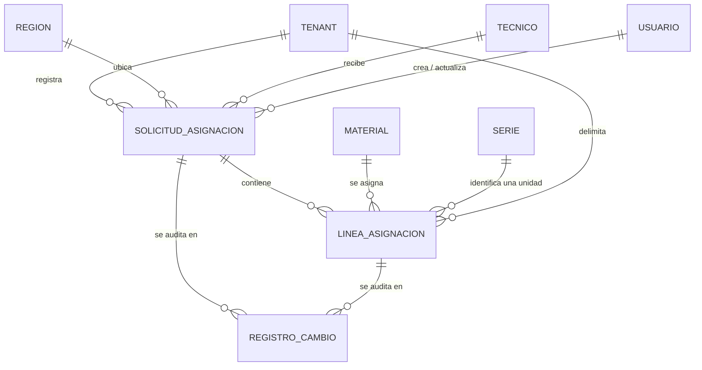

# Modelo de datos: 006 Solicitud de Asignación

**Fase**: 1 | **Fecha**: 2026-11-12 | **Spec**:
`05-especificaciones/006-solicitud-de-asignacion/spec.md`

Este documento describe las entidades nuevas, sus campos, restricciones, transiciones de estado,
consultas de agregación y eventos de auditoría. El detalle de servicios y firmas vive en `plan.md`;
los contratos HTTP en `contracts/`.

## Diagrama de relaciones



- `SOLICITUD_ASIGNACION` y `LINEA_ASIGNACION` son nuevas y pertenecen a la app `asignaciones`.
- `TENANT`, `REGION` y `USUARIO` son de 001; `TECNICO` de 003; `MATERIAL` de 002; `SERIE` de 004;
  `REGISTRO_CAMBIO` de 001. 006 no las modifica.
- `STOCK_GENERAL` (008) no tiene relación de clave foránea con 006: se consulta por
  `(tenant, material)` para calcular disponibilidad.

## Entidades

### `asignaciones.SolicitudAsignacion`

Cabecera de la solicitud. Pertenece a un solo tenant, una región y un técnico.

| Campo | Tipo | Nulo | Regla |
|---|---|---|---|
| `id` | `BigAutoField` | No | Clave primaria |
| `tenant` | FK `tenants.Tenant` | No | `PROTECT`; se fija desde la sesión |
| `region` | FK `tenants.Region` | No | `PROTECT`; instantánea de `tenant.region` |
| `tecnico` | FK `tecnicos.Tecnico` | No | `PROTECT`; debe pertenecer al tenant |
| `fecha` | `DateField` | No | Fecha de la solicitud; por defecto hoy |
| `estado` | `CharField(20)` | No | `BORRADOR` por defecto; ver estados |
| `excel_ruta` | `CharField(255)` | No | Vacío hasta el envío; relativa a `MEDIA_ROOT` |
| `excel_hash` | `CharField(64)` | No | SHA-256 hexadecimal; vacío hasta el envío |
| `excel_generado_en` | `DateTimeField` | Sí | Se fija al generar el Excel |
| `enviada_en` | `DateTimeField` | Sí | Se fija en la transición a `ENVIADA` |
| `confirmada_en` | `DateTimeField` | Sí | Lo fija 007 al confirmar; respaldo histórico de días en mano |
| `creado_por` | FK `acceso.Usuario` | No | `PROTECT`, `related_name="solicitudes_asignacion_creadas"` |
| `creado_en` | `DateTimeField` | No | `auto_now_add` |
| `actualizado_por` | FK `acceso.Usuario` | Sí | `PROTECT`, `related_name="solicitudes_asignacion_actualizadas"` |
| `actualizado_en` | `DateTimeField` | No | `auto_now` |

**Restricciones**

- `CheckConstraint(solicitud_asignacion_estado_valido)`:
  `estado IN ('BORRADOR','ENVIADA','CONFIRMADA','RECHAZADA','CANCELADA')`.
- `Index(tenant, estado, name="solicitud_asign_tenant_estado")`.
- `Index(tecnico, fecha, name="solicitud_asign_tecnico_fecha")`.
- `Index(region, fecha, name="solicitud_asign_region_fecha")`.
- `ordering = ["-fecha", "-id"]`.

**Reglas de negocio**

- `tenant` y `region` nunca se aceptan del cliente; la región se copia de `tenant.region`.
- `tecnico.tenant` debe ser igual a `tenant`; se valida en el servicio y se prueba.
- `excel_ruta`, `excel_hash` y `excel_generado_en` quedan vacíos mientras está `BORRADOR`.
- Una solicitud `ENVIADA` no se edita; su Excel es inmutable.
- `confirmada_en` solo lo escribe 007. Es respaldo histórico: la fuente actual es
  `Serie.asignada_en`. Si una solicitud `CONFIRMADA` no lo tiene, los días en mano
  no se calculan y se reporta como inconsistencia de datos.

### `asignaciones.LineaAsignacion`

Línea de la solicitud. Puede representar una serie (cantidad 1) o un material no seriado
(cantidad agregada).

| Campo | Tipo | Nulo | Regla |
|---|---|---|---|
| `id` | `BigAutoField` | No | Clave primaria |
| `tenant` | FK `tenants.Tenant` | No | `PROTECT`; se copia de `solicitud.tenant` |
| `solicitud` | FK `SolicitudAsignacion` | No | `PROTECT`, `related_name="lineas"` |
| `material` | FK `materiales.Material` | No | `PROTECT`; catálogo global |
| `lote` | `CharField(50)` | No | Copiado de `material.lote`; no editable |
| `serie` | FK `series.Serie` | Sí | `PROTECT`; obligatoria solo en seriados |
| `cantidad` | `IntegerField` | No | `1` en seriados; `> 0` en no seriados |

**Restricciones**

- `CheckConstraint(linea_asignacion_serie_o_cantidad)`: `serie IS NOT NULL OR cantidad > 0`.
- `CheckConstraint(linea_asignacion_serie_cantidad_uno)`: `serie IS NULL OR cantidad = 1`.
- `CheckConstraint(linea_asignacion_cantidad_no_negativa)`: `cantidad >= 0`.
- `UniqueConstraint(solicitud, serie, condition=serie IS NOT NULL, name="linea_asignacion_serie_unica_en_solicitud")`.
- `UniqueConstraint(solicitud, material, condition=serie IS NULL, name="linea_asignacion_no_seriada_unica")`.
- `Index(solicitud, material, name="linea_asign_solicitud_material")`.
- `Index(tenant, material, name="linea_asign_tenant_material")`.
- `Index(serie, name="linea_asign_serie")`.

**Reglas de negocio**

- Para un material seriado: `serie` no nula, `cantidad = 1` y `serie.material == material`.
- Para un material no seriado: `serie` nula, `cantidad > 0` y una sola línea por material en la
  solicitud (las filas del formulario se agrupan sumando).
- `tenant` se fija desde `solicitud.tenant`; nunca se acepta del cliente.
- `lote` se copia del catálogo; el valor del formulario se ignora.
- La unicidad de `serie` por solicitud no impide que la misma serie aparezca en otra solicitud
  histórica; la disponibilidad la decide `Serie.estado`.

### Entidades externas consumidas

| Entidad | Dueña | Uso en 006 | Escritura |
|---|---|---|---|
| `series.Serie` | 004 | Series del inventario general; `DISPONIBLE` se selecciona y `RESERVADA` al enviar | Solo `estado` y `actualizado_por` al enviar |
| `stock.StockGeneral` | 008 | Stock general del tenant para calcular disponibilidad | Ninguna; solo lectura y bloqueo |
| `stock.StockTecnico` | 008 | No se usa en 006 | Ninguna |
| `tecnicos.Tecnico` | 003 | Destinatario; solo activos del tenant | Ninguna |
| `materiales.Material` | 002 | Código, descripción, lote y tipo | Ninguna |
| `tenants.Tenant`, `tenants.Region`, `tenants.Almacen` | 001 | Alcance, región y metadatos del Excel | Ninguna |
| `auditoria.RegistroCambio` | 001 | Trazabilidad de la operación | Solo alta de registros |

## Estados y transiciones

```text
                 enviar (006)                confirmar (007)
BORRADOR ─────────────────────▶ ENVIADA ─────────────────────▶ CONFIRMADA
   │                                │
   │ cancelar (006)                 │ rechazar (007)
   ▼                                ▼
CANCELADA                        RECHAZADA
```

| Estado | Quién lo fija | Operaciones permitidas | Series asociadas |
|---|---|---|---|
| `BORRADOR` | 006 (alta) | Enviar, cancelar | `DISPONIBLE` (sin reserva) |
| `ENVIADA` | 006 (envío) | Ninguna en 006; 007 confirma o rechaza | `RESERVADA` |
| `CONFIRMADA` | 007 | Ninguna; consulta y días en mano | `ASIGNADA` |
| `RECHAZADA` | 007 | Ninguna; queda como histórico | `DISPONIBLE` |
| `CANCELADA` | 006 (cancelación) | Ninguna; queda como histórico | `DISPONIBLE` |

- No hay transición desde `CONFIRMADA`, `RECHAZADA` o `CANCELADA`; son estados terminales.
- No se elimina físicamente ninguna solicitud ni línea.
- Las transiciones se implementan en servicios; no se acepta `estado` desde el formulario.
- 006 implementa `BORRADOR→ENVIADA` y `BORRADOR→CANCELADA`. 007 implementa
  `ENVIADA→CONFIRMADA` y `ENVIADA→RECHAZADA`, y cambia `Serie.estado` en consecuencia.
- `Serie.estado` sigue las transiciones de `03-reglas-de-dominio/series.md`:
  `DISPONIBLE→RESERVADA` (006), `RESERVADA→ASIGNADA` o `RESERVADA→DISPONIBLE` (007/008).

## Reservado y disponibilidad

No existe tabla de reservas. El reservado se calcula así:

| Tipo de material | Fuente del reservado |
|---|---|
| No seriado | `SUM(LineaAsignacion.cantidad)` de líneas sin serie cuyas solicitudes están `ENVIADA` en el tenant y material |
| Seriado | `COUNT(Serie)` del tenant y material con `estado = RESERVADA` |

```text
Disponible(tenant, material) = max(0, StockGeneral.cantidad − Reservado(tenant, material))
```

Reglas:

- Un borrador no reserva: sus líneas no cuentan y sus series siguen `DISPONIBLE`.
- Una solicitud rechazada o cancelada no reserva.
- Una solicitud confirmada ya movió stock en 008; su cantidad no se suma al reservado.
- La consulta del reservado es agregada y se ejecuta una vez por material o una vez para todo el
  formulario, nunca una por línea.
- Si no existe `StockGeneral` para el material, el stock general es 0 y el disponible es 0.
- La validación de la vista no es autoridad; el envío recalcula y bloquea.

## Días en mano y alerta

| Cálculo | Fuente | Regla |
|---|---|---|
| Días en mano de una serie | `Serie.asignada_en` | `(hoy − serie.asignada_en.date()).days`; solo si la serie está `ASIGNADA`; `confirmada_en` es respaldo histórico |
| Series en custodia | Líneas seriadas de solicitudes `CONFIRMADA` cuya `Serie.estado = ASIGNADA` | Se conserva la confirmación más reciente por serie |
| Alerta de cupo | `settings.DIAS_ALERTA_CUSTODIA` (20) | Se alerta si **algún** equipo seriado supera el umbral; no se suman días entre equipos |
| Efecto de la alerta | Ninguno sobre el estado | Se muestra como aviso; no bloquea crear ni enviar |

- Hasta que 009/011 muevan series, la fuente de custodia son las asignaciones confirmadas.
- Cuando 009/011 muevan o devuelvan una serie, deberán actualizar la fuente para que el cálculo siga
  siendo correcto (deuda documental registrada en `plan.md`).
- El detalle de la solicitud confirmada muestra días en mano por serie y la alerta; una solicitud
  no confirmada no muestra días en mano.

## Consultas y totales

| Consulta | Filtro | Uso |
|---|---|---|
| `listar_solicitudes(tenant, estado=None)` | `tenant`; `estado` opcional; orden `fecha`, `id` descendente | Listado paginado |
| `obtener_solicitud(tenant, id)` | `tenant` e `id` | Detalle y operaciones; ajeno ⇒ `404` |
| `obtener_detalle_solicitud(tenant, id)` | `select_related` de técnico y `prefetch_related` de líneas, material y serie | Detalle sin N+1 |
| `calcular_reservado(tenant, material)` | Solicitudes `ENVIADA` | Disponibilidad |
| `series_disponibles_para_asignacion(tenant, material, q, excluir_ids)` | `tenant`, `material`, `DISPONIBLE` | Selector HTMX |
| `series_en_custodia_tecnico(tecnico)` | `Serie.estado=ASIGNADA`, `Serie.tecnico=tecnico` | Días en mano y alerta desde `Serie.asignada_en` |
| `totales_solicitud(solicitud)` | Líneas de la solicitud | `total_lineas`, `total_series`, `total_cantidad` |

- `total_lineas` cuenta todas las líneas.
- `total_series` cuenta las líneas con `serie` no nula.
- `total_cantidad` suma `cantidad` de las líneas con `serie` nula.
- Los totales se calculan en la consulta o con agregación, no con una consulta por línea.

## Auditoría

| Evento | `entidad` | `campo` | `valor_anterior` | `valor_nuevo` |
|---|---|---|---|---|
| Alta de solicitud | `SolicitudAsignacion` | `alta` | — | `fecha`, NIF, `BORRADOR`, líneas, series, cantidades |
| Alta de línea | `LineaAsignacion` | `alta` | — | material, lote, serie o cantidad |
| Envío | `SolicitudAsignacion` | `estado` | `BORRADOR` | `ENVIADA` + totales + hash |
| Reserva de serie | `Serie` | `estado` | `DISPONIBLE` | `RESERVADA` |
| Generación de Excel | `SolicitudAsignacion` | `excel` | — | ruta relativa + hash |
| Cancelación | `SolicitudAsignacion` | `estado` | `BORRADOR` | `CANCELADA` |
| Confirmación (007) | `SolicitudAsignacion` | `estado` | `ENVIADA` | `CONFIRMADA` |
| Rechazo (007) | `SolicitudAsignacion` | `estado` | `ENVIADA` | `RECHAZADA` |
| Serie al confirmar/rechazar (007/008) | `Serie` | `estado` | `RESERVADA` | `ASIGNADA` / `DISPONIBLE` |
| Movimiento de stock (008) | `StockGeneral` / `StockTecnico` | `cantidad` | anterior | nueva |

- Cada registro se escribe en la misma transacción que el cambio; si falla, no se escribe.
- No se audita el contenido del Excel, solo nombre, ruta y hash.
- No se auditan contraseñas, tokens, secretos TOTP ni `token_hash`.
- No se escribe `tenant_id` como campo separado; se deduce del usuario y de la entidad auditada.
- La auditoría de stock es responsabilidad de 008; 006 no la duplica.

## RLS y aislamiento

- `asignaciones_solicitudasignacion` y `asignaciones_lineaasignacion` incluyen `tenant_id` y
  política RLS por tenant, si la infraestructura de 001 está disponible.
- `LineaAsignacion.tenant` se copia de `solicitud.tenant`; el servicio nunca lo acepta del cliente.
- Toda consulta de listado, detalle, validación y selector filtra por el tenant de la sesión.
- `series_serie` y `stock_stockgeneral` conservan sus propias políticas, propiedad de 004 y 008.
- Si RLS no está disponible, el filtrado de aplicación sigue siendo obligatorio y la deuda se
  registra en `research.md`; no se crea una RLS paralela.

## Trazabilidad de criterios de aceptación

| CA | Entidad / consulta | Regla cubierta |
|---|---|---|
| CA-01 | `SolicitudAsignacion`, `LineaAsignacion`, `Serie` | Crear y enviar deja la solicitud `ENVIADA`, las series `RESERVADA` y el Excel generado |
| CA-02 | `series_disponibles_para_asignacion` | El selector solo devuelve `DISPONIBLE` |
| CA-03 | `calcular_disponible`, `validar_cantidad_disponible` | Cantidad mayor al disponible se rechaza |
| CA-04 | `calcular_reservado` | `Disponible = Stock General − Reservado` |
| CA-05 | `Serie.estado` | Al enviar, cada serie seleccionada pasa a `RESERVADA` |
| CA-06 | `excel_ruta`, `excel_hash`, `excel_generado_en` | Metadatos Z31, centro, almacén y NIF en el Excel |
| CA-07 | `Tecnico.nif` | El NIF se copia del técnico y el formulario no lo acepta |
| CA-08 | `Serie.asignada_en` | Días en mano desde la custodia actual, no desde `fecha`; `confirmada_en` respalda datos históricos |
| CA-09 | `series_en_custodia_tecnico` | Alerta si algún equipo supera 20 días |
| CA-10 | `series_disponibles_para_asignacion` | Una serie `ASIGNADA` no aparece |
| CA-11 | `series_disponibles_para_asignacion` | Una serie `RESERVADA` no aparece |
