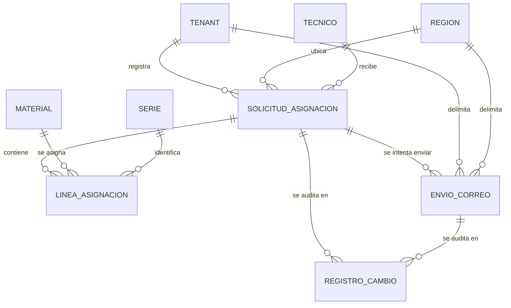

# Modelo de datos: 007 Envío y Revisión del Almacén

**Fase**: 1 | **Fecha**: 2026-11-12 | **Spec**:
`05-especificaciones/007-envio-y-revision-del-almacen/spec.md`

Este documento describe la entidad nueva, los campos agregados a `SolicitudAsignacion`, sus
restricciones, las transiciones de estado, el ciclo de intentos de correo, las consultas del
almacén y la trazabilidad de criterios. El detalle de servicios y firmas vive en `plan.md`; los
contratos HTTP y SSE en `contracts/`.

## Diagrama de relaciones



- `ENVIO_CORREO` es la única entidad nueva de 007.
- `SolicitudAsignacion` y `LineaAsignacion` pertenecen a 006; 007 solo agrega dos campos y cambia
  `estado`/`confirmada_en` mediante servicios.
- `SERIE`, `MATERIAL` y las tablas de `stock` no se duplican ni se recrean.

## Entidades

### `asignaciones.EnvioCorreo` (nueva)

Registro inmutable de cada intento de entrega del Excel al almacén de la región.

| Campo | Tipo | Nulo | Regla |
|---|---|---|---|
| `id` | `BigAutoField` | No | Clave primaria |
| `solicitud` | FK `SolicitudAsignacion` | No | `PROTECT`, `related_name="envios_correo"` |
| `tenant` | FK `tenants.Tenant` | No | `PROTECT`, `related_name="envios_correo"`; copiado de `solicitud.tenant` |
| `region` | FK `tenants.Region` | No | `PROTECT`, `related_name="envios_correo"`; copiado de `solicitud.region` |
| `numero_intento` | `PositiveIntegerField` | No | 1..`ENVIOS_MAX_INTENTOS` (4 por defecto) |
| `destinatario` | `EmailField` | No | `solicitud.region.almacen.buzon` al momento del intento |
| `archivo` | `CharField(255)` | No | Ruta relativa a `MEDIA_ROOT`; mismo Excel de 006 |
| `hash_sha256` | `CharField(64)` | No | 64 hex; igual a `solicitud.excel_hash` |
| `estado` | `CharField(20)` | No | `REINTENTANDO`, `EXITOSO`, `FALLIDO`; defecto `REINTENTANDO` |
| `error_mensaje` | `TextField` | No | `blank=True`, `default=""`; truncado, sin trazas ni credenciales |
| `creado_en` | `DateTimeField` | No | `auto_now_add`; instante de programación del intento |
| `enviado_en` | `DateTimeField` | Sí | Se fija al cerrar el intento como `EXITOSO` o `FALLIDO` |

**Restricciones**

- `UniqueConstraint(fields=["solicitud", "numero_intento"], name="envio_correo_intento_unico")`.
- `CheckConstraint(numero_intento__gte=1, name="envio_correo_numero_intento_positivo")`.
- `CheckConstraint(estado__in=["REINTENTANDO", "EXITOSO", "FALLIDO"], name="envio_correo_estado_valido")`.
- `Index(region, estado)`, `Index(tenant, creado_en)` e
  `Index(solicitud, numero_intento)`.
- `Meta.ordering = ["solicitud", "numero_intento"]`.

**Reglas de escritura**

- La fila se crea al **programar** el intento con `estado="REINTENTANDO"`.
- Se cierra **una sola vez**: `REINTENTANDO→EXITOSO` o `REINTENTANDO→FALLIDO`.
- Los campos de identidad (`solicitud`, `tenant`, `region`, `numero_intento`, `destinatario`,
  `archivo`, `hash_sha256`, `creado_en`) son inmutables.
- No se reutiliza un `numero_intento`; un nuevo intento es una fila nueva.
- No se guarda el cuerpo del correo, credenciales SMTP ni el binario del Excel.
- No se elimina: es evidencia de trazabilidad.

### `asignaciones.SolicitudAsignacion` (campos agregados por 007)

| Campo | Tipo | Nulo | Regla |
|---|---|---|---|
| `motivo_rechazo` | `TextField` | No | `blank=True`, `default=""`; obligatorio y no vacío al rechazar; máximo 1000 caracteres validado en servicio |
| `rechazada_en` | `DateTimeField` | Sí | Se fija al pasar a `RECHAZADA`; `null` en cualquier otro estado |

Campos de 006 que 007 escribe:

| Campo | Uso en 007 |
|---|---|
| `estado` | `ENVIADA→CONFIRMADA` o `ENVIADA→RECHAZADA`; nunca vuelve a `BORRADOR` |
| `confirmada_en` | Se fija en la confirmación; fuente de los días en mano de 006 |
| `actualizado_por` | Actor de la confirmación o del rechazo |
| `actualizado_en` | `auto_now` |

No se agregan `confirmada_por`, `rechazada_por` ni `version`: el actor queda en la auditoría y la
concurrencia se resuelve con `select_for_update` sobre `estado`.

## Transiciones de estado

```text
BORRADOR ── enviar (006) ─────────────▶ ENVIADA
BORRADOR ── cancelar (006) ───────────▶ CANCELADA
ENVIADA  ── confirmar (007) ──────────▶ CONFIRMADA
ENVIADA  ── rechazar (007) ───────────▶ RECHAZADA
```

- `CONFIRMADA`, `RECHAZADA` y `CANCELADA` son terminales.
- 007 solo acepta acciones desde `ENVIADA`; cualquier otro estado responde `409`.
- La confirmación y el rechazo se ejecutan en una transacción con bloqueo de la solicitud.
- No existe transición a `BORRADOR` ni borrado físico.

## Ciclo de intentos de correo

```text
solicitud ENVIADA
   │ on_commit (006)
   ▼
intento 1 REINTENTANDO ── éxito ──▶ EXITOSO  (fin)
   │ fallo
   ▼
intento 1 FALLIDO
   │ numero_intento < 4
   ▼
intento 2 REINTENTANDO  (countdown 300 s)
   │ ...
   ▼
intento 4 REINTENTANDO
   │ fallo
   ▼
intento 4 FALLIDO  → fallo definitivo → aviso al tenant
```

- Máximo 4 intentos: 1 inicial + 3 reintentos.
- Intervalo fijo de 300 segundos entre intentos.
- El fallo de correo **no** cambia el estado de la solicitud ni la saca de la bandeja.
- `envio_definitivo_fallido(solicitud)` es verdadero si el intento 4 está `FALLIDO` y no existe
  ningún intento `EXITOSO`. Es derivado, no se almacena.
- Un envío exitoso no impide que la solicitud siga operando; solo confirma que el almacén recibió
  el adjunto.

## Consultas principales

### Bandeja de despachos

- Filtra `SolicitudAsignacion.region = region` y `estado IN ("ENVIADA", "CONFIRMADA", "RECHAZADA")`.
- Filtro opcional por `estado` dentro de ese conjunto.
- Orden por `enviada_en` descendente y `id` descendente; página de 50.
- Totales:
  - `total_series = Count("lineas", filter=Q(lineas__serie__isnull=False))`.
  - `total_cantidad = Sum("lineas__cantidad", filter=Q(lineas__serie__isnull=True))`, con `0` si no
    hay líneas no seriadas.
- `select_related("tenant", "tecnico", "region")` y `prefetch_related("lineas__material",
  "lineas__serie")` en el detalle; nunca una consulta por fila.

### Contador de pendientes

- `SolicitudAsignacion.objects.filter(region=region, estado="ENVIADA").count()`.
- Alimenta el badge, el evento SSE y el fragmento de polling.
- Es la fuente de recuperación si el cliente pierde eventos.

### Búsqueda histórica

- Fuente: `SolicitudAsignacion.objects.filter(excel_ruta__gt="")`.
- Alcance `REGION`: además `region=region`; alcance `GLOBAL`: sin filtro de región.
- Filtros:
  - `fecha_desde` / `fecha_hasta` sobre `fecha`.
  - `tenant` por `tenant_id` validado dentro del alcance.
  - `tecnico` por `tecnico_id` validado dentro del alcance.
  - `estado` dentro de los cinco estados.
- Orden por `fecha` y `id` descendente; página de 50.
- Cada fila expone `solicitud.excel_hash` y el estado del último intento
  (`Subquery` sobre `EnvioCorreo` ordenado por `numero_intento` descendente).
- No se listan solicitudes sin Excel ni una fila por intento.

### Descarga

- La ruta se resuelve como `Path(MEDIA_ROOT) / solicitud.excel_ruta` y se verifica que quede dentro
  de `MEDIA_ROOT`.
- Se lee el archivo, se calcula SHA-256 y se compara con `solicitud.excel_hash` usando
  `hmac.compare_digest`.
- Si coincide: `200` con `application/vnd.openxmlformats-officedocument.spreadsheetml.sheet` y
  nombre `asignacion-<id>.xlsx`.
- Si no coincide: `409`, sin cuerpo binario y sin revelar la ruta.

## Auditoría

| Evento | Entidad / campo | Cuándo | Contenido |
|---|---|---|---|
| Confirmación | `SolicitudAsignacion/estado` | Transacción de confirmación | `ENVIADA→CONFIRMADA`, `confirmada_en`, actor |
| Rechazo | `SolicitudAsignacion/estado` | Transacción de rechazo | `ENVIADA→RECHAZADA`, `motivo_rechazo`, `rechazada_en`, actor |
| Rechazo | `SolicitudAsignacion/motivo_rechazo` | Transacción de rechazo | Valor nuevo (motivo), sin datos sensibles |
| Rechazo | `Serie/estado` | Transacción de rechazo | `RESERVADA→DISPONIBLE` por serie |
| Envío | `EnvioCorreo/estado` | Tarea de correo | `REINTENTANDO→EXITOSO` o `→FALLIDO`, `numero_intento`, destinatario, archivo, hash |
| Confirmación | `Serie/estado` y stock | 008, misma transacción | Lo escribe 008; 007 no lo duplica |

- Todos los registros usan `auditoria.services.registrar_cambio` y `RegistroCambio`.
- No se auditan contraseñas, tokens, secretos TOTP, credenciales SMTP ni el cuerpo del correo.
- La auditoría de la confirmación y del rechazo es síncrona y transaccional. La del envío ocurre en
  la tarea, después de cerrar el intento.

## RLS y aislamiento

- `asignaciones_enviocorreo` lleva `tenant_id` y `region_id` denormalizados.
- Si la infraestructura de 001 está disponible, `asignaciones/migrations/0004_envio_correo_rls.py`
  crea políticas por `tenant_id` y `region_id` usando las variables de sesión de
  `ContextoUsuarioMiddleware`.
- Si no está disponible, se registra la deuda en `research.md` y el ORM sigue filtrando por
  `region`/`tenant`.
- El rol de aplicación no es superusuario ni `BYPASSRLS`.
- La descarga y la búsqueda vuelven a validar el alcance en el servicio, aunque RLS esté activo.

## Trazabilidad de criterios de aceptación

| CA | Entidad / consulta | Evidencia |
|---|---|---|
| CA-01 | `EnvioCorreo` + correo `locmem` | Intento `EXITOSO` con destinatario, archivo y hash |
| CA-02 | `EnvioCorreo.numero_intento` / `estado` | Intentos 1..4, `FALLIDO` y `countdown=300` |
| CA-03 | `EnvioCorreo` | Destinatario, `creado_en`/`enviado_en`, archivo y `hash_sha256` |
| CA-04 | Consulta de bandeja | Filtro `region=region` |
| CA-05 | `notificaciones.flujo_eventos_region` | Evento SSE solo en el canal de la región |
| CA-06 | Detalle + descarga | Líneas, totales, hash y botón de descarga |
| CA-07 | `verificar_hash_excel` | Comparación SHA-256 antes de descargar |
| CA-08 | `confirmar_solicitud` + 008 | `CONFIRMADA`, `confirmada_en`, stock actualizado |
| CA-09 | `rechazar_solicitud` | `RECHAZADA`, motivo, series `DISPONIBLE`, aviso al tenant |
| CA-10 | Servicio de rechazo | `MotivoRechazoRequerido` si el motivo está vacío |
| CA-11 | Búsqueda histórica | Filtro por fecha, tenant, técnico y estado con hash |
| CA-12 | Descarga | `HashNoCoincide` → `409` y descarga bloqueada |
