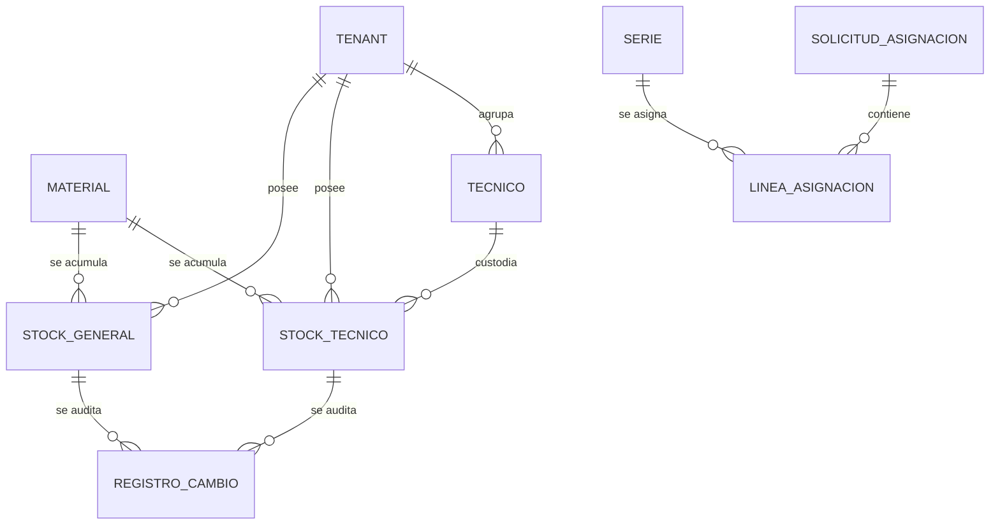

# Modelo de datos: 008 Confirmación y Actualización de Stock

**Fase**: 1 | **Fecha**: 2026-11-12 | **Spec**:
`05-especificaciones/008-confirmacion-y-actualizacion-de-stock/spec.md`

Este documento describe las entidades de stock, sus restricciones, el cálculo de disponibilidad, la
agregación de la confirmación, las transiciones de series, la auditoría y la trazabilidad de
criterios. El detalle de servicios y firmas vive en `plan.md`; los contratos internos en
`contracts/`.

## Diagrama de relaciones



- `STOCK_GENERAL` y `STOCK_TECNICO` son las entidades nuevas de 008.
- `SERIE`, `MATERIAL`, `TECNICO` y `SOLICITUD_ASIGNACION` son externas y no se duplican.
- No hay tabla de reservas: el reservado de no seriados se deriva de solicitudes `ENVIADA`.

## Entidades

### `stock.StockGeneral`

Stock total del tenant por material, antes de asignar a técnicos.

| Campo | Tipo | Nulo | Regla |
|---|---|---|---|
| `id` | `BigAutoField` | No | Clave primaria |
| `tenant` | FK `tenants.Tenant` | No | `PROTECT`, `related_name="stock_general"` |
| `material` | FK `materiales.Material` | No | `PROTECT`, `related_name="stock_general"` |
| `cantidad` | `IntegerField` | No | `default=0`; entero `>= 0` |

**Restricciones**

- `UniqueConstraint(fields=["tenant", "material"], name="stock_general_tenant_material_unico")`.
- `CheckConstraint(cantidad__gte=0, name="stock_general_cantidad_no_negativa")`.
- `Index(tenant, material)` para consultas y bloqueos.
- El lote no forma parte de la clave: el stock se acumula por tenant y material.

**Reglas**

- Suma de series `DISPONIBLE` y cantidades no seriadas del tenant.
- Solo sube con recojos registrados y devoluciones confirmadas; solo baja con asignaciones
  confirmadas.
- No se elimina; se ajusta con un movimiento auditado.
- Material seriado: cada serie cuenta 1. Material no seriado: cuenta la cantidad digitada.

### `stock.StockTecnico`

Custodia actual de un técnico por material.

| Campo | Tipo | Nulo | Regla |
|---|---|---|---|
| `id` | `BigAutoField` | No | Clave primaria |
| `tenant` | FK `tenants.Tenant` | No | `PROTECT`, `related_name="stock_tecnico"`; copiado de `tecnico.tenant` |
| `tecnico` | FK `tecnicos.Tecnico` | No | `PROTECT`, `related_name="stock_tecnico"` |
| `material` | FK `materiales.Material` | No | `PROTECT`, `related_name="stock_tecnico"` |
| `cantidad` | `IntegerField` | No | `default=0`; entero `>= 0` |

**Restricciones**

- `UniqueConstraint(fields=["tecnico", "material"], name="stock_tecnico_tecnico_material_unico")`.
- `CheckConstraint(cantidad__gte=0, name="stock_tecnico_cantidad_no_negativa")`.
- `Index(tenant, material)` y `Index(tecnico, material)` para consultas, bloqueos y RLS.

**Reglas**

- `tenant` es obligatorio porque toda tabla operativa lleva `tenant_id`; se copia de `tecnico.tenant`
  en el servicio y se rechaza si no coincide. Nunca se acepta del cliente.
- La clave lógica sigue siendo `(tecnico, material)`; un técnico pertenece a un solo tenant.
- Sube con asignaciones confirmadas, traspasos recibidos y stock inicial.
- Baja con devoluciones, traspasos enviados y bajas/recuperaciones.
- No se elimina; se ajusta con un movimiento auditado.

## Entidades externas consumidas

| Entidad | Dueña | Uso en 008 |
|---|---|---|
| `series.Serie` | 004 | `RESERVADA→ASIGNADA`; validación de estado, tenant y material. |
| `asignaciones.SolicitudAsignacion` | 006 | `estado="ENVIADA"`, `tenant`, `region`, `tecnico`, `confirmada_en`. 008 no lo modifica. |
| `asignaciones.LineaAsignacion` | 006 | `material`, `serie`, `cantidad`; origen de la agregación. |
| `tecnicos.Tecnico` | 003 | `tenant`, `nif`, `activo`; destinatario del stock. |
| `materiales.Material` | 002 | `codigo`, `es_seriado`, `lote`. |
| `tenants.Tenant` / `Region` | 001 | Alcance, bloqueo y RLS. |
| `auditoria.RegistroCambio` | 001 | Auditoría compartida e inmutable. |

## Cálculos

### Disponibilidad

```text
Reservado(tenant, material no seriado) = suma de LineaAsignacion.cantidad
    de solicitudes ENVIADA, con serie nula y mismo tenant/material

Disponible(tenant, material) = max(0, StockGeneral.cantidad - Reservado)
```

- Las series no se suman al reservado por cantidad: su reserva se refleja en `Serie.estado`.
- Un borrador, una solicitud confirmada, rechazada o cancelada no suman al reservado.
- Material sin `StockGeneral` tiene disponible `0`.
- `calcular_reservado` no crea filas ni modifica stock.

### Agregación de la confirmación

Para una solicitud `ENVIADA`:

```text
por material:
    cantidad_seriados = número de líneas con serie
    cantidad_no_seriados = suma de líneas con serie nula
    cantidad_total = cantidad_seriados + cantidad_no_seriados
```

- Cada serie suma 1 a `StockTecnico` y resta 1 de `StockGeneral`.
- Cada línea no seriada suma su `cantidad` a `StockTecnico` y la resta de `StockGeneral`.
- Se escribe una vez por material, no una vez por línea.
- El total del tenant se conserva: lo que baja del stock general sube al stock del técnico.

### Ejemplo

Solicitud con 5 series del material A y 50 unidades del material B:

| Material | Stock general antes | Stock técnico antes | Cambio | Stock general después | Stock técnico después |
|---|---|---|---|---|---|
| A (seriado) | 100 | 10 | +5 / −5 | 95 | 15 |
| B (no seriado) | 200 | 0 | +50 / −50 | 150 | 50 |

## Transiciones de estado

### Serie

```text
DISPONIBLE ── seleccionar (006) ──▶ RESERVADA
RESERVADA  ── confirmar (008) ───▶ ASIGNADA
RESERVADA  ── rechazar (007) ────▶ DISPONIBLE
ASIGNADA   ── devolución (011) ──▶ DISPONIBLE
```

- 008 solo ejecuta `RESERVADA→ASIGNADA` al confirmar.
- La transición es irreversible dentro de 008; para liberar se requiere devolución o traspaso.
- Una serie que no está `RESERVADA`, o que no pertenece al tenant/material, aborta la confirmación.
- No se crea otra tabla ni otro número de serie.

### Solicitud

008 **no** cambia el estado de la solicitud. 007 ejecuta `ENVIADA→CONFIRMADA` y fija
`confirmada_en` en la misma transacción. Si 008 falla, 007 revierte y la solicitud sigue `ENVIADA`.

## Resultado de la confirmación

`ResultadoConfirmacionStock` es un `dataclass` inmutable con:

| Campo | Tipo | Descripción |
|---|---|---|
| `solicitud_id` | int | Solicitud confirmada |
| `series_actualizadas` | list[int] | IDs de series `RESERVADA→ASIGNADA` |
| `cambios_por_material` | list[CambioStockMaterial] | Detalle por material |
| `confirmada_en` | datetime | Solo lectura, fijado por 007 |
| `total_series` | int | Series actualizadas |
| `total_cantidad` | int | Suma de no seriados |

`CambioStockMaterial` contiene `material_id`, `stock_general_anterior`, `stock_general_nuevo`,
`stock_tecnico_anterior` y `stock_tecnico_nuevo`.

## Consultas y bloqueos

### Confirmación

1. Leer la solicitud con `select_related("tenant", "tecnico")` y
   `prefetch_related("lineas__material", "lineas__serie")`.
2. Validar `estado == "ENVIADA"`, técnico del tenant, series `RESERVADA` y stock suficiente.
3. Bloquear `Tenant` con `select_for_update`.
4. Bloquear `StockGeneral` de los materiales afectados con
   `select_for_update().filter(tenant=..., material_id__in=...).order_by("material_id")`.
5. Bloquear/crear `StockTecnico` de los materiales afectados y del mismo `tenant`, ordenado por
   `material_id`.
6. Bloquear `Serie` de las líneas seriadas, ordenado por `id`.
7. Escribir series, stock y auditoría.

- Si falta una fila de stock, se crea con la cantidad resultante; si la cantidad resultante sería
  negativa, se lanza `StockInsuficiente` antes de crear.
- No se consulta ni se bloquea stock de materiales no afectados.
- No se hace una consulta por línea.

### Consultas de lectura

- `obtener_stock_general` y `obtener_stock_tecnico` devuelven `0` si no existe; no crean.
- `calcular_reservado` agrega con `Sum` y `filter`, sin N+1.
- `calcular_disponible` no escribe ni bloquea.

## Auditoría

| Evento | Entidad / campo | Cuándo | Contenido |
|---|---|---|---|
| Serie asignada | `Serie/estado` | Confirmación | `RESERVADA→ASIGNADA`, serie, material, técnico |
| Stock técnico | `StockTecnico/cantidad` | Confirmación | Material, valor anterior, valor nuevo |
| Stock general | `StockGeneral/cantidad` | Confirmación | Material, valor anterior, valor nuevo |
| Recojo | `StockGeneral/cantidad` | 004 | Material, valor anterior, valor nuevo |
| Stock inicial | `StockTecnico/cantidad` | 005 | Material, valor anterior, valor nuevo |
| Traspaso | `StockTecnico/cantidad` | 009 | Origen y destino, valor anterior y nuevo |

- Todos los registros usan `auditoria.services.registrar_cambio`.
- La auditoría de la confirmación es transaccional: si falla, se revierte todo.
- El actor es el usuario de la sesión que confirma.
- No se auditan secretos, tokens, contraseñas ni contenido binario.
- La auditoría del estado de la solicitud la escribe 007; 008 no la duplica.

## RLS y aislamiento

- `stock_general`: política por `tenant_id`.
- `stock_tecnico`: política por `tenant_id`, copiado y validado desde `tecnico.tenant`.
- Si la infraestructura RLS de 001 no está disponible, se registra la deuda en `research.md` y el
  ORM filtra por `tenant_id` y técnico.
- El rol de aplicación no es superusuario ni `BYPASSRLS`.
- Los servicios validan que el técnico y el material pertenezcan al tenant de la solicitud; no
  aceptan `tenant_id` del cliente.

## Trazabilidad de criterios de aceptación

| CA | Entidad / servicio | Evidencia |
|---|---|---|
| CA-01 | `Serie.estado` | Series de la solicitud pasan a `ASIGNADA` |
| CA-02 | `StockTecnico.cantidad` | Técnico 10 + 5 series = 15 |
| CA-03 | `StockGeneral.cantidad` | Tenant 100 − 5 series = 95 |
| CA-04 | Transacción | Fallo en stock técnico revierte stock general, series y auditoría |
| CA-05 | `SolicitudAsignacion.confirmada_en` | Días en mano calculados por 006 desde la confirmación |
| CA-06 | `RegistroCambio` | Serie, stock técnico y stock general auditados |
| CA-07 | `StockGeneral`/`StockTecnico` | 50 no seriados: técnico +50, general −50 |
