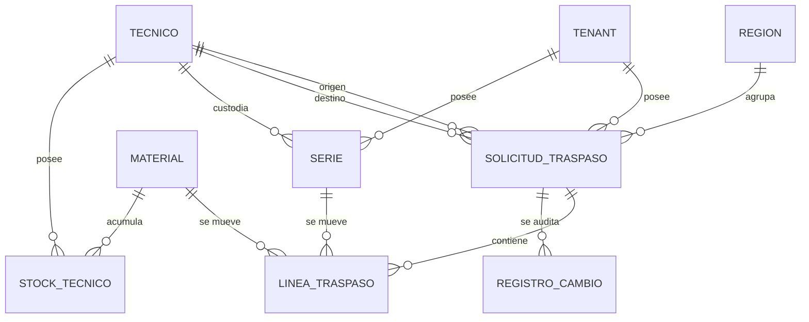

# Modelo de datos: 009 Traspaso entre Técnicos

**Fase**: 1 | **Fecha**: 2026-11-12 | **Spec**:
`05-especificaciones/009-traspaso-entre-tecnicos/spec.md`

Describe las entidades del traspaso, la custodia de series, las reservas derivadas, el cuadre, las
transiciones y la trazabilidad. El detalle de servicios está en `plan.md`; los contratos en
`contracts/`.

## Diagrama de relaciones



- `SOLICITUD_TRASPASO`, `LINEA_TRASPASO` son nuevas.
- `SERIE`, `STOCK_TECNICO`, `TECNICO` y `MATERIAL` son externas; 009 solo cambia la custodia de
  `SERIE` y usa los servicios de `STOCK_TECNICO`.
- `STOCK_GENERAL` no aparece: 009 no lo lee ni lo escribe.
- No hay tabla de reservas: se derivan de `SOLICITUD_TRASPASO.estado=ENVIADA`.

## Entidades

### `traspasos.SolicitudTraspaso`

| Campo | Tipo | Nulo | Regla |
|---|---|---|---|
| `id` | `BigAutoField` | No | Clave primaria |
| `tenant` | FK `tenants.Tenant` | No | `PROTECT`, `related_name="solicitudes_traspaso"`; inmutable |
| `region` | FK `tenants.Region` | No | `PROTECT`, `related_name="solicitudes_traspaso"`; copiada de `tenant.region`; inmutable |
| `tecnico_origen` | FK `tecnicos.Tecnico` | No | `PROTECT`, `related_name="traspasos_origen"`; inmutable |
| `tecnico_destino` | FK `tecnicos.Tecnico` | No | `PROTECT`, `related_name="traspasos_destino"`; inmutable |
| `fecha` | `DateField` | No | Fecha del traspaso; por defecto hoy |
| `estado` | `CharField(20)` | No | `BORRADOR`, `ENVIADA`, `CONFIRMADA`, `RECHAZADA`, `CANCELADA`; default `BORRADOR` |
| `motivo_rechazo` | `TextField` | No | `blank=True, default=""`; solo al rechazar; máximo 1000 |
| `excel_ruta` | `CharField(255)` | No | `blank=True, default=""`; ruta relativa |
| `excel_hash` | `CharField(64)` | No | `blank=True, default=""`; SHA-256 |
| `creado_por` | FK `acceso.Usuario` | No | `PROTECT`, `related_name="traspasos_creados"` |
| `creado_en` | `DateTimeField` | No | `auto_now_add` |
| `enviada_en` | `DateTimeField` | Sí | Se fija al enviar |
| `confirmada_en` | `DateTimeField` | Sí | Se fija al confirmar |
| `rechazada_en` | `DateTimeField` | Sí | Se fija al rechazar |
| `cancelada_en` | `DateTimeField` | Sí | Se fija al cancelar |
| `actualizado_por` | FK `acceso.Usuario` | Sí | `PROTECT`, `related_name="+"` |
| `actualizado_en` | `DateTimeField` | No | `auto_now` |

**Restricciones**

- `CheckConstraint(~Q(tecnico_origen=F("tecnico_destino")), name="solicitud_traspaso_origen_destino_distintos")`.
- `CheckConstraint(estado__in=[...], name="solicitud_traspaso_estado_valido")`.
- La coherencia estado/fecha (`ENVIADA` exige `enviada_en`, etc.) se valida en el servicio y se
  prueba; no se impone con una restricción condicional múltiple para no duplicar la máquina de
  estados.
- La pertenencia de ambos técnicos al `tenant` se valida en el servicio; no se puede expresar con un
  `CheckConstraint` entre tablas.

**Índices**

- `(tenant, estado)`, `(region, estado)`, `(tenant, fecha)`, `(tecnico_origen, fecha)`,
  `(tecnico_destino, fecha)`.

**Reglas**

- `tenant` y `region` salen de la sesión y de `tenant.region`; nunca del cliente.
- `tecnico_origen` y `tecnico_destino` son distintos y del mismo tenant.
- El destino debe estar activo; el origen puede estar inactivo si aún tiene stock.
- Solo `BORRADOR` se edita, envía o cancela; solo `ENVIADA` se confirma o rechaza.
- No se elimina; se conserva con su estado terminal.

### `traspasos.LineaTraspaso`

| Campo | Tipo | Nulo | Regla |
|---|---|---|---|
| `id` | `BigAutoField` | No | Clave primaria |
| `tenant` | FK `tenants.Tenant` | No | `PROTECT`, `related_name="lineas_traspaso"`; copiado de la solicitud |
| `solicitud` | FK `SolicitudTraspaso` | No | `CASCADE`, `related_name="lineas"` |
| `material` | FK `materiales.Material` | No | `PROTECT`, `related_name="lineas_traspaso"`; inmutable |
| `lote` | `CharField(50)` | No | `blank=True, default=""`; copia de `material.lote` |
| `serie` | FK `series.Serie` | Sí | `PROTECT`, `related_name="lineas_traspaso"`; nullable para no seriados |
| `cantidad` | `IntegerField` | No | `default=0`; `>0` para no seriados, `1` para seriados |

**Restricciones**

- `CheckConstraint(Q(serie__isnull=False) | Q(cantidad__gt=0), name="linea_traspaso_serie_o_cantidad")`.
- `CheckConstraint(Q(serie__isnull=True) | Q(cantidad=1), name="linea_traspaso_serie_cantidad_uno")`.
- `CheckConstraint(Q(cantidad__gte=0), name="linea_traspaso_cantidad_no_negativa")`.
- `UniqueConstraint(fields=["solicitud","serie"], condition=Q(serie__isnull=False), name="linea_traspaso_serie_unica")`.
- `UniqueConstraint(fields=["solicitud","material"], condition=Q(serie__isnull=True), name="linea_traspaso_no_seriada_unica")`.

**Índices**

- `(solicitud, material)`, `(tenant, material)`, `(serie)`.

**Reglas**

- `tenant` se copia de `solicitud.tenant`; no se acepta del cliente.
- Para seriados, `serie` no es nula y `cantidad=1`; la serie debe estar `ASIGNADA` al origen.
- Para no seriados, `serie` es nula y `cantidad>0`; varias filas se agregan en una sola línea por
  material.
- No hay dirección: todas las líneas se mueven del origen al destino.
- No se edita una línea fuera de `BORRADOR`.
- No se elimina una línea confirmada; el histórico permanece.

### `series.Serie` (campos añadidos)

| Campo | Tipo | Nulo | Regla |
|---|---|---|---|
| `tecnico` | FK `tecnicos.Tecnico` | Sí | `PROTECT`, `related_name="series"`; custodio actual |
| `asignada_en` | `DateTimeField` | Sí | Inicio de la custodia actual; se reinicia al traspasar |

**Restricciones**

- `CheckConstraint(Q(estado="ASIGNADA", tecnico__isnull=False, asignada_en__isnull=False) | (Q(estado__in=["DISPONIBLE","RESERVADA","INSTALADA","INACTIVA"]) & Q(tecnico__isnull=True) & Q(asignada_en__isnull=True)), name="serie_tecnico_coherente_estado")`; `INSTALADA` la agrega 010 e `INACTIVA` 011.
- `tecnico.tenant_id == serie.tenant_id` se valida en el servicio.
- `Index(tecnico, estado)` y `Index(tecnico, material)`.

**Reglas**

- 004 crea `DISPONIBLE` con ambos nulos.
- 005 crea `ASIGNADA` con `tecnico` y `asignada_en` de la línea de stock inicial.
- 008 confirma una asignación y fija `tecnico`/`asignada_en`.
- 009 confirma un traspaso, cambia `tecnico` al destino y reinicia `asignada_en`; el estado sigue
  `ASIGNADA`.
- 011 devuelve a `DISPONIBLE` y limpia ambos.
- No cambia tenant, región ni material.

### Entidades externas consumidas

| Entidad | Dueña | Uso en 009 |
|---|---|---|
| `series.Serie` | 004 | Identidad, estado y custodia; 009 cambia `tecnico`/`asignada_en`. |
| `stock.StockTecnico` | 008 | Disponibilidad y actualización de stock de ambos técnicos. |
| `stock.StockGeneral` | 008 | **No se lee ni se escribe.** |
| `tecnicos.Tecnico` | 003 | Origen/destino, tenant y estado activo. |
| `materiales.Material` | 002 | Catálogo, lote y tipo seriado. |
| `asignaciones.SolicitudAsignacion` | 006/007 | Historial de asignaciones; no se modifica. |
| `auditoria.RegistroCambio` | 001 | Auditoría compartida. |

## Cálculos

### Disponibilidad del técnico

```text
Reservado(tecnico, material) =
    cantidad de líneas seriadas de solicitudes ENVIADA del técnico y material
  + suma de cantidad de líneas no seriadas de solicitudes ENVIADA del técnico y material

Disponible(tecnico, material) = max(0, StockTecnico.cantidad - Reservado(tecnico, material))
```

- Solo cuenta `ENVIADA`; `BORRADOR`, `CONFIRMADA`, `RECHAZADA` y `CANCELADA` no reservan.
- Para seriados, además de la cantidad, se valida serie por serie que esté `ASIGNADA` al origen y que
  no esté referenciada por otra solicitud `ENVIADA`.
- Material sin `StockTecnico` devuelve `0`.

### Cuadre

```text
Salida  = proyección de la lista canónica de líneas (Z32)
Entrada = proyección de la misma lista canónica (Z31)

Por serie:
    misma cantidad de series, cada serie exactamente una vez en ambos lados

Por material no seriado:
    suma de cantidades de salida == suma de cantidades de entrada
```

- La lista canónica es la única fuente; las proyecciones se comparan antes de generar el Excel y al
  confirmar.
- Una serie que sale y no entra, una cantidad distinta, un material o lote distinto, una línea extra o
  faltante produce `CuadreIncorrecto`.

### Ejemplo

Solicitud con 3 series del material A y 20 unidades del material B:

| Material | Stock origen antes | Stock destino antes | Cambio | Origen después | Destino después | Stock general |
|---|---|---|---|---|---|---|
| A (seriado) | 10 | 5 | −3 / +3 | 7 | 8 | Sin cambio |
| B (no seriado) | 50 | 10 | −20 / +20 | 30 | 30 | Sin cambio |

## Transiciones de estado

### Solicitud de traspaso

```text
BORRADOR ── enviar ──▶ ENVIADA ── confirmar ──▶ CONFIRMADA
   │                       └──── rechazar ────▶ RECHAZADA
   └── cancelar ─────────────────────────────▶ CANCELADA
```

- `BORRADOR`: se puede editar, enviar o cancelar; no reserva ni genera Excel.
- `ENVIADA`: reserva derivada activa; se puede confirmar o rechazar.
- `CONFIRMADA`: series en el destino, stock técnico movido, `asignada_en` reiniciado; terminal.
- `RECHAZADA`: sin cambios de custodia ni stock; motivo obligatorio; terminal.
- `CANCELADA`: solo desde `BORRADOR`; sin cambios; terminal.

### Serie

```text
DISPONIBLE ── reserva 006 ──▶ RESERVADA ── confirmación 008 ──▶ ASIGNADA (tecnico, asignada_en)
ASIGNADA ── traspaso 009 ──▶ ASIGNADA (nuevo tecnico, asignada_en reiniciado)
ASIGNADA ── devolución 011 ──▶ DISPONIBLE (tecnico=null, asignada_en=null)
```

- 009 nunca cambia el estado de la serie; solo su custodio y la fecha de inicio de custodia.
- Una serie solo se traspasa si está `ASIGNADA` al origen.

## Consultas y bloqueos

### Creación o edición de borrador

1. Validar rol, tenant y técnicos.
2. Cargar líneas y materiales.
3. Validar disponibilidad y cuadre.
4. `transaction.atomic`: crear/actualizar solicitud y líneas; auditar.
5. No bloquear series ni stock: el borrador no reserva.

### Envío

1. Bloquear la solicitud con `select_for_update`.
2. Bloquear el `Tenant`.
3. Bloquear `StockTecnico` de origen y destino por `(material_id, tecnico_id)` ascendente.
4. Bloquear las series afectadas por `id` ascendente.
5. Revalidar series, disponibilidad y cuadre dentro del bloqueo.
6. Cambiar a `ENVIADA`, generar Excel, guardar ruta/hash y auditar.

### Confirmación

1. Bloquear la solicitud.
2. Bloquear el `Tenant`.
3. Bloquear `StockTecnico` de ambos técnicos por `(material_id, tecnico_id)`.
4. Bloquear las series por `id`.
5. Revalidar que cada serie siga `ASIGNADA` al origen.
6. Cambiar `tecnico`/`asignada_en` de cada serie.
7. Decrementar/incrementar `StockTecnico` con los servicios de 008.
8. Cambiar a `CONFIRMADA` y auditar.

### Rechazo y cancelación

1. Bloquear la solicitud.
2. Validar estado y motivo.
3. Cambiar estado y auditar; no tocar series ni stock.

### Consultas de lectura

- `listar_traspasos` filtra por tenant y ordena por fecha descendente.
- `obtener_traspaso` filtra por tenant; `obtener_traspaso_almacen` por región.
- `series_disponibles_para_traspaso` filtra por técnico, material, estado y exclusión de reservas.
- Las consultas no crean ni bloquean.

## Excel

- Dos hojas: `Desasignación` (Z32, NIF origen) y `Asignación` (Z31, NIF destino).
- Metadatos: movimiento, Centro, Almacén, NIF, fecha, tenant, región e ID.
- Tabla de seriales: código, descripción, lote, serie y cantidad 1.
- Tabla de material menor: código, descripción, lote y cantidad agregada.
- Generado al enviar; almacenado con ruta relativa y hash SHA-256.
- Descarga verificando hash; si no coincide, `HashNoCoincide`.
- No se guarda el binario en la base ni se audita su contenido.

## Auditoría

| Evento | Entidad / campo | Cuándo | Contenido |
|---|---|---|---|
| Alta de traspaso | `SolicitudTraspaso/alta` | Crear | Tenant, técnicos, fecha, actor |
| Alta de línea | `LineaTraspaso/alta` | Crear/editar | Material, serie o cantidad |
| Baja de línea | `LineaTraspaso/baja` | Editar borrador | Línea eliminada |
| Envío | `SolicitudTraspaso/estado` | Enviar | `BORRADOR→ENVIADA` |
| Excel | `SolicitudTraspaso/excel` | Enviar | Ruta relativa y hash |
| Confirmación | `SolicitudTraspaso/estado` | Confirmar | `ENVIADA→CONFIRMADA` |
| Serie | `Serie/tecnico` | Confirmar | Técnico anterior y nuevo |
| Días en mano | `Serie/asignada_en` | Confirmar | Fecha anterior y nueva |
| Stock origen | `StockTecnico/cantidad` | Confirmar | Lo escribe 008 |
| Stock destino | `StockTecnico/cantidad` | Confirmar | Lo escribe 008 |
| Rechazo | `SolicitudTraspaso/estado` | Rechazar | `ENVIADA→RECHAZADA` |
| Motivo | `SolicitudTraspaso/motivo_rechazo` | Rechazar | Motivo |
| Cancelación | `SolicitudTraspaso/estado` | Cancelar | `BORRADOR→CANCELADA` |

- Todo en la misma transacción; si falla, se revierte.
- Actor de la sesión; nunca inventado.
- Sin secretos, binarios, rutas absolutas ni datos de otro tenant.

## RLS y aislamiento

- `traspasos_solicitudtraspaso`: por `tenant_id` y `region_id`.
- `traspasos_lineatraspaso`: por `tenant_id`.
- `series_serie`: ya tiene RLS por `tenant_id` en 004; 009 no la duplica.
- Si la infraestructura de 001 no está disponible, se registra la deuda y el ORM filtra por
  tenant/región.
- El rol de aplicación no es superusuario ni `BYPASSRLS`.

## Trazabilidad de criterios de aceptación

| CA | Entidad / servicio | Evidencia |
|---|---|---|
| CA-01 | `SolicitudTraspaso` + Excel | Dos hojas generadas para dos técnicos del mismo tenant |
| CA-02 | `validar_tecnicos` + `CheckConstraint` | Origen igual a destino se rechaza |
| CA-03 | `calcular_disponible_tecnico` | 15 sobre 10 se rechaza por insuficiente |
| CA-04 | `validar_cuadre_traspaso` | Serie que sale y no entra se rechaza |
| CA-05 | `validar_cuadre_traspaso` | 50 que salen y 40 que entran se rechaza |
| CA-06 | `Serie.tecnico` | Tras confirmar, las series apuntan al destino |
| CA-07 | `rechazar_traspaso` | Tras rechazar, las series siguen en el origen |
| CA-08 | `StockGeneral` | Sin cambios en todo el ciclo |
| CA-09 | `Serie.asignada_en` | Se reinicia al confirmar el traspaso |
