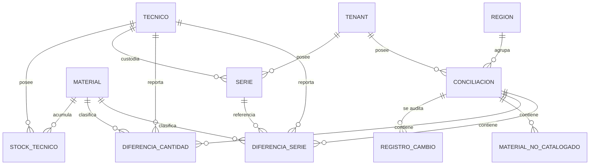

# Modelo de datos: 010 Conciliación de Stock

**Fase**: 1 | **Fecha**: 2026-11-12 | **Spec**:
`05-especificaciones/010-conciliacion-de-stock/spec.md`

Describe las entidades de la conciliación, las diferencias persistidas, el estado terminal de series,
la huella de stock, el algoritmo de aprobación y la trazabilidad. El detalle de servicios está en
`plan.md`; los contratos en `contracts/`.

## Diagrama de relaciones



- `CONCILIACION`, `DIFERENCIA_SERIE`, `DIFERENCIA_CANTIDAD` y `MATERIAL_NO_CATALOGADO` son nuevas.
- `SERIE` y `STOCK_TECNICO` son externas; 010 crea/reasigna/instala series y ajusta stock técnico.
- `STOCK_GENERAL` no aparece: 010 no lo lee ni lo escribe.
- No hay tabla de ajustes: los cambios quedan en las entidades y en la auditoría.

## Entidades

### `conciliaciones.Conciliacion`

| Campo | Tipo | Nulo | Regla |
|---|---|---|---|
| `id` | `BigAutoField` | No | Clave primaria |
| `tenant` | FK `tenants.Tenant` | No | `PROTECT`, `related_name="conciliaciones"`; inmutable |
| `region` | FK `tenants.Region` | No | `PROTECT`, `related_name="conciliaciones"`; copiada de `tenant.region` |
| `estado` | `CharField(20)` | No | `EN_REVISION`, `APROBADA`, `RECHAZADA`; default `EN_REVISION` |
| `archivo_nombre` | `CharField(255)` | No | Nombre original, solo `Path(nombre).name` |
| `archivo_ruta` | `CharField(255)` | No | `blank=True, default=""`; ruta relativa segura |
| `hash_sha256` | `CharField(64)` | No | SHA-256 del archivo original |
| `fecha_carga` | `DateTimeField` | No | `auto_now_add` |
| `fecha_aprobacion` | `DateTimeField` | Sí | Se fija al aprobar |
| `fecha_rechazo` | `DateTimeField` | Sí | Se fija al rechazar |
| `motivo_rechazo` | `TextField` | No | `blank=True, default=""`; opcional |
| `huella_stock` | `CharField(64)` | No | Huella canónica del stock/series afectados |
| `requiere_revision` | `BooleanField` | No | `default=False`; se activa tras un recálculo por cambios |
| `ajustes_aplicados` | `PositiveIntegerField` | No | `default=0`; total de series creadas/reasignadas/instaladas y ajustes de cantidad al aprobar |
| `creado_por` | FK `acceso.Usuario` | No | `PROTECT`, `related_name="conciliaciones_creadas"` |
| `aprobado_por` | FK `acceso.Usuario` | Sí | `PROTECT`, `related_name="conciliaciones_aprobadas"` |
| `actualizado_por` | FK `acceso.Usuario` | Sí | `PROTECT`, `related_name="+"` |
| `actualizado_en` | `DateTimeField` | No | `auto_now` |

**Restricciones**

- `UniqueConstraint(fields=["tenant"], condition=Q(estado="EN_REVISION"), name="conciliacion_una_en_revision_por_tenant")`.
- `CheckConstraint(estado__in=["EN_REVISION","APROBADA","RECHAZADA"], name="conciliacion_estado_valido")`.

**Índices**

- `(tenant, estado)`, `(region, fecha_carga)`.

**Reglas**

- `tenant` y `region` salen de la sesión y de `tenant.region`; nunca del cliente.
- Solo una `EN_REVISION` por tenant; las terminales no se reabren.
- `archivo_ruta` es relativa a `CONCILIACIONES_DIR`/`MEDIA_ROOT`; nunca absoluta.
- `huella_stock` se calcula al cargar y al aprobar.
- `requiere_revision=True` obliga a revisar antes de una nueva aprobación.
- No se elimina; se conserva con su archivo y sus diferencias.

### `conciliaciones.DiferenciaSerie`

| Campo | Tipo | Nulo | Regla |
|---|---|---|---|
| `id` | `BigAutoField` | No | Clave primaria |
| `tenant` | FK `tenants.Tenant` | No | `PROTECT`, `related_name="diferencias_serie"` |
| `conciliacion` | FK `Conciliacion` | No | `CASCADE`, `related_name="diferencias_series"` |
| `tecnico` | FK `tecnicos.Tecnico` | No | `PROTECT`; técnico del reporte (tenant) |
| `material` | FK `materiales.Material` | No | `PROTECT`; material del catálogo |
| `numero` | `CharField(12)` | No | Serie normalizada `^[A-Z0-9]{12}$` |
| `tipo` | `CharField(24)` | No | `EN_REPORTE_NO_SISTEMA`, `EN_SISTEMA_NO_REPORTE`, `EN_OTRO_TECNICO` |
| `tecnico_sistema` | FK `tecnicos.Tecnico` | Sí | `PROTECT`; técnico actual, solo para `EN_OTRO_TECNICO` |
| `lote` | `CharField(50)` | No | `blank=True, default=""`; copia del reporte |

**Restricciones**

- `UniqueConstraint(fields=["conciliacion","tipo","numero"], name="diferencia_serie_unica_por_tipo")`.
- `CheckConstraint` de formato de `numero`.
- `CheckConstraint` de `tipo` válido y `tecnico_sistema` coherente: nulo salvo `EN_OTRO_TECNICO`.

**Índices**

- `(conciliacion, tipo)`, `(tenant, numero)`.

**Reglas**

- `EN_REPORTE_NO_SISTEMA`: el número no existe en el sistema; se creará al aprobar.
- `EN_SISTEMA_NO_REPORTE`: serie `ASIGNADA` de un técnico presente que no aparece; se marcará
  `INSTALADA`.
- `EN_OTRO_TECNICO`: existe, pero con otro técnico; se reasignará.
- Una serie `INSTALADA` reportada no genera diferencia: rechaza el archivo con `SerieInstalada`.
- Una serie que pertenece a otro tenant rechaza el archivo con `SerieFueraTenant`; no se revela su
  propietario ni se reasigna.

### `conciliaciones.DiferenciaCantidad`

| Campo | Tipo | Nulo | Regla |
|---|---|---|---|
| `id` | `BigAutoField` | No | Clave primaria |
| `tenant` | FK `tenants.Tenant` | No | `PROTECT` |
| `conciliacion` | FK `Conciliacion` | No | `CASCADE` |
| `tecnico` | FK `tecnicos.Tecnico` | No | Técnico presente en el reporte |
| `material` | FK `materiales.Material` | No | Material no seriado |
| `cantidad_sistema` | `IntegerField` | No | `>= 0` |
| `cantidad_reporte` | `IntegerField` | No | `>= 0` |
| `diferencia` | `IntegerField` | No | `cantidad_reporte - cantidad_sistema` |

**Restricciones**

- `UniqueConstraint(fields=["conciliacion","tecnico","material"], name="diferencia_cantidad_unica")`.
- `CheckConstraint` de cantidades no negativas.

**Índices**

- `(conciliacion, tecnico)`, `(tenant, material)`.

**Reglas**

- Solo para materiales no seriados.
- Material ausente para un técnico presente: `cantidad_reporte=0`.
- Técnico ausente: no se genera diferencia ni se modifica.

### `conciliaciones.MaterialNoCatalogado`

| Campo | Tipo | Nulo | Regla |
|---|---|---|---|
| `id` | `BigAutoField` | No | Clave primaria |
| `tenant` | FK `tenants.Tenant` | No | `PROTECT` |
| `conciliacion` | FK `Conciliacion` | No | `CASCADE` |
| `codigo` | `CharField(50)` | No | Código del reporte |
| `descripcion` | `CharField(255)` | No | `blank=True, default=""` |
| `tecnico_nif` | `CharField(20)` | No | `blank=True, default=""` |
| `filas` | `PositiveIntegerField` | No | `default=0` |

**Restricciones**

- `UniqueConstraint(fields=["conciliacion","codigo"], name="material_no_catalogado_unico")`.

**Reglas**

- Se registra al cargar; no impide la carga.
- Bloquea la aprobación hasta que el material exista y se recalcule.

### `series.Serie` (estado terminal)

| Aspecto | Cambio |
|---|---|
| `EstadoSerie` | Añade `INSTALADA` |
| `CheckConstraint(serie_estado_valido)` | `DISPONIBLE`, `RESERVADA`, `ASIGNADA`, `INSTALADA` |
| Coherencia de custodia | `INSTALADA` exige `tecnico=None` y `asignada_en=None` |
| Transición | `ASIGNADA → INSTALADA` al aprobar una conciliación |
| Reversión | No vuelve al stock disponible; no se reasigna |

- `INSTALADA` es terminal y refleja la liquidación del equipo.
- 012 cuenta `INSTALADA` como liquidada/instalada.
- No se elimina la serie ni se duplica su número.

### Entidades externas consumidas

| Entidad | Dueña | Uso en 010 |
|---|---|---|
| `series.Serie` | 004 | Crear, reasignar y marcar `INSTALADA`; no se elimina. |
| `stock.StockTecnico` | 008 | Leer y ajustar cantidades; **nunca** `StockGeneral`. |
| `tecnicos.Tecnico` | 003 | NIF, tenant y región. |
| `materiales.Material` | 002 | Catálogo, lote y tipo seriado. |
| `tenants.Tenant` / `Region` | 001 | Alcance, RLS y región. |
| `auditoria.RegistroCambio` | 001 | Auditoría compartida. |

## Cálculos

### Huella de stock

```text
Huella = SHA-256(JSON canónico ordenado de:
    técnico_id, material_id, StockTecnico.cantidad,
    serie.numero, serie.estado, serie.tecnico_id
    para los técnicos presentes y sus materiales/series)
```

- Incluye solo los técnicos presentes del tenant (los que aparecen en el reporte).
- Se calcula al cargar y al aprobar; si cambia, se recalcula y se exige revisión.
- No incluye datos de otros tenants ni el stock general.

### Serie

```text
En reporte, no en sistema: numero no existe en Serie.
En sistema, no en reporte: Serie.estado=ASIGNADA, Serie.tecnico=presente y numero no está en el reporte.
En otro técnico: numero existe, Serie.tecnico != técnico del reporte.
```

### Cantidad no seriada

```text
cantidad_sistema = StockTecnico(tecnico, material).cantidad o 0
cantidad_reporte = suma de "Libre utilización" de las filas del técnico/material
diferencia = cantidad_reporte - cantidad_sistema
```

- Material ausente para un técnico presente: `cantidad_reporte=0`.
- Técnico ausente: no se compara.

### Ejemplo de aprobación

| Caso | Antes | Reporte | Después |
|---|---|---|---|
| Serie A en técnico 1 | `ASIGNADA`, técnico 1 | No aparece | `INSTALADA`, sin técnico |
| Serie B no existe | — | Técnico 2 | `ASIGNADA`, técnico 2, `asignada_en=hoy` |
| Serie C en técnico 1 | `ASIGNADA`, técnico 1 | Técnico 2 | `ASIGNADA`, técnico 2, `asignada_en=hoy` |
| Fungible X técnico 1 | 50 | 40 | 40 |
| Fungible Y técnico 1 | 10 | No aparece | 0 |

Stock general: sin cambios.

## Transiciones de estado

### Conciliación

```text
(no existe) ── cargar ──▶ EN_REVISION ── aprobar ──▶ APROBADA
                              │
                              ├── rechazar ──▶ RECHAZADA
                              └── recalcular ──▶ EN_REVISION (requiere_revision=True)
```

- `EN_REVISION`: se revisa, recalcula, aprueba o rechaza. Solo una por tenant.
- `APROBADA`: ajustes aplicados; terminal.
- `RECHAZADA`: sin cambios; terminal.
- Un recálculo no cambia de estado; actualiza diferencias y marca `requiere_revision`.

### Serie

```text
DISPONIBLE ── reserva 006 ──▶ RESERVADA ── confirmación 008 ──▶ ASIGNADA
ASIGNADA ── traspaso 009 ──▶ ASIGNADA (nuevo técnico)
ASIGNADA ── conciliación 010 ──▶ INSTALADA (sin custodia)
ASIGNADA ── devolución 011 ──▶ DISPONIBLE (sin custodia)
```

- `INSTALADA` no vuelve a `DISPONIBLE`; no se reasigna.
- 010 no cambia `DISPONIBLE`/`RESERVADA`.

## Consultas y bloqueos

### Carga

1. Validar cuenta y ausencia de otra `EN_REVISION`.
2. Leer el Excel; validar; clasificar técnicos; comparar; calcular huella.
3. Guardar archivo y hash.
4. `transaction.atomic`: crear conciliación, diferencias y materiales no catalogados; auditar.
5. No bloquear stock ni series; no escribir stock.

### Aprobación

1. Validar cuenta y `EN_REVISION`.
2. Calcular huella actual; si difiere, recalcular y lanzar `HuboCambios`.
3. Si hay materiales no catalogados, `AprobacionBloqueada`.
4. `transaction.atomic`:
   - Bloquear `Conciliacion`, `Tenant`.
   - Bloquear `StockTecnico` de técnicos afectados por `(material_id, tecnico_id)`.
   - Bloquear series por `id` (ordenadas).
   - Recalcular huella dentro del bloqueo; abortar si cambió.
   - Revalidar diferencias y materiales.
   - Aplicar series (crear, reasignar, instalar) y stock (target por material/técnico).
   - Cambiar a `APROBADA`; auditar.
5. No tocar `StockGeneral`.

### Rechazo

1. Bloquear la conciliación.
2. Validar `EN_REVISION`.
3. Cambiar a `RECHAZADA`, fijar fecha/motivo y auditar; no tocar series ni stock.

### Consultas de lectura

- `listar_conciliaciones` filtra por tenant y ordena por fecha descendente.
- `obtener_conciliacion` filtra por tenant; `404` si es ajena.
- `detalle_conciliacion` agrupa diferencias y alertas, sin N+1.
- `alertas_conciliacion` calcula categorías y técnicos con más diferencias.

## Auditoría

| Evento | Entidad / campo | Cuándo | Contenido |
|---|---|---|---|
| Alta | `Conciliacion/alta` | Cargar | Tenant, región, archivo, hash, actor |
| Archivo | `Conciliacion/archivo` | Cargar | Ruta relativa y hash |
| Recálculo | `Conciliacion/recalculo` | Recalcular | Motivo, conteos, `requiere_revision` |
| Cambios | `Conciliacion/hubo_cambios` | Aprobar con huella distinta | Huella anterior y nueva |
| Aprobación | `Conciliacion/estado` | Aprobar | `EN_REVISION→APROBADA`, fecha, actor |
| Rechazo | `Conciliacion/estado` | Rechazar | `EN_REVISION→RECHAZADA`, fecha, motivo |
| Serie creada | `Serie/alta` | Aprobar | Número, material, técnico |
| Serie instalada | `Serie/estado` | Aprobar | `ASIGNADA→INSTALADA` |
| Reasignación | `Serie/tecnico` | Aprobar | Técnico anterior y nuevo |
| Custodia | `Serie/asignada_en` | Aprobar | Fecha anterior y nueva |
| Stock | `StockTecnico/cantidad` | Aprobar | Lo escribe 008; valor anterior y nuevo |

- Todo en la misma transacción; si falla, se revierte.
- Actor de la sesión; nunca inventado.
- Sin secretos, binarios, rutas absolutas ni datos de otro tenant.

## RLS y aislamiento

- `conciliaciones_conciliacion`: por `tenant_id` y `region_id`.
- `conciliaciones_diferenciaserie`, `conciliaciones_diferenciacantidad` y
  `conciliaciones_materialnocatalogado`: por `tenant_id`.
- `series_serie` y `stock_stocktecnico`: RLS de sus specs; 010 no las duplica.
- Si la infraestructura de 001 no está disponible, se registra la deuda y el ORM filtra por
  tenant/región.
- El rol de aplicación no es superusuario ni `BYPASSRLS`.

## Trazabilidad de criterios de aceptación

| CA | Entidad / servicio | Evidencia |
|---|---|---|
| CA-01 | `crear_conciliacion` | Crea `EN_REVISION` sin modificar stock |
| CA-02 | Índice parcial | Segunda carga rechazada |
| CA-03 | `comparar_*` | Técnico ausente no genera diferencias ni ajustes |
| CA-04 | `comparar_cantidades` | Material ausente para técnico presente = 0 |
| CA-05 | `DiferenciaSerie` | Dos grupos visibles, con listado de series |
| CA-06 | `alertas_conciliacion` | Material ajeno, técnicos inconsistentes, series faltantes |
| CA-07 | `MaterialNoCatalogado` | Aprobación bloqueada hasta corregir el catálogo |
| CA-08 | `aprobar_conciliacion` | Una transacción; fallo revierte todo |
| CA-09 | Series y `StockTecnico` | Ajustados al reporte |
| CA-10 | `RegistroCambio` | Valor anterior y nuevo por ajuste |
| CA-11 | `huella_stock` | Cambio detectado; recalcula y exige revisar |
| CA-12 | `clasificar_tecnicos` | Técnico desconocido/fuera de región rechaza el archivo |
