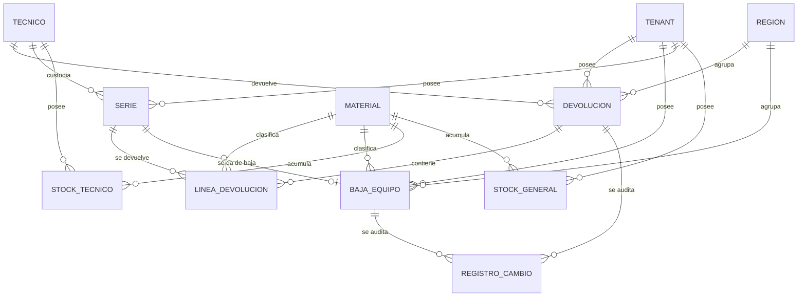

# Modelo de datos: 011 Logística Inversa y Devoluciones

**Fase**: 1 | **Fecha**: 2026-11-12 | **Spec**:
`05-especificaciones/011-logistica-inversa-y-devoluciones/spec.md`

Describe las entidades de devolución y baja, el estado terminal de series, los movimientos de stock,
el acta y la trazabilidad. El detalle de servicios está en `plan.md`; los contratos en `contracts/`.

## Diagrama de relaciones



- `DEVOLUCION`, `LINEA_DEVOLUCION` y `BAJA_EQUIPO` son nuevas.
- `SERIE`, `STOCK_TECNICO` y `STOCK_GENERAL` son externas; 011 las modifica con los servicios de 008.
- No se elimina ninguna serie; la baja conserva la fila.

## Entidades

### `logistica_inversa.Devolucion`

| Campo | Tipo | Nulo | Regla |
|---|---|---|---|
| `id` | `BigAutoField` | No | Clave primaria |
| `tenant` | FK `tenants.Tenant` | No | `PROTECT`, `related_name="devoluciones"`; inmutable |
| `region` | FK `tenants.Region` | No | `PROTECT`, `related_name="devoluciones"`; copiada de `tenant.region` |
| `tecnico` | FK `tecnicos.Tecnico` | No | `PROTECT`, `related_name="devoluciones"`; del tenant |
| `fecha` | `DateField` | No | Fecha de devolución; por defecto hoy; no futura |
| `observaciones` | `TextField` | No | `blank=True, default=""` |
| `acta_ruta` | `CharField(255)` | No | `blank=True, default=""`; ruta relativa |
| `acta_hash` | `CharField(64)` | No | `blank=True, default=""`; SHA-256 |
| `acta_generada_en` | `DateTimeField` | Sí | Se fija al generar el acta |
| `creado_por` | FK `acceso.Usuario` | No | `PROTECT`, `related_name="devoluciones_creadas"` |
| `creado_en` | `DateTimeField` | No | `auto_now_add` |

**Restricciones**

- `CheckConstraint` de fecha no futura no se puede expresar de forma portable; se valida en el
  servicio y se prueba.
- `tenant`/`region`/`tecnico` no cambian tras crear la devolución.

**Índices**

- `(tenant, fecha)`, `(region, fecha)`, `(tecnico, fecha)`.

**Reglas**

- `tenant` y `region` salen de la sesión; nunca del cliente.
- El técnico pertenece al tenant y a la región.
- El acta se genera al registrar; no se regenera.
- No se elimina; conserva líneas, acta y auditoría.

### `logistica_inversa.LineaDevolucion`

| Campo | Tipo | Nulo | Regla |
|---|---|---|---|
| `id` | `BigAutoField` | No | Clave primaria |
| `tenant` | FK `tenants.Tenant` | No | `PROTECT`, `related_name="lineas_devolucion"` |
| `devolucion` | FK `Devolucion` | No | `CASCADE`, `related_name="lineas"` |
| `serie` | FK `series.Serie` | No | `PROTECT`, `related_name="lineas_devolucion"` |
| `material` | FK `materiales.Material` | No | `PROTECT`; copiado de `serie.material` |
| `descripcion` | `CharField(255)` | No | Copia de `material.descripcion` para el acta |
| `lote` | `CharField(50)` | No | `blank=True, default=""`; copia de `serie.lote` |

**Restricciones**

- `UniqueConstraint(fields=["devolucion","serie"], name="linea_devolucion_serie_unica")`.
- `CheckConstraint` de formato no es necesario: la serie ya existe y su formato lo impone `Serie`.

**Índices**

- `(devolucion, serie)`, `(tenant, material)`, `(serie)`.

**Reglas**

- Una serie no se repite en la misma devolución.
- La serie debe estar `ASIGNADA` al técnico al crear la línea.
- No se edita ni se borra; es parte del documento histórico.

### `logistica_inversa.BajaEquipo`

| Campo | Tipo | Nulo | Regla |
|---|---|---|---|
| `id` | `BigAutoField` | No | Clave primaria |
| `tenant` | FK `tenants.Tenant` | No | `PROTECT`, `related_name="bajas_equipos"` |
| `region` | FK `tenants.Region` | No | `PROTECT`, copiada de `tenant.region` |
| `serie` | `OneToOneField(series.Serie)` | No | `PROTECT`, `related_name="baja"`; una baja por serie |
| `material` | FK `materiales.Material` | No | `PROTECT`; copiado de `serie.material` |
| `causa` | `CharField(20)` | No | `AVERIA`, `MIGRACION`, `OTRO` |
| `observaciones` | `TextField` | No | `blank=True, default=""` |
| `creado_por` | FK `acceso.Usuario` | No | `PROTECT`, `related_name="bajas_creadas"` |
| `creado_en` | `DateTimeField` | No | `auto_now_add` |

**Restricciones**

- `OneToOneField` garantiza una sola baja por serie.
- `CheckConstraint(causa__in=["AVERIA","MIGRACION","OTRO"], name="baja_causa_valida")`.

**Índices**

- `(tenant, causa)`, `(region, creado_en)`, `(serie)`.

**Reglas**

- La serie debe estar `ASIGNADA` o `DISPONIBLE`; no `RESERVADA`, `INSTALADA` ni `INACTIVA`.
- Si está `ASIGNADA`, se decrementa `StockTecnico`; si está `DISPONIBLE`, `StockGeneral`.
- La serie pasa a `INACTIVA`, con custodia nula.
- La causa es obligatoria y se conserva.
- No se elimina; conserva la trazabilidad de la baja.

### `series.Serie` (estado terminal `INACTIVA`)

| Aspecto | Cambio |
|---|---|
| `EstadoSerie` | Añade `INACTIVA` |
| `CheckConstraint(serie_estado_valido)` | `DISPONIBLE`, `RESERVADA`, `ASIGNADA`, `INSTALADA`, `INACTIVA` |
| Coherencia de custodia | `INACTIVA` exige `tecnico=None` y `asignada_en=None` |
| Transición | `ASIGNADA`/`DISPONIBLE → INACTIVA` |
| Reversión | No vuelve al stock; no se reasigna |

- `INACTIVA`: recuperación o baja por avería/migración.
- `INSTALADA`: liquidación por conciliación (010).
- Ambas son terminales y no se eliminan.

### Entidades externas consumidas

| Entidad | Dueña | Uso en 011 |
|---|---|---|
| `series.Serie` | 004 | Estado y custodia; 011 cambia estado y limpia técnico/fecha. |
| `stock.StockTecnico` | 008 | Devolución y baja de series en custodia. |
| `stock.StockGeneral` | 008 | Devolución suma; baja de serie disponible resta. |
| `tecnicos.Tecnico` | 003 | Técnico que devuelve. |
| `materiales.Material` | 002 | Código, descripción y lote para el acta. |
| `tenants.Tenant` / `Region` | 001 | Alcance, RLS y metadatos. |
| `auditoria.RegistroCambio` | 001 | Auditoría compartida. |

## Cálculos y movimientos

### Devolución

```text
Por cada serie devuelta:
    Serie.estado: ASIGNADA → DISPONIBLE
    Serie.tecnico: técnico → None
    Serie.asignada_en: fecha → None
    StockTecnico(tecnico, material) -= 1
    StockGeneral(tenant, material) += 1
```

- Agrupado por material para rendimiento y auditoría de stock.
- El total del tenant no cambia.
- La serie puede reasignarse después.

### Baja

```text
Si Serie.estado = ASIGNADA:
    StockTecnico(tecnico, material) -= 1
Si Serie.estado = DISPONIBLE:
    StockGeneral(tenant, material) -= 1

Serie.estado: ASIGNADA/DISPONIBLE → INACTIVA
Serie.tecnico: → None
Serie.asignada_en: → None
```

- Solo se descuenta el nivel donde estaba la serie.
- El total del tenant baja en 1 por serie.
- No se toca el otro nivel ni otro tenant.

### Ejemplo

| Caso | Serie antes | Stock antes | Movimiento | Serie después | Stock después |
|---|---|---|---|---|---|
| Devolución | ASIGNADA a LA0001 | Técnico 10, general 100 | Técnico −1, general +1 | DISPONIBLE | Técnico 9, general 101 |
| Baja de técnico | ASIGNADA a LA0001 | Técnico 10, general 100 | Técnico −1 | INACTIVA | Técnico 9, general 100 |
| Baja de general | DISPONIBLE | Técnico 10, general 100 | General −1 | INACTIVA | Técnico 10, general 99 |

## Transiciones de estado

### Serie

```text
DISPONIBLE ── asignación 006/008 ──▶ ASIGNADA
ASIGNADA ── devolución 011 ──▶ DISPONIBLE
ASIGNADA ── baja 011 ──▶ INACTIVA
DISPONIBLE ── baja 011 ──▶ INACTIVA
ASIGNADA ── conciliación 010 ──▶ INSTALADA
```

- `INACTIVA` no vuelve a `DISPONIBLE`; no se reasigna.
- Una serie `RESERVADA` no se devuelve ni se da de baja.
- 011 no cambia `INSTALADA`.

### Devolución y baja

No tienen estado propio: son registros históricos inmutables. Su efecto se refleja en `Serie` y en el
stock. No se editan ni se eliminan.

## Consultas y bloqueos

### Devolución

1. Validar cuenta, técnico, fecha y series.
2. `transaction.atomic`:
   - Bloquear `Tenant`.
   - Bloquear `StockGeneral` por `material_id`.
   - Bloquear `StockTecnico` del técnico por `material_id`.
   - Bloquear series por `id`.
   - Revalidar estado/custodia/reserva.
   - Crear devolución y líneas.
   - Cambiar series y ajustar stock.
   - Generar acta y auditar.

### Baja

1. Validar cuenta, serie, causa y estado.
2. `transaction.atomic`:
   - Bloquear `Tenant`.
   - Bloquear la fila de stock correspondiente (`StockGeneral` o `StockTecnico`).
   - Bloquear la serie.
   - Revalidar estado, custodia y stock.
   - Crear baja.
   - Ajustar stock y cambiar estado.
   - Auditar.

### Consultas de lectura

- `listar_devoluciones` filtra por tenant y fechas.
- `listar_bajas` filtra por tenant y causa.
- `obtener_*` filtra por tenant; `404` si es ajeno.
- No crean ni bloquean.

## Acta

- Una hoja; metadatos: tenant, región, fecha de generación, ID de devolución.
- Tabla: NIF, material, descripción, serie y fecha de devolución.
- Generada al registrar, no a demanda; inmutable.
- Guardada con nombre relativo y hash SHA-256.
- Descarga verificando hash; si no coincide, `HashNoCoincide`.
- No se guarda el binario en base ni se audita su contenido.
- Las bajas no generan acta en 011.

## Auditoría

| Evento | Entidad / campo | Cuándo | Contenido |
|---|---|---|---|
| Alta devolución | `Devolucion/alta` | Registrar | Tenant, región, técnico, fecha, total series |
| Alta línea | `LineaDevolucion/alta` | Registrar | Serie, material, lote |
| Acta | `Devolucion/acta` | Registrar | Ruta relativa y hash |
| Alta baja | `BajaEquipo/alta` | Registrar | Serie, material, causa, observaciones |
| Estado serie | `Serie/estado` | Ambas | Anterior y nuevo |
| Custodia | `Serie/tecnico` | Ambas | Técnico anterior y nuevo |
| Días en mano | `Serie/asignada_en` | Ambas | Fecha anterior y nueva |
| Stock técnico | `StockTecnico/cantidad` | Ambas | Lo escribe 008 |
| Stock general | `StockGeneral/cantidad` | Ambas | Lo escribe 008 |

- Todo en la misma transacción; si falla, se revierte.
- Actor de la sesión; nunca inventado.
- Sin secretos, binarios, rutas absolutas ni datos de otro tenant.

## RLS y aislamiento

- `logistica_inversa_devolucion`: por `tenant_id` y `region_id`.
- `logistica_inversa_lineadevolucion`: por `tenant_id`.
- `logistica_inversa_bajaequipo`: por `tenant_id` y `region_id`.
- `series_serie`, `stock_stocktecnico` y `stock_stockgeneral`: RLS de sus specs.
- Si 001 no está disponible, deuda registrada y filtrado ORM.
- El rol de aplicación no es superusuario ni `BYPASSRLS`.

## Trazabilidad de criterios de aceptación

| CA | Entidad / servicio | Evidencia |
|---|---|---|
| CA-01 | `registrar_devolucion` | Series salen del técnico y quedan `DISPONIBLE` |
| CA-02 | `Serie.estado` | Una serie devuelta puede asignarse a otro técnico |
| CA-03 | `BajaEquipo` | Serie con causa avería sale del stock y queda `INACTIVA` |
| CA-04 | `BajaEquipo` | Serie con causa migración sale del stock y queda `INACTIVA` |
| CA-05 | `generar_acta_devolucion` | Acta con series, técnico y fecha |
| CA-06 | `RegistroCambio` | Usuario, fecha, series y cambios de estado |
