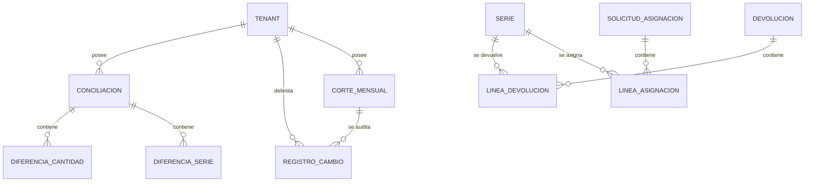

# Modelo de datos: 012 Reportes Mensuales

**Fase**: 1 | **Fecha**: 2026-11-12 | **Spec**:
`05-especificaciones/012-reportes-mensuales/spec.md`

Describe `CorteMensual`, los campos añadidos a auditoría y conciliación, las fórmulas de los totales,
el rango mensual, las exportaciones y la trazabilidad. El detalle de servicios está en `plan.md`; los
contratos en `contracts/`.

## Diagrama de relaciones



- `CORTE_MENSUAL` es la única entidad nueva.
- `REGISTRO_CAMBIO` y `CONCILIACION` reciben campos de apoyo.
- 012 no crea ni modifica stock, series, asignaciones ni devoluciones.

## Entidades

### `reportes.CorteMensual`

| Campo | Tipo | Nulo | Regla |
|---|---|---|---|
| `id` | `BigAutoField` | No | Clave primaria |
| `tenant` | FK `tenants.Tenant` | Sí | `PROTECT`, `related_name="cortes_mensuales"`; `NULL` = global |
| `anio` | `PositiveIntegerField` | No | 2000–2100 |
| `mes` | `PositiveSmallIntegerField` | No | 1–12 |
| `solicitados` | `PositiveIntegerField` | No | `default=0`; unidades solicitadas en el mes |
| `asignados` | `PositiveIntegerField` | No | `default=0`; unidades confirmadas en el mes |
| `liquidados_instalados` | `PositiveIntegerField` | No | `default=0`; series `INSTALADA` en el mes |
| `devueltos` | `PositiveIntegerField` | No | `default=0`; series devueltas en el mes |
| `no_justificado` | `PositiveIntegerField` | No | `default=0`; `max(0, asignados - liquidados - devueltos)` |
| `porcentaje_merma` | `DecimalField(5,2)` | No | `default=0`; 0–100 |
| `version` | `PositiveIntegerField` | No | `default=1`; aumenta al regenerar |
| `generado_por` | FK `acceso.Usuario` | No | `PROTECT`, `related_name="cortes_generados"` |
| `generado_en` | `DateTimeField` | No | `auto_now_add` |
| `actualizado_por` | FK `acceso.Usuario` | Sí | `PROTECT`, `related_name="+"` |
| `actualizado_en` | `DateTimeField` | No | `auto_now` |
| `regenerado_en` | `DateTimeField` | Sí | Última regeneración |

**Restricciones**

- `UniqueConstraint(fields=["tenant","anio","mes"], condition=Q(tenant__isnull=False), name="corte_tenant_anio_mes_unico")`.
- `UniqueConstraint(fields=["anio","mes"], condition=Q(tenant__isnull=True), name="corte_global_anio_mes_unico")`.
- `CheckConstraint(mes 1–12, name="corte_mes_valido")`.
- `CheckConstraint(anio 2000–2100, name="corte_anio_valido")`.
- `CheckConstraint(porcentaje_merma 0–100, name="corte_merma_valida")`.
- Los totales son `PositiveIntegerField`; no se aceptan negativos.

**Índices**

- `(tenant, anio, mes)`, `(anio, mes)`.

**Reglas**

- `tenant=None` es global; solo el Administrador lo genera/ve.
- Un corte por tenant/mes/año y uno global por mes/año.
- El corte guardado es una foto; regenerar actualiza y audita, manteniendo `version`.
- No se elimina; el histórico se conserva.

### `auditoria.RegistroCambio` (campo añadido)

| Campo | Tipo | Nulo | Regla |
|---|---|---|---|
| `tenant` | FK `tenants.Tenant` | Sí | `PROTECT`, `related_name="registros_cambio"`; nulo para acciones globales |

- Índice `(tenant, fecha)`.
- `registrar_cambio` lo puebla desde la entidad o el actor; si no puede determinarlo, `None`.
- Permite filtrar la exportación de auditoría por tenant.
- No cambia el resto de campos (`entidad`, `entidad_id`, `campo`, valores, usuario, fecha).

### `conciliaciones.Conciliacion` (campo añadido)

| Campo | Tipo | Nulo | Regla |
|---|---|---|---|
| `ajustes_aplicados` | `PositiveIntegerField` | No | `default=0`; total de series creadas/reasignadas/instaladas y ajustes de cantidad al aprobar |

- En `EN_REVISION`/`RECHAZADA` es `0`.
- 010 lo fija al aprobar; 012 solo lo lee.

### Entidades externas consumidas

| Entidad | Dueña | Uso en 012 |
|---|---|---|
| `asignaciones.SolicitudAsignacion` / `LineaAsignacion` | 006/007 | Solicitados y asignados |
| `series.Serie` / `EstadoSerie` | 004/010/011 | Liquidados/instalados; no se modifica |
| `logistica_inversa.Devolucion` / `LineaDevolucion` | 011 | Devueltos |
| `auditoria.RegistroCambio` | 001 | Exportación de auditoría |
| `conciliaciones.Conciliacion` | 010 | Exportación de conciliación |
| `tenants.Tenant` / `Region` | 001 | Alcance y RLS |

## Cálculos

### Rango del mes

```text
inicio = primer instante del mes/año en la zona configurada
fin    = primer instante del mes siguiente
filtro = [inicio, fin)
```

- Mes 1–12; año 2000–2100.
- Evita incluir el primer instante del mes siguiente.

### Unidades

```text
unidad(linea con serie)      = 1
unidad(linea sin serie)      = linea.cantidad
```

### Totales

```text
solicitados = suma de unidades de LineaAsignacion
              de solicitudes con fecha en el mes y estado
              ENVIADA, CONFIRMADA o RECHAZADA

asignados = suma de unidades de LineaAsignacion
            de solicitudes CONFIRMADA con confirmada_en en el mes

liquidados_instalados = cantidad de series distintas con
                        RegistroCambio entidad="Serie", campo="estado",
                        valor_nuevo="INSTALADA" y fecha en el mes

devueltos = cantidad de LineaDevolucion de devoluciones con fecha en el mes

no_justificado = max(0, asignados - liquidados_instalados - devueltos)
porcentaje_merma = 0 si asignados = 0
                   else round(no_justificado / asignados * 100, 2)
```

- Para un corte de tenant, todos los filtros incluyen `tenant_id`.
- Para un corte global, no se filtra por tenant.
- `INACTIVA` no se suma a liquidados/instalados; es baja y no forma parte de esta métrica.

### Ejemplo

| Concepto | Valor |
|---|---:|
| Solicitados | 120 |
| Asignados | 100 |
| Liquidados/instalados | 80 |
| Devueltos | 5 |
| No justificado | 15 |
| % merma | 15.00 |

## Transiciones

`CorteMensual` no tiene una máquina de estados; se crea una vez y puede regenerarse:

```text
(no existe) ── generar ──▶ versión 1
versión N ── regenerar ──▶ versión N+1
```

- Generar un corte ya existente falla con `CorteExistente`.
- Regenerar exige que el corte exista y actualiza los totales.
- No se elimina.

## Consultas y bloqueos

### Generación

1. Resolver alcance (tenant/global) y validar mes/año.
2. Verificar que no exista el corte.
3. Calcular totales con agregaciones.
4. `transaction.atomic`: crear `CorteMensual` y auditar.
5. No bloquear stock.

### Regeneración

1. Resolver alcance.
2. `transaction.atomic`: `select_for_update` del corte, recalcular, actualizar campos, `version += 1`,
   `regenerado_en`, `actualizado_por`; auditar.
3. No bloquear stock.

### Exportaciones

- Auditoría: `RegistroCambio` por `fecha` y `tenant`; orden por fecha/id; `openpyxl` en memoria.
- Conciliación: `Conciliacion` por `fecha_carga` y tenant; conteos de diferencias; `ajustes_aplicados`.
- No crean archivos ni bloquean.

### Consultas de lectura

- `listar_cortes`: tenant propio o global (admin).
- `obtener_corte`: filtra por alcance; `404` si es ajeno.
- `detalle_corte`: totales, versión y fechas.

## Exportaciones

### Auditoría

| Columna | Origen |
|---|---|
| Fecha | `RegistroCambio.fecha` |
| Usuario | `RegistroCambio.usuario` |
| Entidad | `RegistroCambio.entidad` |
| Acción | `RegistroCambio.campo` |
| Valor anterior | `RegistroCambio.valor_anterior` |
| Valor nuevo | `RegistroCambio.valor_nuevo` |

- Filtro por tenant (`tenant_id`) y mes.
- Global: todos los registros, incluidos los de tenant `NULL`.
- No incluye secretos; la auditoría ya los excluye.

### Conciliación

| Columna | Origen |
|---|---|
| Fecha | `Conciliacion.fecha_carga` |
| Estado | `Conciliacion.estado` |
| Tenant | `Conciliacion.tenant.codigo` (solo global) |
| Diferencias series | conteo de `DiferenciaSerie` |
| Diferencias cantidades | conteo de `DiferenciaCantidad` |
| Ajustes aplicados | `Conciliacion.ajustes_aplicados` |

- Filtro por tenant y mes de carga.
- Global: todos los tenants.

## Auditoría

| Evento | Entidad / campo | Cuándo | Contenido |
|---|---|---|---|
| Alta de corte | `CorteMensual/alta` | Generar | Alcance, mes, año, totales, actor |
| Regeneración | `CorteMensual/regenerado` | Regenerar | Valores anteriores/nuevos, versión, actor |

- No se audita el contenido de los Excel ni cada descarga.
- La auditoría de los datos de origen pertenece a sus specs.
- Sin secretos, binarios ni rutas.

## RLS y aislamiento

- `reportes_cortemensual`: por `tenant_id`; filas globales (`tenant_id IS NULL`) solo para Admin.
- `auditoria_registrocambio`: ya es global; la exportación filtra por `tenant_id` en el servicio.
- `conciliaciones_conciliacion`: RLS de 010.
- Si 001 no está disponible, deuda registrada y filtrado ORM.
- El rol de aplicación no es superusuario ni `BYPASSRLS`.

## Trazabilidad de criterios de aceptación

| CA | Entidad / servicio | Evidencia |
|---|---|---|
| CA-01 | `calcular_totales` + `CorteMensual` | Muestra solicitados, asignados, liquidados/instalados, devueltos y % merma |
| CA-02 | `calcular_totales` | 100 asignados, 80 liquidados y 5 devueltos = 15.00% |
| CA-03 | `exportar_auditoria` | Excel con todos los movimientos del mes |
| CA-04 | `exportar_conciliacion` | Excel con todas las conciliaciones del mes |
