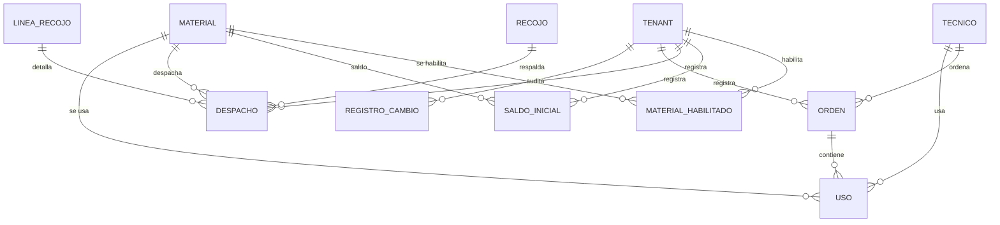

# Modelo de datos: 013 Registro de Materiales

**Fase**: 1 | **Fecha**: 2026-11-12 | **Spec**:
`05-especificaciones/013-registro-materiales/spec.md`

Describe el catálogo habilitado, los saldos, los despachos, las órdenes, los usos y el cálculo mensual.
El detalle de servicios está en `plan.md`; los contratos en `contracts/`.

## Diagrama de relaciones



- `MATERIAL_HABILITADO`, `SALDO_INICIAL`, `DESPACHO`, `ORDEN` y `USO` son nuevas.
- `MATERIAL`, `RECOJO`, `LINEA_RECOJO` y `TECNICO` son externas; no se modifican.
- No aparecen `STOCK_GENERAL`, `STOCK_TECNICO` ni `CONCILIACION`: 013 no las lee ni escribe.

## Entidades

### `registro_materiales.MaterialHabilitado`

| Campo | Tipo | Nulo | Regla |
|---|---|---|---|
| `id` | `BigAutoField` | No | Clave primaria |
| `tenant` | FK `tenants.Tenant` | No | `PROTECT`, `related_name="materiales_habilitados"` |
| `material` | FK `materiales.Material` | No | `PROTECT`, `related_name="habilitaciones"` |
| `activo` | `BooleanField` | No | `default=True` |
| `orden` | `PositiveIntegerField` | No | `default=0`; orden de presentación |
| `creado_por` | FK `acceso.Usuario` | No | `PROTECT`, `related_name="+"` |
| `creado_en` | `DateTimeField` | No | `auto_now_add` |
| `actualizado_por` | FK `acceso.Usuario` | Sí | `PROTECT`, `related_name="+"` |
| `actualizado_en` | `DateTimeField` | No | `auto_now` |

**Restricciones**

- `UniqueConstraint(fields=["tenant","material"], name="material_habilitado_unico")`.
- `Index(tenant, activo, orden)`, `Index(material)`.

**Reglas**

- Solo materiales del catálogo compartido; no se copian descripciones.
- Deshabilitar no borra; el historial se conserva.
- Un material inactivo no se ofrece para nuevas órdenes; sus usos históricos se muestran.

### `registro_materiales.SaldoInicialPeriodo`

| Campo | Tipo | Nulo | Regla |
|---|---|---|---|
| `id` | `BigAutoField` | No | Clave primaria |
| `tenant` | FK `Tenant` | No | `PROTECT` |
| `material` | FK `Material` | No | `PROTECT` |
| `periodo` | `CharField(7)` | No | `^[0-9]{4}-(0[1-9]|1[0-2])$` |
| `cantidad` | `PositiveIntegerField` | No | `>=0` |
| `creado_por` | FK `Usuario` | No | `PROTECT` |
| `creado_en` | `DateTimeField` | No | `auto_now_add` |
| `actualizado_por` | FK `Usuario` | Sí | `PROTECT` |
| `actualizado_en` | `DateTimeField` | No | `auto_now` |

**Restricciones**

- `UniqueConstraint(fields=["tenant","material","periodo"], name="saldo_inicial_unico")`.
- `CheckConstraint(cantidad >= 0)`.
- `CheckConstraint(periodo regex, name="saldo_periodo_valido")`.
- Índices `(tenant, material, periodo)` y `(tenant, periodo)`.

**Reglas**

- Un saldo manual por mes/material; si existe, prevalece.
- Si no existe, el saldo inicial es el final del mes anterior.
- Si no hay datos anteriores, 0.
- La edición se audita con valor anterior y nuevo.

### `registro_materiales.DespachoAlmacen`

| Campo | Tipo | Nulo | Regla |
|---|---|---|---|
| `id` | `BigAutoField` | No | Clave primaria |
| `tenant` | FK `Tenant` | No | `PROTECT` |
| `material` | FK `Material` | No | `PROTECT`; debe ser el de la línea |
| `recojo` | FK `recojos.Recojo` | No | `PROTECT`; del tenant |
| `recojo_linea` | FK `recojos.LineaRecojo` | No | `PROTECT`; del recojo |
| `fecha` | `DateField` | No | Define el periodo |
| `cantidad` | `PositiveIntegerField` | No | `>=0`; 0 no suma |
| `creado_por` | FK `Usuario` | No | `PROTECT` |
| `creado_en` | `DateTimeField` | No | `auto_now_add` |
| `actualizado_por` | FK `Usuario` | Sí | `PROTECT` |
| `actualizado_en` | `DateTimeField` | No | `auto_now` |

**Restricciones**

- `CheckConstraint(cantidad >= 0)`.
- Índices `(tenant, fecha)`, `(tenant, material, fecha)`, `(recojo_linea)`.

**Reglas**

- `recojo.tenant == tenant`; `recojo_linea.recojo == recojo`; `recojo_linea.tenant == tenant`.
- `material == recojo_linea.material`.
- Suma de despachos de la línea (excluyendo el despacho editado) + cantidad ≤
  `recojo_linea.cantidad`.
- Varios despachos por línea están permitidos mientras no superen el total.
- Se registra con cantidad 0, pero no suma.
- No se borra; se edita con auditoría.

### `registro_materiales.OrdenLiquidacion`

| Campo | Tipo | Nulo | Regla |
|---|---|---|---|
| `id` | `BigAutoField` | No | Clave primaria |
| `tenant` | FK `Tenant` | No | `PROTECT` |
| `tecnico` | FK `Tecnico` | No | `PROTECT`; del tenant |
| `numero_orden` | `CharField(30)` | No | `^[A-Z0-9]{1,30}$`; normalizado |
| `fecha_liquidacion` | `DateField` | No | Fecha de la orden |
| `periodo` | `CharField(7)` | No | Derivado de la fecha |
| `creado_por` | FK `Usuario` | No | `PROTECT` |
| `actualizado_por` | FK `Usuario` | Sí | `PROTECT` |
| `creado_en` | `DateTimeField` | No | `auto_now_add` |
| `actualizado_en` | `DateTimeField` | No | `auto_now` |

**Restricciones**

- `UniqueConstraint(fields=["tenant","tecnico","periodo","numero_orden"], name="orden_unica_por_tecnico_mes_numero")`.
- `CheckConstraint(numero_orden regex)`.
- `CheckConstraint(periodo regex)`.
- Índices `(tenant, periodo)`, `(tenant, tecnico, periodo)`, `(numero_orden)`.

**Reglas**

- La orden se identifica por tenant, técnico, periodo y número.
- El mismo técnico puede tener varias órdenes en el mes con números distintos.
- La misma orden puede existir en otro técnico o mes.
- Si ya existe la clave, se abre para editar; no se duplica.
- Cambiar la fecha a otro mes recalcula el periodo y revalida la unicidad.
- No se borra.

### `registro_materiales.UsoMaterialOrden`

| Campo | Tipo | Nulo | Regla |
|---|---|---|---|
| `id` | `BigAutoField` | No | Clave primaria |
| `tenant` | FK `Tenant` | No | `PROTECT` |
| `orden` | FK `OrdenLiquidacion` | No | `CASCADE` |
| `tecnico` | FK `Tecnico` | No | `PROTECT`; igual a `orden.tecnico` |
| `material` | FK `Material` | No | `PROTECT`; habilitado |
| `cantidad` | `PositiveIntegerField` | No | `default=0` |
| `creado_por` | FK `Usuario` | No | `PROTECT` |
| `creado_en` | `DateTimeField` | No | `auto_now_add` |
| `actualizado_por` | FK `Usuario` | Sí | `PROTECT` |
| `actualizado_en` | `DateTimeField` | No | `auto_now` |

**Restricciones**

- `UniqueConstraint(fields=["orden","material"], name="uso_unico_por_orden_material")`.
- `CheckConstraint(cantidad >= 0)`.
- Índices `(tenant, tecnico, material)`, `(tenant, material)`, `(orden)`.

**Reglas**

- Una línea por orden y material.
- Vacío o 0 significa no usado; la línea existente se conserva con 0.
- El técnico de la línea debe coincidir con el de la orden.
- El material debe estar habilitado al crear/editar; un material deshabilitado después se conserva en
  el historial.
- No se borra.

### Entidades externas consumidas

| Entidad | Dueña | Uso en 013 |
|---|---|---|
| `materiales.Material` | 002 | Catálogo compartido; no se duplica. |
| `recojos.Recojo` / `LineaRecojo` | 004 | Respaldo del despacho; no se modifica. |
| `tecnicos.Tecnico` | 003 | Técnico de orden y uso. |
| `tenants.Tenant` | 001 | Alcance y RLS. |
| `auditoria.RegistroCambio` | 001 | Auditoría compartida. |

## Cálculos

### Periodo

```text
periodo(fecha) = YYYY-MM de fecha_liquidacion o fecha de despacho
```

- No se acepta un periodo distinto del derivado de la fecha.

### Saldo inicial efectivo

```text
si existe SaldoInicialPeriodo(tenant, material, periodo):
    inicial = cantidad manual
si no:
    si no hay datos (manual, despacho o uso) anteriores:
        inicial = 0
    si no:
        inicial = saldo_final(tenant, material, periodo anterior)
```

- La búsqueda itera desde el periodo más antiguo con datos hasta el anterior.
- Se cachea por request para el reporte.

### Saldo final

```text
despachos = Σ cantidad de DespachoAlmacen del tenant/material con fecha en el periodo
usado     = Σ cantidad de UsoMaterialOrden del tenant/material en órdenes del periodo
final     = inicial + despachos - usado
```

- El saldo final puede ser negativo; se muestra con alerta y no bloquea.
- Un despacho con cantidad 0 no suma.
- Un uso con cantidad 0 no suma.

### Ejemplo

| Concepto | Valor |
|---|---:|
| Saldo inicial | 100 |
| Despachos | 20 |
| Usado | 30 |
| Saldo final | 90 |

Si el mes siguiente no tiene saldo manual, su inicial es 90.

## Transiciones

No hay estados en las entidades; son registros históricos:

```text
OrdenLiquidacion: se crea o se actualiza; nunca se borra
UsoMaterialOrden: se crea/actualiza; cantidad 0 se conserva
SaldoInicialPeriodo: se crea/actualiza; nunca se borra
DespachoAlmacen: se crea/actualiza; nunca se borra
MaterialHabilitado: activo ↔ inactivo; nunca se borra
```

- Una orden existente se abre para editar; no se duplica.
- Un cambio de fecha a otro mes cambia el periodo y puede cambiar la clave.

## Consultas y bloqueos

### Guardar orden

1. Validar cuenta, técnico, número, fecha y cantidades.
2. `transaction.atomic`:
   - Bloquear `Tenant`.
   - Buscar la orden existente por clave y bloquearla con `select_for_update` si existe.
   - Crear/actualizar la orden y revalidar la unicidad.
   - Crear/actualizar usos; no borrar.
   - Auditar.

### Guardar saldo

1. Validar material habilitado, periodo y cantidad.
2. `transaction.atomic`: crear/actualizar saldo; auditar.

### Guardar despacho

1. Validar cuenta, recojo, línea, material, fecha y cantidad.
2. `transaction.atomic`:
   - Bloquear `Tenant` y `LineaRecojo`.
   - Sumar despachos de la línea, excluyendo el editado.
   - Validar el límite.
   - Crear/actualizar despacho; auditar.

### Reporte

- Agregaciones por material y por técnico; `select_related`; sin N+1.
- No bloquea ni escribe.

## Auditoría

| Evento | Entidad / campo | Cuándo | Contenido |
|---|---|---|---|
| Habilitar | `MaterialHabilitado/alta` | Crear/reactivar | Material, activo |
| Deshabilitar | `MaterialHabilitado/activo` | Deshabilitar | Anterior/nuevo |
| Saldo | `SaldoInicialPeriodo/alta` | Crear | Material, periodo, cantidad |
| Saldo | `SaldoInicialPeriodo/cantidad` | Editar | Anterior/nuevo |
| Orden | `OrdenLiquidacion/alta` | Crear | Técnico, número, fecha, periodo |
| Orden | `OrdenLiquidacion/numero_orden` | Editar | Anterior/nuevo |
| Orden | `OrdenLiquidacion/fecha_liquidacion` | Editar | Anterior/nuevo |
| Orden | `OrdenLiquidacion/periodo` | Cambio de mes | Anterior/nuevo |
| Uso | `UsoMaterialOrden/alta` | Crear | Material, cantidad |
| Uso | `UsoMaterialOrden/cantidad` | Editar | Anterior/nuevo |
| Despacho | `DespachoAlmacen/alta` | Crear | Recojo, línea, material, fecha, cantidad |
| Despacho | `DespachoAlmacen/fecha` y `/cantidad` | Editar | Anterior/nuevo |

- Todo en la misma transacción; si falla, se revierte.
- Actor de la sesión; `tenant` desde la entidad/actor.
- Sin secretos, binarios ni datos de otro tenant.
- La auditoría no se borra.

## RLS y aislamiento

- `registro_materiales_materialhabilitado`, `saldos`, `despachos`, `ordenes` y `usos`: por `tenant_id`.
- `materiales_material` es global; solo lectura.
- `recojos_recojo`/`lineas`: RLS de 004; 013 filtra por tenant.
- Si 001 no está disponible, deuda registrada y filtrado ORM.
- El rol de aplicación no es superusuario ni `BYPASSRLS`.

## Trazabilidad de criterios de aceptación

| Criterio | Entidad / servicio | Evidencia |
|---|---|---|
| Menú solo tenant | Servicio y plantilla | Solo `USUARIO_TENANT` ve la opción |
| Catálogo en orden nueva | `materiales_habilitados` | Materiales activos del tenant en 0 |
| Orden existente se abre | `obtener_orden` | Misma clave devuelve la orden |
| Misma orden otro técnico/mes | `UniqueConstraint` | Clave distinta permite |
| Cantidad 0 no suma | `UsoMaterialOrden` | Línea 0 o inexistente |
| Cantidad inválida | `validar_cantidad` | Entero ≥ 0 |
| Saldo final | `saldo_final` | 100+20−30=90 |
| Herencia | `saldo_inicial_efectivo` | 90 del mes anterior |
| Saldo manual | `registrar_saldo_inicial` | Prevalece y audita |
| Despacho del tenant | `registrar_despacho` | Recojo/línea del tenant |
| Despacho ajeno | Servicio | Rechazo |
| Despacho excede línea | Servicio y bloqueo | Suma ≤ línea |
| Técnico de línea | Servicio | Coincide con la orden |
| Historial | `RegistroCambio` | Valores anterior/nuevo |
| Aislamiento | Filtros y RLS | Datos ajenos inexistentes |
| Reporte detalle | `reporte_mensual` | Totales y detalle por técnico |
| Doble clic | `UniqueConstraint` | No duplica |
| Cambio de mes | Servicio | Recalcula periodo y unicidad |
| Saldo negativo | `reporte_mensual` | Alerta |
