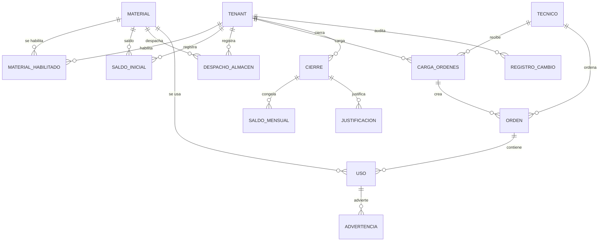

# Modelo de datos: 013 Registro de Materiales

**Fase**: 1 | **Fecha**: 2026-11-13 | **Spec**:
`05-especificaciones/013-registro-materiales/spec.md`

Describe el catálogo habilitado, la carga masiva de órdenes, el uso por orden, los saldos, el
dashboard, el cierre mensual y las exportaciones. El detalle de servicios está en `plan.md`; los
contratos en `contracts/`.

## Diagrama de relaciones



- `MATERIAL_HABILITADO`, `SALDO_INICIAL`, `DESPACHO_ALMACEN`, `CARGA_ORDENES`, `ORDEN`,
  `USO`, `ADVERTENCIA`, `CIERRE`, `SALDO_MENSUAL` y `JUSTIFICACION` son de 013.
- `MATERIAL`, `TECNICO` y `TENANT` son externas.
- No aparecen `STOCK_GENERAL`, `STOCK_TECNICO`, `SERIE` ni `CONCILIACION`.

## Entidades

### `registro_materiales.MaterialHabilitado`

| Campo | Tipo | Nulo | Regla |
|---|---|---|---|
| `id` | `BigAutoField` | No | Clave primaria |
| `tenant` | FK `tenants.Tenant` | No | `PROTECT`, `related_name="materiales_habilitados"` |
| `material` | FK `materiales.Material` | No | `PROTECT`, `related_name="habilitaciones"` |
| `activo` | `BooleanField` | No | `default=True` |
| `orden` | `PositiveIntegerField` | No | `default=0` |
| `creado_por` | FK `Usuario` | No | `PROTECT` |
| `creado_en` | `DateTimeField` | No | `auto_now_add` |
| `actualizado_por` | FK `Usuario` | Sí | `PROTECT` |
| `actualizado_en` | `DateTimeField` | No | `auto_now` |

- `UniqueConstraint(tenant, material)`.
- Deshabilitar conserva historial; no se borra.

### `registro_materiales.SaldoInicialPeriodo`

| Campo | Tipo | Nulo | Regla |
|---|---|---|---|
| `tenant` | FK `Tenant` | No | `PROTECT` |
| `material` | FK `Material` | No | `PROTECT` |
| `periodo` | `CharField(7)` | No | `^[0-9]{4}-(0[1-9]|1[0-2])$` |
| `cantidad` | `PositiveIntegerField` | No | `>=0` |
| `creado_por` | FK `Usuario` | No | `PROTECT` |
| `creado_en` | `DateTimeField` | No | `auto_now_add` |
| `actualizado_por` | FK `Usuario` | Sí | `PROTECT` |
| `actualizado_en` | `DateTimeField` | No | `auto_now` |

- `UniqueConstraint(tenant, material, periodo)`.
- Manual prevalece; si no, se hereda del cierre anterior.
- El cambio se audita.
- No se permite un saldo que deje el mes en negativo si ya hay uso.

### `registro_materiales.DespachoAlmacen` (existente)

| Campo | Uso en el cálculo |
|---|---|
| `tenant` | Filtro de alcance |
| `material` | Material |
| `fecha` | Mes del despacho |
| `cantidad` | Suma al disponible |

- Ya existe en 013; no se crea una segunda tabla.
- 013 no registra despachos desde la pantalla de materiales.
- Si el modelo tiene campos adicionales (por ejemplo, recojo), no se usan para el cálculo.
- Se lee en modo agregado; no se modifica su estructura.
- Si en un entorno nuevo no existe, la migración base de 013 la crea una sola vez.
- La alta/edición existente de `DespachoAlmacen` llama a `validar_periodo_abierto`; un mes `CERRADO`
  lanza `PeriodoCerrado`. No se cambia la estructura ni la pantalla.

### `registro_materiales.CargaOrdenes`

| Campo | Tipo | Nulo | Regla |
|---|---|---|---|
| `id` | `BigAutoField` | No | Clave primaria |
| `tenant` | FK `Tenant` | No | `PROTECT` |
| `tecnico` | FK `Tecnico` | No | `PROTECT` |
| `periodo` | `CharField(7)` | No | Mes seleccionado |
| `hash_texto` | `CharField(64)` | No | SHA-256 del texto pegado |
| `total_leidas` | `PositiveIntegerField` | No | — |
| `total_nuevas` | `PositiveIntegerField` | No | — |
| `total_omitidas` | `PositiveIntegerField` | No | — |
| `total_otro_tecnico` | `PositiveIntegerField` | No | Cuántas también existen para otro técnico |
| `creado_por` | FK `Usuario` | No | `PROTECT` |
| `creado_en` | `DateTimeField` | No | `auto_now_add` |
| `deshecha_en` | `DateTimeField` | Sí | — |
| `deshecha_por` | FK `Usuario` | Sí | `PROTECT` |
| `motivo_deshacer` | `TextField` | No | `blank=True` |

- No guarda el texto completo; solo hash y conteos.
- Deshacer solo aplica a órdenes del lote sin materiales.

### `registro_materiales.OrdenLiquidacion`

| Campo | Tipo | Nulo | Regla |
|---|---|---|---|
| `id` | `BigAutoField` | No | Clave primaria |
| `tenant` | FK `Tenant` | No | `PROTECT` |
| `tecnico` | FK `Tecnico` | No | `PROTECT` |
| `numero_original` | `CharField(30)` | No | Tal como se ingresó |
| `numero_normalizado` | `CharField(30)` | No | Mayúsculas, sin espacios |
| `periodo` | `CharField(7)` | No | Mes de carga; editable con la fecha |
| `fecha_instalacion` | `DateField` | Sí | Nulo hasta registrar materiales |
| `carga` | FK `CargaOrdenes` | Sí | Nulo para alta manual |
| `creado_por` | FK `Usuario` | No | `PROTECT` |
| `creado_en` | `DateTimeField` | No | `auto_now_add` |
| `actualizado_por` | FK `Usuario` | Sí | `PROTECT` |
| `actualizado_en` | `DateTimeField` | No | `auto_now` |

**Restricciones**

- `UniqueConstraint(tenant, tecnico, periodo, numero_normalizado, name="orden_unica_por_tecnico_mes_numero")`.
- `CheckConstraint(numero_normalizado regex ^[A-Z0-9]{1,30}$)`.
- `CheckConstraint(periodo regex)`.
- Índices `(tenant, tecnico, periodo)`, `(tenant, periodo)`, `(numero_normalizado)`.

**Reglas**

- El mismo número puede existir para otro técnico o en otro mes.
- Si la fecha de instalación cambia el mes, se actualiza `periodo` y se revalida la clave.
- Una orden sin usos con cantidad > 0 es pendiente.
- No se borra, salvo el deshacer de una carga sin materiales.

### `registro_materiales.UsoMaterialOrden`

| Campo | Tipo | Nulo | Regla |
|---|---|---|---|
| `id` | `BigAutoField` | No | Clave primaria |
| `tenant` | FK `Tenant` | No | `PROTECT` |
| `orden` | FK `OrdenLiquidacion` | No | `CASCADE` |
| `tecnico` | FK `Tecnico` | No | Igual a `orden.tecnico` |
| `material` | FK `Material` | No | Habilitado |
| `cantidad` | `PositiveIntegerField` | No | `default=0` |
| `creado_por` | FK `Usuario` | No | `PROTECT` |
| `creado_en` | `DateTimeField` | No | `auto_now_add` |
| `actualizado_por` | FK `Usuario` | Sí | `PROTECT` |
| `actualizado_en` | `DateTimeField` | No | `auto_now` |

- `UniqueConstraint(orden, material)`.
- `CheckConstraint(cantidad >= 0)`.
- Una línea existente a 0 se conserva; no se borra.
- El técnico de la línea debe ser el de la orden.

### `registro_materiales.AdvertenciaUso`

| Campo | Tipo | Nulo | Regla |
|---|---|---|---|
| `id` | `BigAutoField` | No | Clave primaria |
| `tenant` | FK `Tenant` | No | `PROTECT` |
| `uso` | FK `UsoMaterialOrden` | No | `CASCADE` |
| `tipo` | `CharField(20)` | No | `CANTIDAD_ATIPICA` |
| `mensaje` | `TextField` | No | Detalle |
| `resuelta` | `BooleanField` | No | `default=False` |
| `justificacion` | `TextField` | No | `blank=True` |
| `resuelta_por` | FK `Usuario` | Sí | `PROTECT` |
| `resuelta_en` | `DateTimeField` | Sí | — |
| `creada_en` | `DateTimeField` | No | `auto_now_add` |

- No bloquea el guardado.
- Bloquea el cierre si no está resuelta o justificada.
- `resolver_advertencia` marca `resuelta`, `justificacion`, `resuelta_por` y `resuelta_en`.
- El umbral es 3× el promedio mensual de los últimos 3 meses cerrados; sin historial no advierte.
- Una advertencia resuelta o con `JustificacionCierre` de tipo `ADVERTENCIA` no bloquea el cierre.

### `registro_materiales.CierreMensual`

| Campo | Tipo | Nulo | Regla |
|---|---|---|---|
| `id` | `BigAutoField` | No | Clave primaria |
| `tenant` | FK `Tenant` | No | `PROTECT` |
| `periodo` | `CharField(7)` | No | `YYYY-MM` |
| `estado` | `CharField(20)` | No | `ABIERTO` / `CERRADO` |
| `version` | `PositiveIntegerField` | No | `default=1` |
| `cerrado_por` | FK `Usuario` | Sí | `PROTECT` |
| `cerrado_en` | `DateTimeField` | Sí | — |
| `reabierto_por` | FK `Usuario` | Sí | `PROTECT` |
| `reabierto_en` | `DateTimeField` | Sí | — |
| `motivo_reapertura` | `TextField` | No | `blank=True` |
| `backup_ref` | `CharField(255)` | No | `blank=True` |
| `backup_en` | `DateTimeField` | Sí | — |
| `actualizado_en` | `DateTimeField` | No | `auto_now` |

- `UniqueConstraint(tenant, periodo)`.
- `CheckConstraint(estado IN ('ABIERTO','CERRADO'))`.
- Un periodo sin fila se considera abierto.
- Cerrar exige `backup_ref` con formato válido emitido por `respaldar_bd`.
- Al reabrir, el snapshot anterior queda en el historial de auditoría; al recerrar se reemplaza con
  auditoría de los valores anteriores.

### `registro_materiales.SaldoMensualMaterial`

| Campo | Tipo | Nulo | Regla |
|---|---|---|---|
| `id` | `BigAutoField` | No | Clave primaria |
| `cierre` | FK `CierreMensual` | No | `CASCADE` |
| `tenant` | FK `Tenant` | No | `PROTECT` |
| `material` | FK `Material` | No | `PROTECT` |
| `saldo_inicial` | `IntegerField` | No | — |
| `despachos` | `IntegerField` | No | `>=0` |
| `usado` | `IntegerField` | No | `>=0` |
| `saldo_final` | `IntegerField` | No | Puede ser negativo con alerta |

- `UniqueConstraint(cierre, material)`.
- Es la foto congelada del mes.
- El saldo final es el inicial del mes siguiente.
- En una reapertura y nuevo cierre se actualiza el snapshot; los valores anteriores quedan en la
  auditoría y en la versión del `CierreMensual`.

### `registro_materiales.JustificacionCierre`

| Campo | Tipo | Nulo | Regla |
|---|---|---|---|
| `id` | `BigAutoField` | No | Clave primaria |
| `cierre` | FK `CierreMensual` | No | `CASCADE` |
| `tenant` | FK `Tenant` | No | `PROTECT` |
| `tipo` | `CharField(30)` | No | `ORDEN_SIN_MATERIALES`, `SALDO_NEGATIVO`, `ADVERTENCIA` |
| `referencia` | `CharField(100)` | No | ID o número |
| `motivo` | `TextField` | No | Obligatorio |
| `creado_por` | FK `Usuario` | No | `PROTECT` |
| `creado_en` | `DateTimeField` | No | `auto_now_add` |

- Permite cerrar con un pendiente revisado y justificado.

### Entidades externas consumidas

| Entidad | Dueña | Uso |
|---|---|---|
| `materiales.Material` | 002 | Catálogo |
| `tecnicos.Tecnico` | 003 | Técnico |
| `tenants.Tenant` | 001 | Alcance |
| `auditoria.RegistroCambio` | 001 | Auditoría |

## Cálculos

### Periodo

```text
periodo = YYYY-MM de fecha_instalacion, o el mes seleccionado en la carga
```

### Despachos

```text
despachos(tenant, material, periodo) =
    suma de DespachoAlmacen.cantidad
    donde tenant coincide, material coincide y fecha está en el periodo
```

- Solo lectura.
- Cantidad 0 no suma.
- Materiales sin despacho: 0.

### Saldo inicial efectivo

```text
si existe SaldoInicialPeriodo(tenant, material, periodo):
    inicial = cantidad manual
si no, si existe SaldoMensualMaterial del cierre anterior:
    inicial = saldo_final del cierre anterior
si no:
    inicial = saldo final calculado del periodo anterior
    si no hay datos anteriores, 0
```

### Saldo final

```text
usado(tenant, material, periodo) =
    suma de UsoMaterialOrden.cantidad de órdenes con periodo

final = inicial + despachos - usado
```

- Para el dashboard se puede mostrar negativo con alerta.
- Para el guardado de un uso nuevo, el total no puede superar `inicial + despachos`.
- Un uso 0 no suma.

### Ejemplo

| Concepto | Valor |
|---|---:|
| Saldo inicial | 15 |
| Despachos | 30 |
| Disponible | 45 |
| Técnico A | 10 |
| Técnico B | 5 |
| Usado | 15 |
| Saldo final | 30 |
| Inicial mes siguiente | 30 |

## Transiciones

### Orden

```text
Carga masiva → PENDIENTE (sin materiales)
PENDIENTE → CON MATERIALES (al guardar uso > 0)
CON MATERIALES → PENDIENTE (si todos los usos quedan en 0)
```

- No hay borrado salvo deshacer una carga sin materiales.
- El cambio de mes recalcula el periodo y la clave.

### Cierre

```text
(no existe) → ABIERTO
ABIERTO → CERRADO (checklist y backup)
CERRADO → ABIERTO (reapertura con motivo)
ABIERTO → CERRADO (nueva versión)
```

- `CERRADO` bloquea cambios de órdenes, usos, saldos y despachos.
- La reapertura conserva el motivo y la auditoría.

## Consultas y bloqueos

### Carga masiva

1. Normalizar y deduplicar el texto.
2. Comparar con órdenes del técnico/mes y de otros técnicos.
3. Devolver resumen.
4. En transacción confirmar y crear lote/órdenes.

### Guardar uso

1. Validar mes abierto.
2. Bloquear `Tenant`, la orden y el `CierreMensual` del periodo.
3. Calcular disponible y uso total.
4. Bloquear si el nuevo total supera el disponible.
5. Crear/actualizar usos, advertencias y auditoría.

### Cierre

1. Bloquear `CierreMensual`.
2. Construir checklist.
3. Exigir justificaciones y `backup_ref`.
4. Congelar `SaldoMensualMaterial`.
5. Marcar `CERRADO` y auditar.

### Reporte

- Agregaciones por material y técnico; `select_related`; sin N+1.
- No escribe ni bloquea.

## Auditoría

| Evento | Entidad / campo | Cuándo |
|---|---|---|
| Carga | `CargaOrdenes/alta` | Confirmar carga |
| Deshacer | `CargaOrdenes/deshecha` | Deshacer lote |
| Orden | `OrdenLiquidacion/alta`, `/numero_orden`, `/fecha_instalacion`, `/periodo` | Crear/editar |
| Uso | `UsoMaterialOrden/alta`, `/cantidad` | Registrar/editar |
| Saldo | `SaldoInicialPeriodo/alta`, `/cantidad` | Cargar/editar |
| Catálogo | `MaterialHabilitado/alta`, `/activo` | Habilitar/deshabilitar |
| Advertencia | `AdvertenciaUso/alta`, `/resuelta` | Crear/resolver |
| Cierre | `CierreMensual/alta`, `/cerrado`, `/reabierto` | Cerrar/reabrir |
| Justificación | `JustificacionCierre/alta` | Justificar pendiente |

- Todo en la misma transacción; si falla, se revierte.
- Actor de la sesión; `tenant` desde la entidad/actor.
- Sin secretos, binarios ni datos de otro tenant.

## RLS y aislamiento

- Todas las tablas nuevas: por `tenant_id`.
- `materiales_material` es global y de solo lectura.
- `DespachoAlmacen`: RLS de 013 por `tenant_id`.
- Si 001 no está disponible, deuda y filtrado ORM.
- El rol de aplicación no es superusuario ni `BYPASSRLS`.

## Trazabilidad de criterios de aceptación

| CA | Entidad / servicio | Evidencia |
|---|---|---|
| CA-01 | Servicios y plantilla | Solo tenant |
| CA-02 | `materiales_habilitados` | Catálogo activo |
| CA-03 | `procesar_lista` | Normalización/dedupe |
| CA-04 | `previsualizar/confirmar` | Carga idempotente |
| CA-05 | `confirmar_carga` | Mismo número para otro técnico |
| CA-06 | `ResumenCarga` | Conteos |
| CA-07 | `deshacer_carga` | Sin materiales |
| CA-08 | `buscar_orden` | Abre existente |
| CA-09 | `guardar_uso` | Cambio de mes |
| CA-10 | `UsoMaterialOrden` | Cero no suma |
| CA-11 | `validar_cantidad` | Inválidas |
| CA-12 | `guardar_uso` | Bloqueo negativo |
| CA-13 | `AdvertenciaUso` | Atípica |
| CA-14 | `saldo_final` | 100+20−30=90 |
| CA-15 | `saldo_inicial_efectivo` | Herencia |
| CA-16 | `registrar_saldo` | Manual prevalece |
| CA-17 | `DespachoAlmacen` | Suma sin doble registro |
| CA-18 | `RegistroCambio` | Historial |
| CA-19 | `ordenes_pendientes` | Panel |
| CA-20 | `lista_chequeo` | Cierre bloqueado |
| CA-21 | `SaldoMensualMaterial` | Traspaso |
| CA-22 | `CierreMensual` | Reapertura |
| CA-23 | `exportacion` | Excel/CSV |
