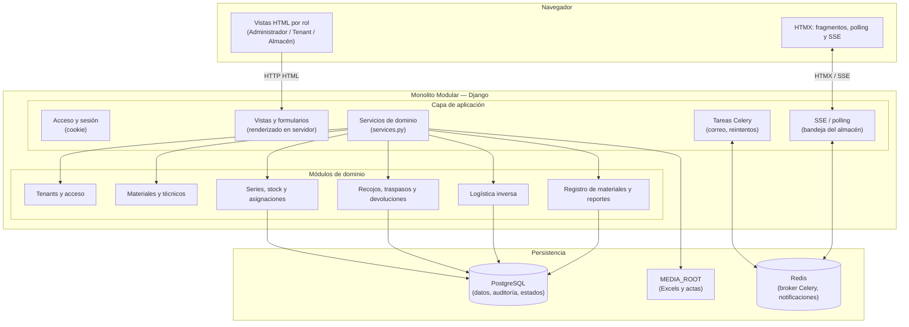

# Arquitectura del Sistema

Monolito modular en Django con renderizado en servidor, HTMX y PostgreSQL.

## Notas

- La interfaz es HTML renderizado por Django y potenciado con HTMX. No hay SPA, API REST ni JWT.
- La sesión se mantiene con cookie de Django; los roles y el alcance por tenant/región se validan en
  los servicios, no en el cliente.
- El backend es un único despliegue con módulos de dominio separados y lógica de negocio en
  `services.py`.
- PostgreSQL es la única base de datos. Redis se usa para Celery y para las notificaciones de la
  bandeja del almacén.
- Los Excel y actas se generan con `openpyxl`, se guardan bajo `MEDIA_ROOT` y se verifican con hash
  SHA-256.
- Las notificaciones del almacén usan SSE y polling de respaldo; no hay WebSocket ni Channels.
