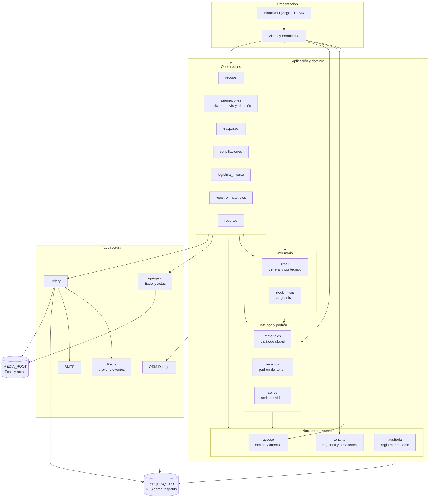
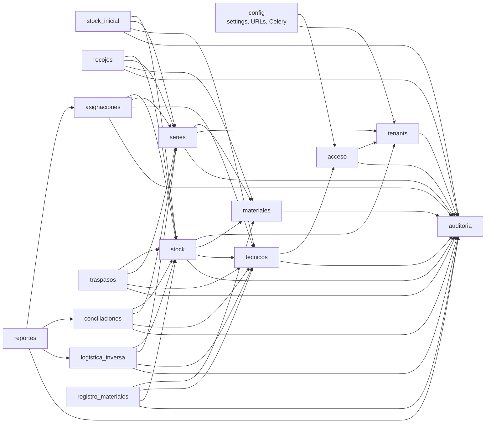
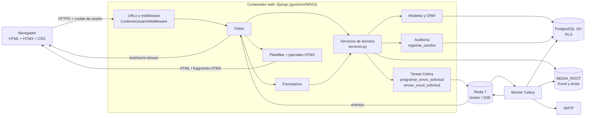
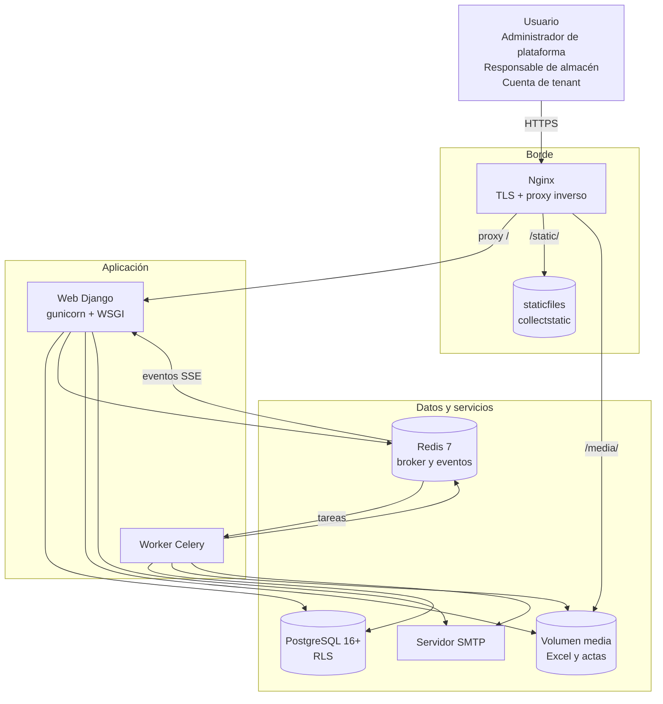

# Diagramas Mermaid: monolito modular, componentes y arquitectura

Estos diagramas describen la **implementación real** del repositorio: Django + HTMX, cookie de sesión, PostgreSQL, Celery/Redis y `MEDIA_ROOT`. No representan la SPA/REST/JWT que todavía aparece en `docs/02-arquitectura-software/arquitectura.md`; prevalecen ADR-008 y ADR-015.

> Para visualizarlos: pega cada bloque en <https://mermaid.live>, usa la extensión Mermaid de VS Code o abre el archivo en GitHub.

## 1. Monolito modular

Un solo despliegue Django, una sola base PostgreSQL y módulos de dominio con dependencias unidireccionales. La presentación habla con servicios; los servicios concentran las reglas; los modelos y la infraestructura quedan debajo. `auditoria`, `series` y `stock` actúan como núcleo compartido.

### Mapa de dependencias entre apps

## 2. Diagrama de componentes

Componentes dentro del contenedor web y su comunicación con los contenedores de datos. La sesión se transporta con cookie de Django; las notificaciones del almacén usan SSE sobre Redis.

## 3. Diagrama de arquitectura

Contenedores de despliegue. Nginx sirve estáticos y protege la aplicación; la web y el worker comparten PostgreSQL, Redis y el volumen de documentos. El detalle de despliegue aún no está fijado en el repositorio, así que este diagrama muestra la topología objetivo, no una receta de infraestructura.

## Notas de lectura

- **Un solo despliegue web**: no hay microservicios; los módulos son apps Django y se comunican por servicios, no por red.
- **Una sola base**: PostgreSQL concentra datos operativos, stock, series, auditoría y RLS.
- **Worker separado**: Celery ejecuta correos, reintentos y procesos de fondo; comparte código, base y `MEDIA_ROOT` con la web.
- **Documentos**: los Excel de asignación, traspaso, conciliación, stock inicial y las actas viven en `MEDIA_ROOT`; su hash SHA-256 se guarda en base para verificar integridad.
- **Sesión**: cookie de Django, no JWT. El tenant y la región salen de `request.usuario`, nunca del cliente.
- **Tiempo real**: SSE del almacén sobre Redis/pub-sub; no WebSocket ni Django Channels.
- **Auditoría**: toda operación de escritura relevante registra `RegistroCambio` en la misma transacción; el historial es de solo inserción.
